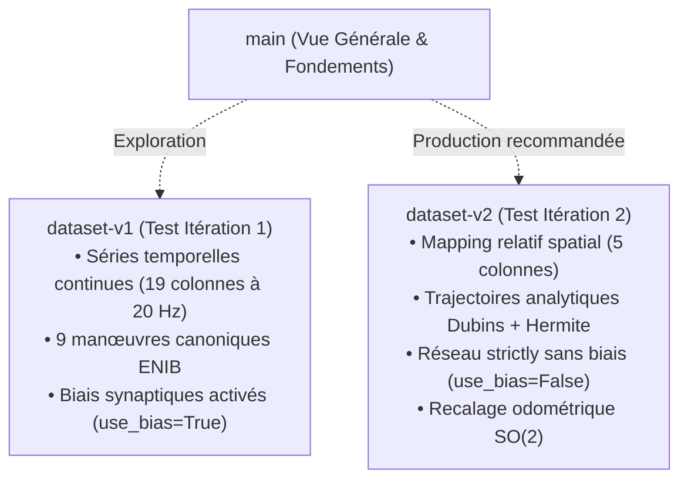

# LIMO Offline Learning : Apprentissage Supervisé Hors Ligne et Contrôle Neuromorphique

[](https://docs.ros.org/)
[](https://pytorch.org/)
[](https://www.iso.org/standard/66847.html)
[](https://www.enib.fr/)

Ce dépôt contient le framework de commande neuronale en boucle fermée pour la navigation et l'accostage du robot mobile **AgileX LIMO** sous **ROS 2**. Développé dans le cadre des activités de recherche au **Centre Européen de Réalité Virtuelle (CERV)** et à l'**École Nationale d'Ingénieurs de Brest (ENIB)**, ce projet implémente l'apprentissage supervisé par démonstration (*Learning from Demonstration - LfD*) / clonage comportemental (*Behavioral Cloning*) avec un protocole de qualification métrologique basé sur la norme internationale **ISO 18646-2**.

---

## 🔀 Organisation des Branches du Dépôt

Le projet est structuré en **branches d'expérimentation indépendantes**. Chaque branche implémente un **type de test spécifique** reposant sur un **format de jeu de données (*dataset*) distinct**, avec sa propre logique de génération et d'apprentissage :



---

### 📋 Présentation des Branches et Types de Datasets

#### 1. Branche `main` *(Cette Branche)*
- **Rôle** : Référentiel central, présentation globale de l'architecture logicielle, formalisation mathématique et guide de navigation.
- **Utilisation** :
  ```bash
  git checkout main
  ```

#### 2. Branche `dataset-v1` *(Test Itération 1 — Séries Temporelles 19 Colonnes)*
- **Type de Dataset** : Séries temporelles complètes enregistrées à 20 Hz selon un schéma à **19 colonnes** (`timestamp`, $x, y, \theta$, $t_x, t_y, t_\theta$, $e_x, e_y, e_\theta$, $in_0, in_1, in_2$, $v_{\text{lin}}, v_{\text{ang}}$, vitesses de roues, identifiant de manœuvre, quadrant).
- **Type de Test** : Évaluation du clonage comportemental sur les **9 manœuvres canoniques de l'ENIB** avec cibles arbitraires et réseau avec biais synaptiques (`use_bias=True`).
- **Utilisation** :
  ```bash
  git checkout dataset-v1
  ```
  Consultez le [README de la branche dataset-v1](https://github.com/jupivato/limo-offline-learning/tree/dataset-v1).

#### 3. Branche `dataset-v2` *(Test Itération 2 — Mapping Relatif 5 Colonnes)*
- **Type de Dataset** : Schéma compact et direct à **5 colonnes relatives** (`x_r, y_r, theta_r, v_r, w_r`) systématiquement centrées sur la cible relative $(0, 0, 0)$.
- **Type de Test** : Trajectoires analytiques hybrides (**courbes de Dubins** pour l'avance et **splines d'Hermite** pour le recul), **funil terminal d'alignement angulaire pour $\theta \to 0$**, perceptron strictly sans biais (**`use_bias=False`**) garantissant mathématiquement l'arrêt absolu à l'origine, et correction odométrique par **matrice de rotation $SO(2)$**.
- **Utilisation** :
  ```bash
  git checkout dataset-v2
  ```
  Consultez le [README de la branche dataset-v2](https://github.com/jupivato/limo-offline-learning/tree/dataset-v2).

---

## 📊 Matrice Méthodologique des Versions de Dataset

| Dimension | Branche `dataset-v1` | Branche `dataset-v2` |
| :--- | :--- | :--- |
| **Format du Dataset** | 19 colonnes temporelles | **5 colonnes relatives** |
| **Repère spatial** | Coordonnées globales + cibles arbitraires | **Repère relatif centré cible $(0, 0, 0)$** |
| **Génération des trajectoires** | Intégration cinématique continue à 20 Hz | **Analytique : Dubins ($x \le 0$) + Hermite ($x \ge 0$)** |
| **Alignement terminal** | Non contraint | **Funil haute densité orienté $\theta \to 0$** |
| **Architecture Réseau** | `PioneerNN` avec biais (`use_bias=True`) | **`PioneerNN` sans biais (`use_bias=False`)** |
| **Garantie d'équilibre** | Dépend de la convergence des poids | **Mathématique : $\text{MLP}(\vec{0}) = \vec{0}$** |
| **Recalage Odométrique** | Décalage cartésien simple | **Matrice de rotation 2D $SO(2)$** |

---

## 📐 Modélisation Commune et Contrôleur Neuromorphique

### 1. Variables d'Entrée Normalisées
Le châssis différentiel du LIMO est guidé par 3 variables normalisées transmises au réseau de neurones :
- **`in_0`** = $(x - x_{\text{cible}}) \times \alpha_x$
- **`in_1`** = $(y - y_{\text{cible}}) \times \alpha_y$
- **`in_2`** = $(\text{recast}(\theta - \theta_{\text{cible}}) - \theta_s(x, y)) \times \alpha_\theta$

Avec :
- Facteurs d'échelle : $\boldsymbol{\alpha} = [1/3, 1/3, 1/\pi]$
- Orientation stratégique (évitement des minima locaux) : $\theta_s(x, y) = \tanh(10\cdot x) \cdot \arctan(1\cdot y)$

### 2. Architecture PioneerNN
- Perceptron multicouche (MLP) à 3 entrées, 1 couche cachée de 1 000 neurones et 2 sorties $(v_{\text{lin}}, v_{\text{ang}})$.
- Activation : $\tanh$ (tangente hyperbolique).
- Sérialisation : Fichier JSON standard (`input_weights`, `output_weights`) totalisant 5 000 poids synaptiques.

---

## 🚀 Démarrage Rapide

### 1. Cloner le Dépôt
```bash
git clone https://github.com/jupivato/limo-offline-learning.git
cd limo-offline-learning
```

### 2. Basculer sur la Branche Souhaitée

#### Pour le pipeline V2 (recommandé) :
```bash
git checkout dataset-v2
pip install -r requirements.txt
python3 -m src.data.generate_rule_based_dataset --output data/curated/handcrafted_dataset.csv --stride 2
python3 -m src.training.train_offline --dataset data/curated/handcrafted_dataset.csv --no-bias
```

#### Pour le pipeline V1 (expérimentation 19 colonnes) :
```bash
git checkout dataset-v1
pip install -r requirements.txt
python3 -m src.data.generate_rule_based_dataset --output data/curated/handcrafted_dataset.csv
python3 -m src.training.train_offline --dataset data/curated/handcrafted_dataset.csv
```

---

## 👥 Projet et Affiliation

- **Cadre** : Projet Pluridisciplinaire en Équipe (PPE)
- **Laboratoire** : Centre Européen de Réalité Virtuelle (CERV) / École Nationale d'Ingénieurs de Brest (ENIB)
- **Robot** : AgileX Robotics LIMO (Plateforme mobile sous ROS 2)
