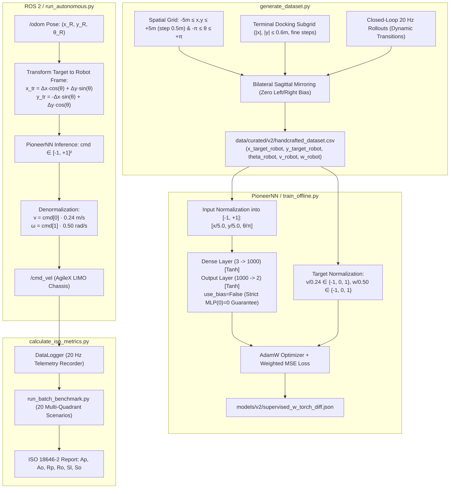

# AgileX LIMO Offline Learning: Behavioral Cloning Framework & ISO 18646-2 Benchmarking

[](https://docs.ros.org/)
[](https://pytorch.org/)
[](https://www.iso.org/standard/66847.html)
[](https://www.enib.fr/)
[](#)

This repository hosts a clean, modular, production-ready closed-loop neural motion control framework for the **AgileX LIMO** mobile robot under **ROS 2**. Developed as part of the **Projet Pluridisciplinaire en Équipe (PPE)** at the **Centre Européen de Réalité Virtuelle (CERV)** and the **École Nationale d'Ingénieurs de Brest (ENIB)**, this project enables offline learning via Behavioral Cloning and standardized metrological evaluation according to **ISO 18646-2**.

---

## 🏛️ System Architecture

The control policy maps the docking target's position expressed directly in the **robot's local body frame** $(x_{\text{target}}^{\text{robot}}, y_{\text{target}}^{\text{robot}})$ along with the robot's **absolute heading** $\theta_{\text{robot}} \in [-\pi, \pi]$ to discrete velocity commands $(v_{\text{robot}}, \omega_{\text{robot}})$.



---

## 📂 Repository Structure

```text
limo-offline-learning/
├── calculus/
│   ├── __init__.py
│   └── calculate_iso_metrics.py         # ISO 18646-2 metrological calculation engine
├── config/
│   └── v2_config.json                   # Bounds, kinematic limits, & normalization
├── data/
│   ├── curated/
│   │   └── v2/                          # Curated dataset (handcrafted_dataset.csv)
│   └── evaluation/
│       └── v2/                          # Benchmark runs, telemetry logs, & training curves
├── docs/
│   ├── PLANIFICATION_APPRENTISSAGE_HORS_LIGNE.md        # Experimental planning
│   └── v2/
│       ├── SPECIFICATION_V2.md                          # Technical architecture specification
│       └── KINEMATICS_AND_NORMALIZATION_SPECIFICATION.md # Full mathematical derivations & limits
├── models/
│   └── v2/                              # Optimized weights (JSON format) & history
├── src/
│   ├── core/
│   │   ├── __init__.py
│   │   └── pioneer_nn.py                # PioneerNN architecture (bias-free MLP)
│   ├── ros2/
│   │   ├── __init__.py
│   │   └── limo_interface.py            # ROS 2 odometry transform & command publisher
│   ├── evaluation/
│   │   ├── __init__.py
│   │   ├── data_logger.py               # Real-time 20 Hz state recorder
│   │   ├── run_autonomous.py            # Closed-loop autonomous controller
│   │   ├── run_batch_benchmark.py       # Automated multi-run testbench
│   │   └── benchmark_visualizer.py      # Trajectory visualizer and HTML dashboards
│   └── approaches/
│       ├── __init__.py
│       └── v2_relative/
│           ├── __init__.py
│           ├── generate_dataset.py      # Robot-centric discrete dataset generator
│           ├── train_offline.py         # PyTorch offline training script
│           └── plot_curves.py           # Training/Validation loss curve plotter
├── requirements.txt
└── README.md
```

---

## 🔬 Kinematic Specifications & Normalization

For complete mathematical derivations, stability proofs, and friction stopping distances, see [KINEMATICS_AND_NORMALIZATION_SPECIFICATION.md](docs/v2/KINEMATICS_AND_NORMALIZATION_SPECIFICATION.md).

### Summary Table of Parameters

| Parameter | Symbol | Value | Physical & Mathematical Rationale |
| :--- | :---: | :---: | :--- |
| Spatial Arena Bounds | $X_{\max}, Y_{\max}$ | **$\pm 5.0\text{ m}$** | Covers the entire laboratory testing arena |
| Spatial Grid Step | $\Delta_{xy}$ | **$0.5\text{ m}$** | Regular grid interval $-5.0 \le x, y \le 5.0\text{ m}$ |
| Maximum Linear Velocity | $V_{\max}$ | **$0.24\text{ m/s}$** | Lab safety limit, eliminates wheel slip |
| Maximum Angular Velocity | $\Omega_{\max}$ | **$0.50\text{ rad/s}$** | Derived from $V_{\max} / R_{\min} \approx 0.57\text{ rad/s}$; bounded for in-place yaw |
| Minimum Turning Radius | $R_{\min}$ | **$0.42\text{ m}$** | Minimum non-holonomic turning radius on lab flooring |
| Braking Distance Threshold | $D_{\text{brake}}$ | **$0.20\text{ m}$** | Distance threshold where targets transition to zero velocity ($v=0$) |
| Terminal Dock Deadband | $D_{\text{stop}}$ | **$0.05\text{ m}$** | Full stop zone ($v=0, \omega=0$) upon target alignment |
| Control Frequency | $f$ | **$20\text{ Hz}$** | Yields $\Delta s = 1.2\text{ cm}$ per tick, ideal for millimeter-level precision |
| Bias Formulation | $\mathbf{b}$ | **Disabled (`--no-bias`)** | Mathematical guarantee $\text{MLP}(\mathbf{0}) = \mathbf{0}$ preventing creeping drift |

### Coordinate Transformation & Normalization Pipeline

1. **Target in Robot Local Body Frame**:
   Given robot global pose $(x_R, y_R, \theta_R)$ and target global pose $(x_T, y_T)$:
   $$\begin{bmatrix} x_{\text{target}}^{\text{robot}} \\ y_{\text{target}}^{\text{robot}} \end{bmatrix} = \begin{bmatrix} \cos\theta_R & \sin\theta_R \\ -\sin\theta_R & \cos\theta_R \end{bmatrix} \begin{bmatrix} x_T - x_R \\ y_T - y_R \end{bmatrix}$$

2. **Network Input Normalization (into $[-1.0, 1.0]$)**:
   $$\text{in}_0 = \frac{x_{\text{target}}^{\text{robot}}}{5.0}, \quad \text{in}_1 = \frac{y_{\text{target}}^{\text{robot}}}{5.0}, \quad \text{in}_2 = \frac{\theta_{\text{robot}}}{\pi}$$

3. **Discrete Action Space**:
   $$v_{\text{robot}} \in \{-V_{\max}, 0.0, +V_{\max}\} = \{-0.24, 0.0, +0.24\}\text{ m/s}$$
   $$\omega_{\text{robot}} \in \{-\Omega_{\max}, 0.0, +\Omega_{\max}\} = \{-0.50, 0.0, +0.50\}\text{ rad/s}$$

4. **Training Output Normalization**:
   $$v_{\text{norm}} = \frac{v_{\text{robot}}}{V_{\max}} \in \{-1.0, 0.0, +1.0\}, \quad \omega_{\text{norm}} = \frac{\omega_{\text{robot}}}{\Omega_{\max}} \in \{-1.0, 0.0, +1.0\}$$

5. **Robot Denormalization (Inference Phase)**:
   $$v_{\text{cmd}} = \hat{y}_0 \cdot V_{\max}, \quad \omega_{\text{cmd}} = \hat{y}_1 \cdot \Omega_{\max}$$

---

## 🚀 Quick Start Guide

### 1. Environment Setup

```bash
# Clone the repository
git clone https://github.com/jupivato/limo-offline-learning.git
cd limo-offline-learning

# Install dependencies
pip install -r requirements.txt
```

### 2. Generate the Dataset

Generates the 5-column dataset across $[-5, +5]\text{ m}$ every $0.5\text{ m}$ with high-density docking and 20 Hz rollouts:

```bash
python3 src/approaches/v2_relative/generate_dataset.py
```

### 3. Train the Bias-Free Neural Controller

Trains the 3-layer MLP (`3 -> 1000 -> 2`) with AdamW, early stopping, and zero bias:

```bash
python3 src/approaches/v2_relative/train_offline.py --no-bias --epochs 100 --batch-size 1024
```

### 4. Plot Training Convergence Curves

Visualizes training and validation MSE curves:

```bash
python3 src/approaches/v2_relative/plot_curves.py
```

### 5. Closed-Loop Evaluation & Benchmarking

#### Single Scenario Execution:
```bash
python3 src/evaluation/run_autonomous.py \
    --weights models/v2/supervised_w_torch_diff.json \
    --x-target 0.0 --y-target 0.0 --theta-target 0.0
```

#### Batch Benchmarking (20 Multi-Quadrant Scenarios under ISO 18646-2):
```bash
python3 src/evaluation/run_batch_benchmark.py \
    --weights models/v2/supervised_w_torch_diff.json \
    --outdir data/evaluation/v2/batch_run
```

---

## 👥 Authors & Affiliation

- **Framework Author**: Julia Pivato
- **Project**: Projet Pluridisciplinaire en Équipe (PPE)
- **Institution**: Centre Européen de Réalité Virtuelle (CERV) / École Nationale d'Ingénieurs de Brest (ENIB)
- **Target Hardware**: AgileX Robotics LIMO (Four-Wheel Differential / Ackermann ROS 2 Platform)
