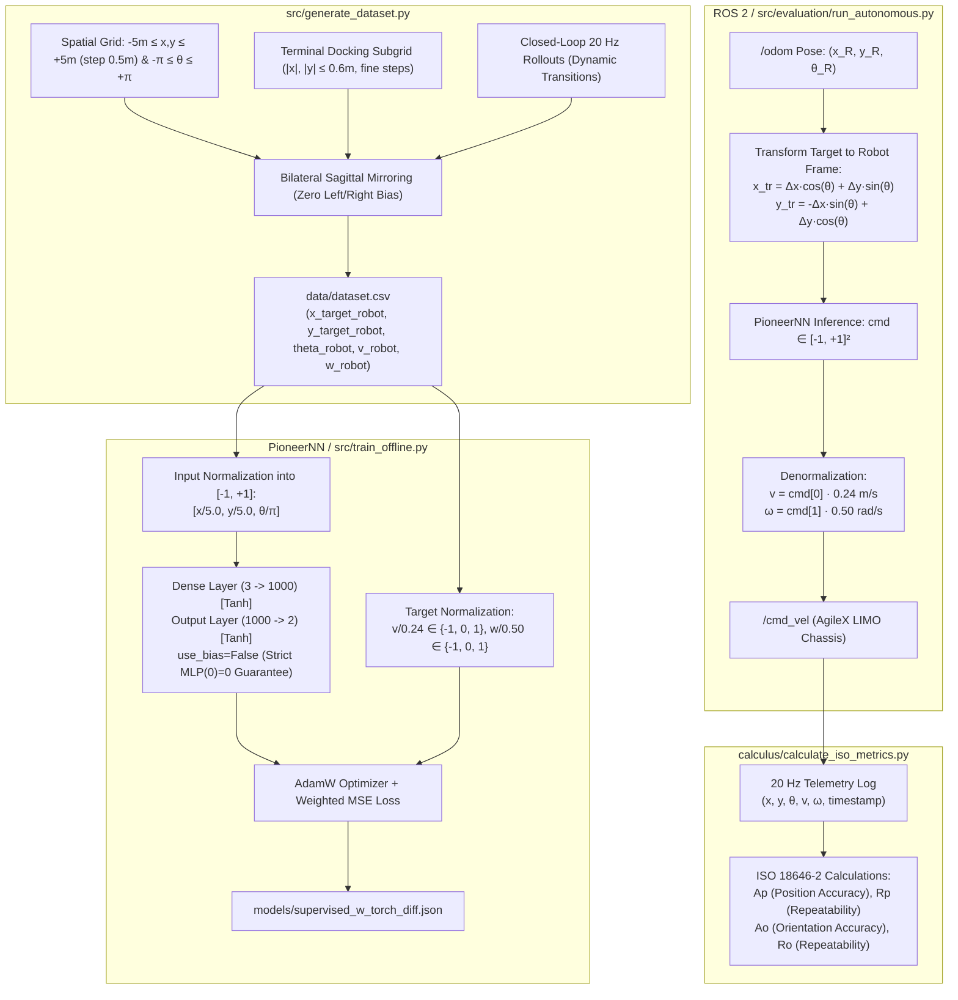

# LIMO Offline Learning: Behavioral Cloning & ISO 18646-2 Metrological Benchmarking

Autonomous closed-loop neural controller for the **AgileX LIMO** differential mobile robot, implementing offline behavioral cloning, robot-centric coordinate frames, discrete ternary actions, and metrological benchmarking under **ISO 18646-2**.

---

## 🏗️ Architecture & Pipeline Overview



---

## 📂 Repository Structure

```text
limo-offline-learning/
├── calculus/
│   ├── __init__.py
│   └── calculate_iso_metrics.py         # ISO 18646-2 metrological calculation engine
├── config/
│   └── config.json                      # Spatial bounds, kinematic limits, & normalization
├── data/
│   ├── dataset.csv                      # Canonical offline dataset (70,664 discrete samples)
│   └── evaluation/
│       └── batch_run/                   # Benchmark runs, telemetry logs, & trajectory plots
├── docs/
│   ├── KINEMATICS_AND_NORMALIZATION_SPECIFICATION.md # Mathematical derivations & limits
│   ├── LEARNING_RATE_STUDY.md                        # Empirical hyperparameter study on LR & AdamW
│   └── PLANIFICATION_APPRENTISSAGE_HORS_LIGNE.md     # Experimental planning
├── models/
│   ├── supervised_w_torch_diff.json     # Trained neural weights (JSON format)
│   └── training_history.json            # Training and validation loss history
├── src/
│   ├── generate_dataset.py              # Robot-centric discrete dataset generator
│   ├── train_offline.py                 # Multi-engine offline training pipeline
│   ├── plot_curves.py                   # Training/validation loss curve plotter
│   ├── core/
│   │   ├── __init__.py
│   │   └── pioneer_nn.py                # PioneerNN architecture (bias-free MLP)
│   ├── ros2/
│   │   ├── __init__.py
│   │   └── limo_interface.py            # ROS 2 odometry transform & command publisher
│   └── evaluation/
│       ├── __init__.py
│       ├── data_logger.py               # Real-time 20 Hz state recorder
│       ├── run_autonomous.py            # Closed-loop autonomous controller
│       ├── run_batch_benchmark.py       # Automated multi-run testbench
│       └── benchmark_visualizer.py      # Trajectory visualizer and HTML dashboards
├── requirements.txt
└── README.md
```

---

## 🔬 Kinematic Specifications & Normalization

For complete mathematical derivations, stability proofs, and friction stopping distances, see [KINEMATICS_AND_NORMALIZATION_SPECIFICATION.md](docs/KINEMATICS_AND_NORMALIZATION_SPECIFICATION.md).  
For the empirical ablation study on learning rates and optimizer selection, see [LEARNING_RATE_STUDY.md](docs/LEARNING_RATE_STUDY.md).

### Summary Table of Parameters

| Parameter | Symbol | Value | Physical & Mathematical Rationale |
| :--- | :---: | :---: | :--- |
| Spatial Arena Bounds | $X_{\max}, Y_{\max}$ | **$\pm 5.0\text{ m}$** | Covers the entire laboratory testing arena |
| Grid Sampling Step | $\Delta x, \Delta y$ | **$0.5\text{ m}$** | Discrete space interval specification |
| Absolute Robot Heading | $\theta_R$ | **$[-\pi, +\pi]\text{ rad}$** | Full $SO(2)$ circle coverage |
| Maximum Linear Velocity | $V_{\max}$ | **$0.24\text{ m/s}$** | Empirically calibrated from physical LIMO teleoperation |
| Maximum Angular Velocity | $\Omega_{\max}$ | **$0.50\text{ rad/s}$** | Maximum safe yaw rate preventing wheel slip |
| Linear Velocity Set | $v_{\text{robot}}$ | **$\{-0.24, 0.0, +0.24\}\text{ m/s}$** | Strictly discrete ternary output |
| Angular Velocity Set | $w_{\text{robot}}$ | **$\{-0.50, 0.0, +0.50\}\text{ rad/s}$** | Strictly discrete ternary output |
| Deceleration Funnel | $D_{\text{brake}}$ | **$0.20\text{ m}$** | Allows the MLP to learn a smooth deceleration ramp |
| Terminal Stop Deadband | $D_{\text{stop}}$ | **$0.05\text{ m}$** | Prevents motor chattering and limit cycles at origin |

### Coordinate Transformation

The neural network navigates strictly in the **robot's local body frame**:

$$\begin{bmatrix} x_{\text{target}}^{\text{robot}} \\ y_{\text{target}}^{\text{robot}} \end{bmatrix} = \begin{bmatrix} \cos\theta_R & \sin\theta_R \\ -\sin\theta_R & \cos\theta_R \end{bmatrix} \begin{bmatrix} x_{\text{target}} - x_{\text{robot}} \\ y_{\text{target}} - y_{\text{robot}} \end{bmatrix}$$

### Input & Output Normalization

$$\text{in}_0 = \frac{x_{\text{target}}^{\text{robot}}}{5.0} \in [-1.0, 1.0], \quad \text{in}_1 = \frac{y_{\text{target}}^{\text{robot}}}{5.0} \in [-1.0, 1.0], \quad \text{in}_2 = \frac{\theta_{\text{robot}}}{\pi} \in [-1.0, 1.0]$$

During inference on the robot:
$$v_{\text{cmd}} = \hat{y}_0 \times 0.24\text{ m/s}, \quad \omega_{\text{cmd}} = \hat{y}_1 \times 0.50\text{ rad/s}$$

---

## 🚀 Quickstart & Execution Guide

### 1. Installation

```bash
# Clone the repository
git clone https://github.com/jupivato/limo-offline-learning.git
cd limo-offline-learning

# Install dependencies
pip install -r requirements.txt
```

### 2. Generate the Dataset

Generates the 5-column dataset across $[-5, +5]\text{ m}$ every $0.5\text{ m}$ with high-density docking and 20 Hz rollouts:

```bash
python3 src/generate_dataset.py
```

### 3. Train the Bias-Free Neural Controller

Trains the MLP (`3 -> 1000 -> 2`) using pure constant SGD (strictly constant learning rate, zero momentum, zero weight decay) for 150 epochs:

```bash
python3 src/train_offline.py
```

*(For complete operational instructions, directory structures, and Gazebo tutorials, see [TUTORIAL.md](TUTORIAL.md)).*

### 4. Plot Training Convergence Curves

Visualizes training and validation MSE curves:

```bash
python3 src/plot_curves.py
```

### 5. Closed-Loop Evaluation & Benchmarking

#### Single Scenario Execution:
```bash
python3 src/evaluation/run_autonomous.py \
    --weights models/supervised_w_torch_diff.json \
    --x-target 0.0 --y-target 0.0 --theta-target 0.0
```

#### Batch Benchmarking (Canonical Scenarios under ISO 18646-2):
```bash
python3 src/evaluation/run_batch_benchmark.py \
    --weights models/supervised_w_torch_diff.json \
    --outdir data/evaluation/batch_run
```

---

## 👥 Authors & Affiliation

- **Framework Author**: Julia Pivato
- **Project**: Projet Pluridisciplinaire en Équipe (PPE)
- **Institution**: Centre Européen de Réalité Virtuelle (CERV) / École Nationale d'Ingénieurs de Brest (ENIB)
- **Target Hardware**: AgileX Robotics LIMO (Four-Wheel Differential / Ackermann ROS 2 Platform)
