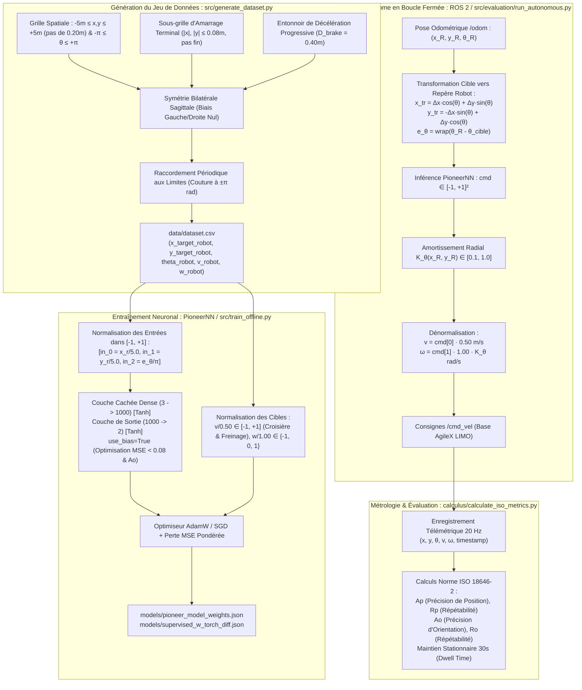

# LIMO Offline Learning : Apprentissage Hors-Ligne & Métrologie ISO 18646-2

Contrôleur neuronal autonome en boucle fermée pour le robot mobile différentiel **AgileX LIMO**, implémentant l'apprentissage par imitation hors-ligne (*Behavioral Cloning*), un repère centré sur le robot, des commandes ternaires discrètes, et une certification métrologique rigoureuse selon la norme **ISO 18646-2**.

L'objectif strict du contrôleur est de ramener le véhicule de n'importe quelle pose initiale $(x_0, y_0, \theta_0)$ dans l'arène vers **l'unique quai d'amarrage terminal situé exactement à $(0.0, 0.0, 0.0)$ avec une orientation alignée à $0^\circ$**.

---

## Architecture du Système & Pipeline



---

## Structure Essentielle du Répertoire

Le projet a été rationalisé pour ne conserver que les scripts et modules strictement indispensables :

```text
limo-offline-learning/
├── calculus/
│   ├── __init__.py
│   └── calculate_iso_metrics.py         # Moteur de calcul métrologique officiel (ISO 18646-2)
├── config/
│   └── config.json                      # Paramètres unifiés (limites cinématiques, D_stop, D_brake)
├── data/
│   ├── dataset.csv                      # Dataset canonique (45 000 échantillons équilibrés, 9 classes)
│   └── evaluation/                      # Télémétries, graphiques et benchmarks enregistrés
├── docs/
│   ├── docs/                            # Norme ISO 18646-2 et articles scientifiques de référence
│   └── images/                          # Graphiques diagnostiques et matrices de confusion (300 DPI)
├── models/
│   ├── pioneer_model_weights.json       # Poids neuronaux entraînés (format JSON universel)
│   ├── supervised_w_torch_diff.json     # Poids sérialisés synchronisés
│   └── training_history.json            # Historique d'apprentissage (époques, perte, taux d'apprentissage)
├── src/
│   ├── __init__.py
│   ├── generate_dataset.py              # Générateur de dataset centré robot (45 000 échantillons)
│   ├── train_offline.py                 # Pipeline d'apprentissage supervisé (PioneerNN, use_bias=True)
│   ├── core/
│   │   ├── __init__.py
│   │   └── pioneer_nn.py                # Architecture PioneerNN (MLP 3->1000->2, K_theta, replays)
│   ├── ros2/
│   │   ├── __init__.py
│   │   ├── limo_interface.py            # Interface matérielle ROS 2 (/odom, /wheel/odom et /cmd_vel)
│   │   └── show_pose.py                 # Moniteur temps réel en console de la pose et du cap
│   ├── evaluation/
│   │   ├── __init__.py
│   │   ├── data_logger.py               # Enregistreur télémétrique 20 Hz et planches 3x3
│   │   ├── run_autonomous.py            # Navigation autonome unitaire en boucle fermée
│   │   └── run_batch_benchmark.py       # Banc de test multi-scénarios (suite ISO 18646-2)
│   └── visualization/
│       ├── __init__.py
│       ├── plot_curves.py               # Courbes de convergence (perte MSE d'entraînement et validation)
│       ├── benchmark_visualizer.py      # Planches comparatives de trajectoires et dashboard HTML
│       └── plot_confusion_and_dataset_analysis.py # Matrice de confusion et distribution des manœuvres
├── requirements.txt                     # Dépendances Python
├── TUTORIAL.md                          # Guide pas-à-pas détaillé pour exécuter le projet
└── README.md                            # Documentation générale de référence
```

---

## Guide de Déploiement sur Robot Réel (AgileX LIMO)

Sur le robot physique, la navigation s'exécute via **3 terminaux distincts** (connectés en SSH ou via écran/clavier local). L'odométrie accumulée est gérée de façon entièrement automatique : **aucune saisie manuelle de coordonnées n'est requise**.

> [IMPORTANT]
> **Compatibilité des Plateformes Robotiques :**
> - **LIMO COBOT (Bras articulé, ex : `192.168.1.113`)** : Fonctionne sous **Ubuntu 20.04 + ROS 2 Foxy**. Son espace de travail matériel actif est `~/limo_ros2_ws`. Si l'invite `ros: noetic(1) foxy(2) ?` apparaît à l'ouverture du terminal, tapez **`2`**.
> - **LIMO Standard (ex : `192.168.1.111`)** : Fonctionne sous **Ubuntu 22.04 + ROS 2 Humble**. Son espace de travail est `~/agilex_ws` ou `~/ros2_ws`.

---

### Terminal 1 : Driver Matériel de la Base Mobile

Initialise la liaison série/CAN avec les actionneurs des roues et la centrale inertielle (IMU). Ce nœud initialise l'origine odométrique $(0, 0, 0)$ et publie sur `/odom` (ou `/wheel/odom`).

1. Placez le robot éteint ou immobile **exactement sur le quai d'amarrage souhaité (la cible $(0, 0, 0)$ avec un cap de $0^\circ$)**.
2. Lancez le driver :

```bash
# Pour LIMO COBOT (ROS 2 Foxy) :
source /opt/ros/foxy/setup.bash
source ~/limo_ros2_ws/install/setup.bash
ros2 launch limo_base limo_base.launch.py
```

*(Ou pour LIMO Standard sous ROS 2 Humble) :*
```bash
source /opt/ros/humble/setup.bash
source ~/agilex_ws/install/setup.bash
ros2 launch limo_base limo_base.launch.py
```

> [NOTE]
> Ce terminal doit rester ouvert et en cours d'exécution pendant toute la durée des essais.

---

### Terminal 2 : Téléopération au Clavier

Permet d'éloigner manuellement le robot de la cible $(0, 0, 0)$ pour le placer sur une pose de départ arbitraire (ex : à 2 mètres avec une inclinaison angulaire).

```bash
# Sous ROS 2 Foxy :
source /opt/ros/foxy/setup.bash
ros2 run teleop_twist_keyboard teleop_twist_keyboard

# Ou sous ROS 2 Humble :
source /opt/ros/humble/setup.bash
ros2 run teleop_twist_keyboard teleop_twist_keyboard
```

#### Touches Principales de Commande :
- **`i`** : Avancer
- **`,`** : Reculer
- **`j`** : Rotation sur place vers la gauche (sens anti-horaire)
- **`l`** : Rotation sur place vers la droite (sens horaire)
- **`k`** : Arrêt d'urgence immédiat ($v=0, \omega=0$)

Une fois le robot stationné au point de départ voulu, appuyez sur **`k`** puis quittez avec **`Ctrl + C`** pour libérer le canal `/cmd_vel`.

> [TIP]
> Vous pouvez lancer à tout moment l'outil `python3 src/ros2/show_pose.py` dans un terminal pour observer en direct les coordonnées cartésiennes et le cap avec rose des vents.

---

### Terminal 3 : Contrôleur Autonome Hors-Ligne (PioneerNN)

Lance le contrôleur en boucle fermée. Le nœud lit automatiquement la pose odométrique `/odom`, effectue la projection dans le repère local du véhicule, applique l'inférence PioneerNN à 20 Hz et pilote `/cmd_vel` jusqu'à l'amarrage complet à $(0, 0, 0)$.

```bash
# Sous ROS 2 Foxy :
source /opt/ros/foxy/setup.bash
cd ~/limo-offline-learning
python3 src/evaluation/run_autonomous.py --real --speed-scale 0.6
```

*(L'argument `--speed-scale 0.6` limite la vitesse de croisière à $0.30\text{ m/s}$, assurant une dynamique fluide sans patinage des pneus sur sol lisse).*

1. Le script détecte la pose de départ et l'affiche :
   ```text
   [Odometry] Current robot pose: x = 1.84 m, y = -0.92 m, theta = 34.2°
   [Ready] Press Enter to start autonomous docking...
   ```
2. Appuyez sur **`[Entrée]`** : le réseau prend les commandes, effectue la manœuvre d'approche, ralentit dans l'entonnoir des 40 cm, s'immobilise dans le cercle d'amarrage terminal ($D_{\text{stop}} = 0.08\text{ m}$), et valide les 30 secondes de maintien stationnaire sans dérive.
3. Les données télémétriques et les graphiques de la session sont automatiquement archivés dans `data/evaluation/`.

---

## Spécifications Cinématiques & Formulation Mathématique

> [!NOTE]
> **Conformité aux Standards ROS REP-103 et SI :**
> - **Vitesse linéaire ($v$)** : $\text{m/s}$ ($V_{\max} = 0.50\text{ m/s}$)
> - **Vitesse angulaire ($\omega$)** : $\text{rad/s}$ ($\Omega_{\max} = 1.00\text{ rad/s} \approx 57.30^\circ/\text{s}$, jamais en degrés/s)
> - **Angle / Orientation ($\theta$)** : $\text{rad}$ ramené dans $[-\pi, +\pi]$
> - **Coordonnées de position ($x, y$)** : $\text{m}$ ($[-5.0, +5.0]\text{ m}$)

### Tableau Récapitulatif des Paramètres

| Paramètre | Symbole | Valeur | Rôle dans le Contrôle |
| :--- | :---: | :---: | :--- |
| Domaine de l'Arène | $X_{\max}, Y_{\max}$ | **$\pm 5.0\text{ m}$** | Dimensions maximales de l'espace de navigation |
| Pas de Grille Standard | $\Delta x, \Delta y$ | **$0.20\text{ m}$** | Discrétisation spatiale du domaine d'entraînement |
| Cap Absolu du Châssis | $\theta_R$ | **$[-\pi, +\pi]\text{ rad}$** | Couverture complète du groupe $SO(2)$ |
| Vitesse Linéaire Maximale | $V_{\max}$ | **$0.50\text{ m/s}$** | Plafond de saturation de vitesse longitudinale |
| Vitesse Angulaire Maximale | $\Omega_{\max}$ | **$1.00\text{ rad/s}$** | Plafond de saturation de vitesse de rotation |
| Actions Linéaires Cibles | $v_{\text{robot}}$ | **$\{-0.50, 0.0, +0.50\}\text{ m/s}$** | Croisière ternaire avec rampe de décélération |
| Actions Angulaires Cibles | $w_{\text{robot}}$ | **$\{-1.00, 0.0, +1.00\}\text{ rad/s}$** | Actions ternaires discrètes avec amortissement radial $K_\theta$ |
| Entonnoir de Décélération | $D_{\text{brake}}$ | **$0.40\text{ m}$** | Distance amorçant le ralentissement progressif |
| Rayon d'Amarrage Terminal | $D_{\text{stop}}$ | **$0.08\text{ m}$** | Rayon de capture terminale (8 cm) |
| Tolérance Angulaire Terminale | $\theta_{\text{tol}}$ | **$0.26\text{ rad } (\approx 15.0^\circ)$** | Seuil d'alignement angulaire pour l'arrêt ISO 18646-2 |
| Durée de Maintien Stationnaire | $T_{\text{dwell}}$ | **$30.0\text{ s}$** | Vérification d'immobilité stricte continue |

### Transformation Centrée sur le Robot (Robot-Centric)

Le réseau opère exclusivement dans le **repère local du véhicule**, garantissant l'invariance par rapport aux repères globaux :

$$\begin{bmatrix} x_{\text{cible}}^{\text{robot}} \\ y_{\text{cible}}^{\text{robot}} \end{bmatrix} = \begin{bmatrix} \cos\theta_R & \sin\theta_R \\ -\sin\theta_R & \cos\theta_R \end{bmatrix} \begin{bmatrix} x_{\text{cible}} - x_{\text{robot}} \\ y_{\text{cible}} - y_{\text{robot}} \end{bmatrix}$$

### Normalisation des Entrées & Sorties du Réseau

$$\text{in}_0 = \frac{x_{\text{cible}}^{\text{robot}}}{5.0} \in [-1.0, 1.0], \quad \text{in}_1 = \frac{y_{\text{cible}}^{\text{robot}}}{5.0} \in [-1.0, 1.0], \quad \text{in}_2 = \frac{\text{wrap}(\theta_{\text{robot}} - \theta_{\text{cible}})}{\pi} \in [-1.0, 1.0]$$

À l'amarrage $(0, 0, 0)$, le vecteur d'entrée s'annule rigoureusement : $[\text{in}_0, \text{in}_1, \text{in}_2]^T \to [0, 0, 0]^T$.

Lors de l'inférence en boucle fermée sur le robot :
$$v_{\text{cmd}} = \hat{y}_0 \times 0.50\text{ m/s}, \quad \omega_{\text{cmd}} = \hat{y}_1 \times 1.00 \times K_\theta(x_{\text{cible}}^{\text{robot}}, y_{\text{cible}}^{\text{robot}})\text{ rad/s}$$

avec le gain d'amortissement radial :
$$K_\theta(x_R, y_R) = 1.0 - 0.9 \exp\left(-10 (x_R^2 + y_R^2)^2\right) \in [0.1, 1.0]$$

---

## Démarrage Rapide & Simulation Gazebo

### 1. Installation de l'Environnement

```bash
git clone https://github.com/jupivato/limo-offline-learning.git
cd limo-offline-learning
pip install -r requirements.txt
```

### 2. Génération du Jeu de Données Hors-Ligne

Génère le dataset canonique de 45 000 échantillons équilibrés :
```bash
python3 src/generate_dataset.py
```

### 3. Entraînement du Contrôleur Neuronal

Entraîne l'architecture PioneerNN (`3 -> 1000 -> 2`, `use_bias=True`) avec l'optimiseur AdamW et la perte MSE pondérée :
```bash
python3 src/train_offline.py
```

### 4. Tracé des Courbes de Convergence

Génère les graphiques d'évolution de la perte MSE et du taux d'apprentissage :
```bash
python3 src/visualization/plot_curves.py
```

### 5. Évaluation sous Gazebo 3D ou en Mode Cinématique

#### Essai Unitaire :
```bash
python3 src/evaluation/run_autonomous.py \
    --weights models/pioneer_model_weights.json \
    --teleport-to 2.0 2.0 0.0 \
    --target 0.0 0.0 0.0
```

#### Campagne de Certification Complète ISO 18646-2 :
```bash
# Mode simulation cinématique rapide (sans besoin d'ouvrir Gazebo) :
python3 src/evaluation/run_batch_benchmark.py --suite canonical

# Ou directement connecté au simulateur Gazebo 3D :
python3 src/evaluation/run_batch_benchmark.py --suite extended --gazebo
```

---

## Outils d'Analyse Métrologique & Visualisation

Le module `src/visualization/` fournit l'ensemble des diagnostics scientifiques :

- **Visualiseur Comparatif & Tableaux de Bord ISO 18646-2** :
  ```bash
  python3 src/visualization/benchmark_visualizer.py --dir data/evaluation/test_2026_11_10_16_40_10
  ```
  Génère la planche récapitulative des trajectoires (`benchmark_trajectory.png`), le dashboard complet 3x3 (`benchmark_all.png`), la grille par quadrant (`benchmark_quadrants.png`), la carte vectorielle SVG (`benchmark_trajectory.svg`) et le rapport web interactif (`benchmark_dashboard.html`).

- **Matrices de Confusion & Diagnostics du Modèle** :
  ```bash
  python3 src/visualization/plot_confusion_and_dataset_analysis.py
  ```
  Calcule les matrices de confusion de classification pour les commandes linéaires et angulaires, génère la carte de densité spatiale de l'arène 2D et les histogrammes comparatifs entre le superviseur expert et la prédiction de la PioneerNN.

- **Calcul Direct des Métriques ISO 18646-2** :
  ```bash
  python3 calculus/calculate_iso_metrics.py --dir data/evaluation/test_2026_11_10_16_40_10
  ```
  Extrait et calcule directement depuis les traces CSV les métriques métrologiques normalisées ($A_p$, $R_p$, $A_o$, $R_o$).

---

## Certification Métrologique ISO 18646-2

La norme internationale **ISO 18646-2** (*Robots de service - Navigation des robots mobiles terrestres : Précision et répétabilité de pose*) régit l'évaluation du système :

- **Précision de Positionnement ($A_p$)** : Distance euclidienne entre le barycentre des arrivées et la cible nominale :
  $$A_p = \sqrt{(\bar{x} - x_{\text{cible}})^2 + (\bar{y} - y_{\text{cible}})^2}$$
- **Répétabilité de Positionnement ($R_p$)** : Rayon de dispersion à $3\sigma$ des points finaux autour du barycentre :
  $$R_p = \bar{l} + 3 S_l$$
- **Précision d'Orientation ($A_o$) & Répétabilité ($R_o$)** : Erreur angulaire absolue moyenne et dispersion à $3\sigma$.
- **Validation Stationnaire (Dwell Time)** : Vérification de l'absence de micro-oscillations motrices ($< 5\text{ mm}$, vitesses nulles) pendant au moins 30 secondes au quai $(0, 0, 0)$.

---

## Auteurs & Affiliation

- **Auteurs du Projet** : Julia PIVATO DE OLIVEIRA & Zeinab KOMAIHA
- **Projet** : Projet Pluridisciplinaire en Équipe (PPE)
- **Institution** : Centre Européen de Réalité Virtuelle (CERV) / École Nationale d'Ingénieurs de Brest (ENIB)
- **Plateforme Matérielle** : AgileX Robotics LIMO (Châssis différentiel 4 roues motrices / ROS 2)
