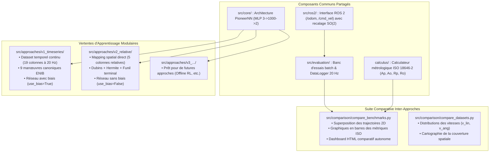

# LIMO Offline Learning : Framework Modulaire d'Apprentissage Hors Ligne et de Benchmarking

[](https://docs.ros.org/)
[](https://pytorch.org/)
[](https://www.iso.org/standard/66847.html)
[](https://www.enib.fr/)
[](#)

Ce dépôt héberge un **framework modulaire unifié** de commande neuronale en boucle fermée pour le robot mobile **AgileX LIMO** sous **ROS 2**. Développé dans le cadre du **Projet Pluridisciplinaire en Équipe (PPE)** au **Centre Européen de Réalité Virtuelle (CERV)** et à l'**École Nationale d'Ingénieurs de Brest (ENIB)**, ce projet permet de développer, entraîner, évaluer et **comparer rigoureusement** différentes approches d'apprentissage par clonage comportemental (*Behavioral Cloning / Learning from Demonstration*) selon la norme internationale **ISO 18646-2**.

---

## 🏛️ Architecture Modulaire du Framework

Le projet est structuré pour permettre la coexistence de plusieurs vertentes d'apprentissage indépendantes tout en partageant les composants matériels, cinématiques et métrologiques communs :



---

## 📂 Organisation Séparée des Dossiers (Données, Modèles et Évaluations)

Chaque approche dispose de ses propres espaces dédiés pour stocker ses jeux de données, ses poids de réseaux et ses résultats d'évaluation :

```text
limo-offline-learning/
├── calculus/
│   └── calculate_iso_metrics.py         # Calcul normalisé ISO 18646-2 partagé
├── config/
│   ├── v1_config.json                   # Configuration de l'approche V1
│   └── v2_config.json                   # Configuration de l'approche V2
├── data/
│   ├── raw/
│   │   ├── v1/                          # Démonstrations brutes pour V1
│   │   └── v2/                          # Démonstrations brutes pour V2
│   ├── curated/
│   │   ├── v1/                          # handcrafted_dataset.csv (19 colonnes)
│   │   └── v2/                          # handcrafted_dataset.csv (5 colonnes)
│   └── evaluation/
│       ├── v1/                          # Télémétries et logs d'évaluation V1
│       ├── v2/                          # Télémétries et logs d'évaluation V2
│       └── comparison/                  # Graphiques et dashboards comparatifs V1 vs V2
├── docs/
│   ├── PLANIFICATION_APPRENTISSAGE_HORS_LIGNE.md  # Planification expérimentale
│   ├── v1/
│   │   └── SPECIFICATION_V1.md          # Spécification détaillée V1
│   └── v2/
│       └── SPECIFICATION_V2.md          # Spécification détaillée V2
├── models/
│   ├── v1/                              # Poids optimisés V1 (supervised_w_torch_diff.json)
│   └── v2/                              # Poids optimisés V2 (supervised_w_torch_diff.json)
├── src/
│   ├── core/
│   │   └── pioneer_nn.py                # Perceptron PioneerNN unifié (support use_bias=True/False)
│   ├── ros2/
│   │   └── limo_interface.py            # Interface ROS 2 avec recalage SO(2)
│   ├── teleop/
│   │   └── collect_demonstrations.py    # Enregistreur téléopération à 20 Hz
│   ├── evaluation/
│   │   ├── data_logger.py               # Enregistreur temps réel à 20 Hz
│   │   ├── run_autonomous.py            # Contrôleur autonome en boucle fermée
│   │   ├── run_batch_benchmark.py       # Exécuteur batch multi-scénarios
│   │   └── benchmark_visualizer.py      # Tracé des sessions individuelles
│   ├── approaches/
│   │   ├── v1_timeseries/               # VERTENTE V1 (Séries temporelles 19 colonnes)
│   │   │   ├── generate_dataset.py      # Générateur 19 colonnes (9 manœuvres ENIB)
│   │   │   ├── curate_dataset.py        # Curateur et symétrie bilatérale
│   │   │   ├── train_offline.py         # Entraînement V1 (use_bias=True)
│   │   │   ├── export_visualizer.py     # Visualiseur interactif V1
│   │   │   └── plot_distribution.py     # Graphiques de distribution V1
│   │   └── v2_relative/                 # VERTENTE V2 (Mapping relatif 5 colonnes)
│   │       ├── generate_dataset.py      # Générateur 5 colonnes (Dubins + Hermite + funil)
│   │       ├── curate_dataset.py        # Curateur et miroir V2
│   │       ├── train_offline.py         # Entraînement V2 (use_bias=False)
│   │       └── plot_curves.py           # Outil de tracé des courbes d'entraînement
│   └── comparison/                      # MODULE COMPARATIF INTER-APPROCHES
│       ├── compare_datasets.py          # Comparaison statistique des datasets
│       └── compare_benchmarks.py        # Superposition des trajectoires & métriques ISO
├── requirements.txt
└── README.md
```

---

## 📊 Matrice Synthétique des Approches

| Caractéristique | Approche V1 (`v1_timeseries`) | Approche V2 (`v2_relative`) |
| :--- | :--- | :--- |
| **Philosophie** | Séries temporelles d'Euler à 20 Hz | Cartographie spatiale relative continue |
| **Format du Dataset** | 19 colonnes complètes | **5 colonnes directes** (`x_r, y_r, theta_r, v_r, w_r`) |
| **Génération** | 9 manœuvres canoniques ENIB | **Courbes de Dubins ($x \le 0$) + Splines d'Hermite ($x \ge 0$)** |
| **Zone d'Accostage** | Non contrainte | **Funil terminal haute densité orienté $\theta \to 0$** |
| **Biais Neuronaux** | Activés (`use_bias=True`) | **Désactivés (`use_bias=False`, garantie $\text{MLP}(\vec{0}) = \vec{0}$)** |
| **Dossier Dataset** | `data/curated/v1/` | `data/curated/v2/` |
| **Dossier Modèle** | `models/v1/` | `models/v2/` |
| **Dossier Évaluation** | `data/evaluation/v1/` | `data/evaluation/v2/` |

---

## 🚀 Guide d'Utilisation : Exécution et Comparaison

### 1. Installation de l'Environnement
```bash
pip install -r requirements.txt
```

---

### 2. Pipeline de l'Approche V1 (Séries Temporelles)

```bash
# A. Générer le dataset V1 (19 colonnes)
python3 -m src.approaches.v1_timeseries.generate_dataset

# B. Entraîner le modèle V1
python3 -m src.approaches.v1_timeseries.train_offline

# C. Évaluer sous Gazebo / simulation et enregistrer les télémétries
python3 -m src.evaluation.run_batch_benchmark \
    --weights models/v1/supervised_w_torch_diff.json \
    --outdir data/evaluation/v1/batch_run
```

---

### 3. Pipeline de l'Approche V2 (Mapping Relatif)

```bash
# A. Générer le dataset V2 (5 colonnes)
python3 -m src.approaches.v2_relative.generate_dataset --stride 2

# B. Entraîner le modèle V2 (sans biais)
python3 -m src.approaches.v2_relative.train_offline --no-bias --epochs 100

# C. Tracer les courbes de convergence de la perte MSE
python3 -m src.approaches.v2_relative.plot_curves

# D. Évaluer sous Gazebo / simulation et enregistrer les télémétries
python3 -m src.evaluation.run_batch_benchmark \
    --weights models/v2/supervised_w_torch_diff.json \
    --outdir data/evaluation/v2/batch_run
```

---

### 4. 🔬 Module Comparatif Inter-Approches

Une fois les évaluations des approches exécutées, lancez les outils de comparaison pour analyser les différences :

#### A. Comparaison Statistique des Datasets
Compare les distributions de vitesses ($v_{\text{lin}}, v_{\text{ang}}$), le nombre d'échantillons et la dispersion spatiale :
```bash
python3 -m src.comparison.compare_datasets \
    --v1-dataset data/curated/v1/handcrafted_dataset.csv \
    --v2-dataset data/curated/v2/handcrafted_dataset.csv \
    --outdir data/evaluation/comparison
```
*Génère : `dataset_comparison_distributions.png` et `dataset_comparison_stats.json`.*

#### B. Comparaison Métrologique et Trajectorielle ISO 18646-2
Superpose directement les trajectoires des deux approches, trace les barres comparatives des métriques ISO et génère un tableau de bord HTML autonome :
```bash
python3 -m src.comparison.compare_benchmarks \
    --v1-dir data/evaluation/v1/batch_run \
    --v2-dir data/evaluation/v2/batch_run \
    --name1 "V1 (19 cols)" \
    --name2 "V2 (5 cols)" \
    --outdir data/evaluation/comparison
```
*Génère dans `data/evaluation/comparison/` :*
- **`comparison_trajectories.png` & `.svg`** : Superposition visuelle 2D des trajectoires.
- **`comparison_iso_metrics.png` & `.svg`** : Graphiques en barres comparatifs ($A_p, A_o, R_p, S_l$) avec les seuils ISO normatifs.
- **`comparison_summary.csv`** : Tableau récapitulatif tabulaire des métriques.
- **`comparison_dashboard.html`** : Dashboard interactif complet visualisable dans tout navigateur web.

---

## ⚙️ Guide d'Expérimentation et Réglage des Hyperparamètres

Le framework est conçu pour permettre l'exploration rapide et la comparaison métrologique de différentes configurations architecturales et cinématiques.

### 1. Paramètres d'Entraînement en Ligne de Commande (CLI)

Chaque script d'entraînement (`train_offline.py`) expose directement les hyperparamètres sans nécessiter de modification du code source :

| Paramètre CLI | Description | Valeur par défaut | Exemple d'utilisation |
| :--- | :--- | :---: | :--- |
| `--hidden-size` | Nombre de neurones dans la couche cachée de PioneerNN | `1000` | `--hidden-size 256` (réseau compact) ou `2000` |
| `--lr` | Taux d'apprentissage de l'optimiseur AdamW | `0.001` | `--lr 0.0005` (optimisation conservatrice) |
| `--beta` | Pondération de la perte angulaire ($\mathcal{L} = \text{MSE}_v + \beta \cdot \text{MSE}_\omega$) | `1.0` | `--beta 2.0` (priorisation du cap $\theta \to 0$) |
| `--epochs` | Nombre maximal d'époques d'apprentissage | `100` | `--epochs 150` |
| `--batch-size` | Taille des lots échantillonnés avec mélange aléatoire | `128` | `--batch-size 256` |
| `--patience` | Seuil d'époques sans amélioration pour arrêt précoce | `15` | `--patience 20` |
| `--no-bias` / `--use-bias` | Activation ou suppression stricte des biais neuronaux | `--no-bias` (V2) | `--use-bias` (pour tester la dérive résiduelle) |

#### Exemples de commandes d'expérimentation :
```bash
# Entraînement d'un modèle compact pour microprocesseur embarqué (256 neurones) :
python3 -m src.approaches.v2_relative.train_offline --hidden-size 256 --output models/v2/model_compact.json

# Entraînement avec forte priorisation de l'alignement angulaire (bêta = 2.0) :
python3 -m src.approaches.v2_relative.train_offline --beta 2.0 --lr 0.0005
```

---

### 2. Paramètres de Normalisation ($\boldsymbol{\alpha}$) et Loi d'Orientation

Les entrées du réseau sont dimensionnées par les constantes de normalisation définies dans les modules d'entraînement (`ALPHA`) :

$$\mathbf{in} = \begin{bmatrix} (x - x_d) \cdot \alpha_x \\ (y - y_d) \cdot \alpha_y \\ (\text{recast}(\theta - \theta_d) - \theta_s(x,y)) \cdot \alpha_\theta \end{bmatrix}, \quad \boldsymbol{\alpha} = \begin{bmatrix} 1/3 \\ 1/3 \\ 1/\pi \end{bmatrix}$$

- **Facteurs $\alpha_x = 1/3$ et $\alpha_y = 1/3$** : Dimensionnés pour un rayon d'évolution nominal de 3 mètres (erreur cartésienne projetée dans $[-1, 1]$). Pour tester une arène de 5 mètres, adapter à $\boldsymbol{\alpha} = [1/5, 1/5, 1/\pi]$.
- **Facteur $\alpha_\theta = 1/\pi$** : Normalise l'erreur d'orientation périodique $[-\pi, \pi]$ dans $[-1, 1]$.
- **Loi d'orientation stratégique $\theta_s(x, y) = \tanh(10x) \cdot \arctan(1y)$** : Évite les singularités et minima locaux lorsque le robot tourne le dos à la cible. Les coefficients $10.0$ et $1.0$ règlent la courbure du champ d'attraction.

---

### 3. Paramètres de Génération Cinématique (Oracles Dubins & Hermite)

Dans `src/approaches/v2_relative/generate_dataset.py`, la résolution spatiale et les contraintes dynamiques peuvent être adaptées :
- **`--stride`** : Facteur de sous-échantillonnage temporel des trajectoires.
  - `--stride 2` : Cartographie haute densité (recommandé pour la production).
  - `--stride 5` : Échantillonnage plus rapide pour prototypage léger.
- **`R_MIN = 0.42 m`** : Rayon de courbure minimal admissible par le châssis différentiel du LIMO (empattement et adhérence des roues).
- **`V_CRUISE = 0.24 m/s`** : Vitesse linéaire nominale de consigne.

---

## ➕ Comment Ajouter une Nouvelle Approche (ex: V3)

Pour ajouter une nouvelle méthode (ex: Offline RL, Diffusion Policy, DAgger) :
1. Créez votre dossier dans `src/approaches/v3_nom_approche/` avec vos scripts `generate_dataset.py` et `train_offline.py`.
2. Configurez vos chemins de sortie vers `data/curated/v3/`, `models/v3/` et `data/evaluation/v3/`.
3. Comparez-la directement avec la V1 et la V2 en appelant `src.comparison.compare_benchmarks --v1-dir ... --v2-dir ...`.

---

## 👥 Projet et Affiliation

- **Cadre** : Projet Pluridisciplinaire en Équipe (PPE)
- **Laboratoire** : Centre Européen de Réalité Virtuelle (CERV) / École Nationale d'Ingénieurs de Brest (ENIB)
- **Robot** : AgileX Robotics LIMO (Plateforme mobile sous ROS 2)
