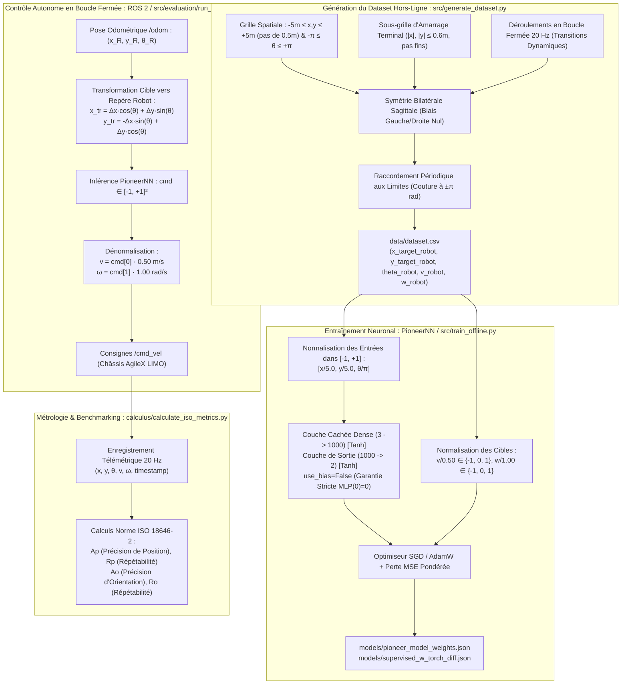

# LIMO Offline Learning : Clonage Comportemental & Métrologie ISO 18646-2

Contrôleur neuronal autonome en boucle fermée pour le robot mobile différentiel **AgileX LIMO**, implémentant le clonage comportemental hors-ligne (*Behavioral Cloning*), des repères centrés sur le robot, des actions ternaires discrètes, et une certification métrologique selon la norme **ISO 18646-2**.

---

## 🏗️ Architecture du Système & Pipeline



---

## 📂 Structure du Dépôt

```text
limo-offline-learning/
├── calculus/
│   ├── __init__.py
│   └── calculate_iso_metrics.py         # Moteur de calcul métrologique (ISO 18646-2)
├── config/
│   └── config.json                      # Limites cinématiques, bornes spatiales & normalisation
├── data/
│   ├── dataset.csv                      # Dataset canonique hors-ligne (45 000 échantillons équilibrés)
│   └── evaluation/                      # Télémétries d'essais & benchmarks ISO (ignoré par git)
├── docs/
│   ├── docs/                            # Articles scientifiques de référence & normes ISO
│   └── images/                          # Graphiques haute résolution des benchmarks et trajectoires
├── models/
│   ├── pioneer_model_weights.json       # Poids neuronaux entraînés (format JSON universel)
│   ├── supervised_w_torch_diff.json     # Miroir synchronisé des poids
│   └── archive_old_trainings.zip        # Archives des sessions d'entraînement historiques
├── src/
│   ├── generate_dataset.py              # Générateur de dataset centré robot
│   ├── train_offline.py                 # Pipeline d'entraînement supervisé hors-ligne (PioneerNN)
│   ├── core/
│   │   ├── __init__.py
│   │   └── pioneer_nn.py                # Architecture PioneerNN (MLP sans biais, use_bias=False)
│   ├── ros2/
│   │   ├── __init__.py
│   │   └── limo_interface.py            # Interface ROS 2 (transformations odométriques & /cmd_vel)
│   ├── evaluation/
│   │   ├── __init__.py
│   │   ├── data_logger.py               # Enregistreur télémétrique temps réel 20 Hz
│   │   ├── run_autonomous.py            # Contrôleur autonome en boucle fermée (Robot Réel & Simu)
│   │   └── run_batch_benchmark.py       # Banc d'évaluation multi-scénarios (ISO 18646-2)
│   └── visualization/
│       ├── __init__.py
│       ├── plot_curves.py               # Tracé des courbes de perte (Loss MSE Entraînement/Validation)
│       ├── benchmark_visualizer.py      # Visualiseur de trajectoires & dashboards HTML interactifs
│       ├── evaluate_xy_plane.py         # Cartographie du plan XY (champs de vecteurs carquois & heatmaps)
│       └── plot_confusion_and_dataset_analysis.py # Matrices de confusion et distribution des manœuvres
├── requirements.txt
├── TUTORIAL.md                          # Tutoriel pas-à-pas complet pour débutants
└── README.md
```

---

## 🤖 Guide de Déploiement sur Robot Réel (AgileX LIMO)

Pour exécuter le contrôleur autonome sur le robot physique dans la salle de test, le protocole standard s'articule autour de **3 terminaux distincts** (exécutés via SSH ou directement sur le terminal du robot).

> [!IMPORTANT]
> **Identification de la Plateforme Robotique :**
> - **LIMO COBOT (Bras articulé, ex: `192.168.1.113`)** : Fonctionne sous **Ubuntu 20.04 + ROS 2 Foxy**. Son workspace matériel actif est `~/limo_ros2_ws`. Lors de l'ouverture du terminal, si l'invite `ros: noetic(1) foxy(2) ?` apparaît, choisissez **`2`**.
> - **LIMO Standard (ex: `192.168.1.111`)** : Fonctionne sous **Ubuntu 22.04 + ROS 2 Humble**. Son workspace matériel est `~/agilex_ws`.

---

### 💻 Terminal 1 : Driver Matériel de la Base Mobile

Ce terminal initialise la communication matérielle avec le bus CAN des moteurs et la centrale inertielle (IMU). Il publie la pose odométrique sur `/odom` et écoute les commandes de vitesse sur `/cmd_vel`.

1. Placez manuellement le robot éteint ou immobile **exactement à l'emplacement souhaité pour le quai d'amarrage (la cible $(0, 0, 0)$)**.
2. Ouvrez le **Terminal 1** et lancez le driver :

```bash
# Pour LIMO COBOT (ROS 2 Foxy) :
source /opt/ros/foxy/setup.bash
source ~/limo_ros2_ws/install/setup.bash
ros2 launch limo_base limo_base.launch.py
```

*(Si vous utilisez un LIMO Standard sous ROS 2 Humble) :*
```bash
source /opt/ros/humble/setup.bash
source ~/agilex_ws/install/setup.bash
ros2 launch limo_base limo_base.launch.py
```

> [!NOTE]
> **Ce terminal doit rester ouvert et actif en permanence.**
> Des messages de statut indiquant la connexion au port série/CAN vont s'afficher en continu. C'est le comportement nominal normal.

---

### 🎮 Terminal 2 : Téléopération Manuelle au Clavier

Le nœud de téléopération au clavier permet d'éloigner manuellement le robot de sa cible $(0, 0, 0)$ et de le positionner à une pose de départ arbitraire (ex: à 2 mètres avec une orientation de $90^\circ$).

1. Ouvrez un **Terminal 2** sur le robot :

```bash
# Pour LIMO COBOT (ROS 2 Foxy) :
source /opt/ros/foxy/setup.bash
ros2 run teleop_twist_keyboard teleop_twist_keyboard
```

*(Ou sous ROS 2 Humble : `source /opt/ros/humble/setup.bash && ros2 run teleop_twist_keyboard teleop_twist_keyboard`)*

#### ⌨️ Guide des Touches du Clavier :
Le terminal affiche les commandes de direction ci-dessous :

| Touche | Action sur le Robot | Description |
| :---: | :--- | :--- |
| **`i`** | **Avancer** | Déplacement linéaire vers l'avant ($+v$) |
| **`,`** | **Reculer** | Déplacement linéaire vers l'arrière ($-v$) |
| **`j`** | **Pivoter à Gauche** | Rotation pure anti-horaire sur place ($+\omega$) |
| **`l`** | **Pivoter à Droite** | Rotation pure horaire sur place ($-\omega$) |
| **`u`** | **Avancer + Virage Gauche** | Trajectoire en arc de cercle vers l'avant gauche |
| **`o`** | **Avancer + Virage Droite** | Trajectoire en arc de cercle vers l'avant droite |
| **`m`** | **Reculer + Virage Gauche** | Trajectoire en arc de cercle vers l'arrière gauche |
| **`.`** | **Reculer + Virage Droite** | Trajectoire en arc de cercle vers l'arrière droite |
| **`k`** | **ARRÊT D'URGENCE (Stop)** | Coupe instantanément les consignes de vitesse ($v=0, \omega=0$) |
| **`q`** / **`z`** | Vitesse linéaire $\pm 10\%$ | Ajuste le pas d'incrément de la vitesse d'avance |
| **`w`** / **`x`** | Vitesse angulaire $\pm 10\%$ | Ajuste le pas d'incrément de la vitesse de rotation |

2. Conduisez le robot jusqu'au point de départ souhaité.
3. Appuyez sur **`k`** pour immobiliser le robot.
4. Quittez le téléop avec `Ctrl + C` pour libérer le topic `/cmd_vel`.

---

### 🧠 Terminal 3 : Contrôleur Autonome Hors-Ligne (PioneerNN)

Ce terminal lance le réseau de neurones PioneerNN. Il lit automatiquement l'odométrie accumulée (avec détection automatique transparente de `/odom` ou `/wheel/odom`), calcule la transformation dans le repère local du robot, et prend le contrôle exclusif de `/cmd_vel` pour ramener le robot au quai $(0, 0, 0)$.

1. Ouvrez un **Terminal 3** sur le robot :

```bash
# Pour LIMO COBOT (ROS 2 Foxy) :
source /opt/ros/foxy/setup.bash
cd ~/limo-offline-learning
python3 src/evaluation/run_autonomous.py --real --speed-scale 0.6
```

*(Note : `--speed-scale 0.6` ajuste la vitesse maximale à 0.30 m/s pour des essais en laboratoire fluides et sans patinage des roues. La rampe de décélération progressive et le filtre d'accélération garantissent un amarrage en douceur).*

*(Ou sous ROS 2 Humble : `source /opt/ros/humble/setup.bash && cd ~/limo-offline-learning && python3 src/evaluation/run_autonomous.py --real`)*

2. **Déroulement de l'Amarrage :**
   - Le script lit la pose courante depuis `/odom` et l'affiche à l'écran :
     ```text
     [INFO] Lecture de la pose initiale depuis /odom...
     [INFO] Pose initiale détectée : x = 1.842 m, y = -0.512 m, theta = 42.15 deg
     [Prêt] Appuyez sur Entrée pour démarrer l'amarrage autonome...
     ```
   - Vérifiez que l'aire de navigation est dégagée, puis appuyez sur **`[Entrée]`**.
   - Le réseau PioneerNN calcule les commandes à 20 Hz jusqu'à l'amarrage parfait à la cible.
   - Les données de trajectoire sont automatiquement enregistrées dans `data/evaluation/` pour l'analyse ISO 18646-2.

---

## 🔬 Spécifications Cinématiques & Normalisation

> [!NOTE]
> **Conformité aux Normes ROS REP-103 et Système International (SI) :**
> Toutes les grandeurs physiques du projet respectent strictement le standard [ROS REP 103](https://www.ros.org/reps/rep-0103.html) :
> - **Vitesse linéaire ($v$)** : $\text{m/s}$ ($V_{\max} = 0.50\text{ m/s}$)
> - **Vitesse angulaire ($\omega$)** : $\text{rad/s}$ ($\Omega_{\max} = 1.00\text{ rad/s} \approx 57.30^\circ/\text{s}$, jamais en degrés/s)
> - **Angle / Orientation ($\theta$)** : $\text{rad}$ ($[-\pi, +\pi]$)
> - **Coordonnées spatiales ($x, y$)** : $\text{m}$ ($[-5.0, +5.0]\text{ m}$)

### Tableau Récapitulatif des Paramètres

| Paramètre | Symbole | Valeur | Justification Physique et Mathématique |
| :--- | :---: | :---: | :--- |
| Bornes Spatiales de l'Arène | $X_{\max}, Y_{\max}$ | **$\pm 5.0\text{ m}$** | Couvre l'intégralité de la zone d'essai en laboratoire |
| Pas d'Échantillonnage de Grille | $\Delta x, \Delta y$ | **$0.5\text{ m}$** | Discrétisation spatiale régulière du domaine d'apprentissage |
| Cap Absolu du Châssis | $\theta_R$ | **$[-\pi, +\pi]\text{ rad}$** | Couverture intégrale du cercle trigonométrique $SO(2)$ |
| Vitesse Linéaire Maximale | $V_{\max}$ | **$0.50\text{ m/s}$** | Limite cinématique maximale en mode différentiel |
| Vitesse Angulaire Maximale | $\Omega_{\max}$ | **$1.00\text{ rad/s}$** | Taux de lacet sécurisé éliminant le glissement transversal des roues |
| Ensemble des Vitesses Linéaires | $v_{\text{robot}}$ | **$\{-0.50, 0.0, +0.50\}\text{ m/s}$** | Ensemble d'actions ternaires discrètes |
| Ensemble des Vitesses Angulaires | $w_{\text{robot}}$ | **$\{-1.00, 0.0, +1.00\}\text{ rad/s}$** | Ensemble d'actions ternaires discrètes |
| Entonnoir de Décélération | $D_{\text{brake}}$ | **$0.20\text{ m}$** | Permet au MLP d'apprendre une rampe de freinage progressive |
| Bande Morte Terminale d'Arrêt | $D_{\text{stop}}$ | **$0.05\text{ m}$** | Élimine les oscillations à haute fréquence et cycles limites à l'origine |

### Transformation du Repère Global vers le Repère Robot

Le réseau de neurones opère exclusivement dans le **repère local du châssis (robot-centric)**, garantissant une invariance par translation globale :

$$\begin{bmatrix} x_{\text{cible}}^{\text{robot}} \\ y_{\text{cible}}^{\text{robot}} \end{bmatrix} = \begin{bmatrix} \cos\theta_R & \sin\theta_R \\ -\sin\theta_R & \cos\theta_R \end{bmatrix} \begin{bmatrix} x_{\text{cible}} - x_{\text{robot}} \\ y_{\text{cible}} - y_{\text{robot}} \end{bmatrix}$$

### Normalisation des Entrées & Sorties du Réseau

$$\text{in}_0 = \frac{x_{\text{cible}}^{\text{robot}}}{5.0} \in [-1.0, 1.0], \quad \text{in}_1 = \frac{y_{\text{cible}}^{\text{robot}}}{5.0} \in [-1.0, 1.0], \quad \text{in}_2 = \frac{\theta_{\text{robot}}}{\pi} \in [-1.0, 1.0]$$

Pendant l'inférence en boucle fermée sur le robot :
$$v_{\text{cmd}} = \hat{y}_0 \times 0.50\text{ m/s}, \quad \omega_{\text{cmd}} = \hat{y}_1 \times 1.00\text{ rad/s}$$

---

## ⚡ Démarrage Rapide & Simulation Gazebo

### 1. Installation de l'Environnement

```bash
# Cloner le dépôt
git clone https://github.com/jupivato/limo-offline-learning.git
cd limo-offline-learning

# Installer les dépendances Python
pip install -r requirements.txt
```

### 2. Génération du Jeu de Données Hors-Ligne

Génère le dataset équilibré de 45 000 échantillons sur $[-5, +5]\text{ m}$ tous les $0.5\text{ m}$, avec sous-grille fine d'amarrage, symétrie sagittale et raccordement périodique à $\pm\pi$ :

```bash
python3 src/generate_dataset.py
```

### 3. Entraînement du Contrôleur Neuronal sans Biais

Entraîne l'architecture PioneerNN (`3 -> 1000 -> 2`, `use_bias=False`) garantissant l'invariance stricte de repos $f(0, 0, 0) = [0, 0]$ :

```bash
python3 src/train_offline.py
```

### 4. Visualisation des Courbes de Convergence

Affiche les courbes de convergence de la perte quadratique moyenne (MSE) :

```bash
python3 src/visualization/plot_curves.py
```

### 5. Évaluation sous Gazebo 3D & Benchmark ISO 18646-2

#### Test d'un Scénario Unique sous Simulation Gazebo :
```bash
python3 src/evaluation/run_autonomous.py \
    --weights models/pioneer_model_weights.json \
    --teleport-to 2.0 2.0 0.0 \
    --target 0.0 0.0 0.0
```

#### Campagne de Certification Complète (20 Scénarios sous Norme ISO 18646-2) :
```bash
python3 src/evaluation/run_batch_benchmark.py \
    --gazebo \
    --suite extended \
    --weights models/pioneer_model_weights.json \
    --outdir data/evaluation/batch_run
```

---

## 📊 Outils d'Analyse & Visualisation

Le module `src/visualization/` regroupe l'ensemble des diagnostics scientifiques :

- **Cartographie Vectorielle du Plan XY** :
  ```bash
  python3 src/visualization/evaluate_xy_plane.py
  ```
  Génère les cartes de champs de vecteurs (*quiver plots*) et les cartes de chaleur (*heatmaps*) démontrant la convergence des flux vers l'origine $(0, 0)$.

- **Tableau de Bord Interactif des Trajectoires** :
  ```bash
  python3 src/visualization/benchmark_visualizer.py
  ```
  Génère des visualisations 2D comparatives des trajectoires et un rapport HTML interactif complet.

- **Matrices de Confusion & Équilibre des Classes** :
  ```bash
  python3 src/visualization/plot_confusion_and_dataset_analysis.py
  ```
  Vérifie la répartition rigoureuse des 9 manœuvres canoniques de l'ENIB et la symétrie sagittale du dataset.

---

## 📏 Certification Métrologique ISO 18646-2

La norme internationale **ISO 18646-2** (*Robots de service - Navigation des robots mobiles terrestres : Précision et répétabilité de pose*) définit les métriques calculées par `calculus/calculate_iso_metrics.py` :

- **Précision de Positionnement ($A_p$)** : Distance euclidienne entre la position moyenne d'arrêt et la pose nominale visée :
  $$A_p = \sqrt{(\bar{x} - x_{\text{cible}})^2 + (\bar{y} - y_{\text{cible}})^2}$$
- **Répétabilité de Positionnement ($R_p$)** : Rayon de dispersion à $3\sigma$ des arrivées autour du barycentre :
  $$R_p = \bar{l} + 3 S_l$$
- **Précision d'Orientation ($A_o$) & Répétabilité ($R_o$)** : Erreur angulaire absolue moyenne et écart-type associé à $3\sigma$.
- **Critère de Stabilisation Terminale** : Maintien immobile en zone morte pendant une période de repos de 30 secondes sans cycle limite moteur.

---

## 👥 Auteurs & Affiliation

- **Auteurs du Projet** : Julia PIVATO DE OLIVEIRA & Zeinab KOMAIHA
- **Projet** : Projet Pluridisciplinaire en Équipe (PPE)
- **Institution** : Centre Européen de Réalité Virtuelle (CERV) / École Nationale d'Ingénieurs de Brest (ENIB)
- **Plateforme Matérielle** : AgileX Robotics LIMO (Châssis 4 roues différentielles / Ackermann ROS 2)
