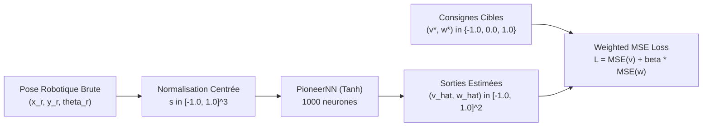

# Guide Méthodologique : Compréhension de la Fonction de Perte (MSE) et Interprétation des Courbes d'Apprentissage

**Projet** : LIMO Offline Learning — Navigation Autonome par Clonage Comportemental  
**Cadre Académique** : Projet de Fin d'Études / PPE — CERV (Centre Européen de Réalité Virtuelle) / ENIB (École Nationale d'Ingénieurs de Brest)  
**Auteur** : Julia Pivato  
**Objet** : Explication didactique et mathématique détaillée de la fonction de perte quadratique moyenne pondérée (*Weighted MSE Loss*), décomposition des éléments graphiques des courbes d'apprentissage, et justification théorique montrant pourquoi une perte résiduelle comprise entre $0.50$ et $0.60$ est saine et optimale pour la navigation d'un robot mobile différentiel.

---

## 1. Introduction et Problématique

Dans le cadre du clonage comportemental (*Behavioral Cloning*) appliqué au robot mobile **AgileX LIMO**, le réseau de neurones [`PioneerNN`](../src/core/pioneer_nn.py) apprend à reproduire la politique de commande d'un opérateur expert à partir d'un ensemble de démonstrations préalablement enregistrées.

Lors de l'analyse des résultats d'entraînement, une interrogation classique émerge :
> *"Pourquoi la valeur finale de l'erreur quadratique moyenne se stabilise-t-elle autour de 0.50 à 0.60 ? Une perte de 0.6 n'est-elle pas excessivement élevée ?"*

L'objectif de ce document est de répondre de manière rigoureuse et formalisée à cette question en trois temps :
1. Décrypter l'ensemble des éléments visuels figurant sur chaque graphique de courbe d'apprentissage.
2. Établir la formulation mathématique pas-à-pas du calcul de la perte à partir des coordonnées physiques du robot.
3. Démontrer mathématiquement et physiquement pourquoi une perte de $\approx 0.50$ représente en réalité une excellente performance (plus de $60\%$ de la variance comportementale expliquée), tout en exposant le **paradoxe de la perte en robotique mobile**.

---

## 2. Anatomie Détaillée des Courbes d'Apprentissage

Chaque configuration d'entraînement produit un fichier graphique individuel haute résolution enregistré dans le répertoire [`docs/images/`](images/) (par exemple [`curva_aprendizado_sgd_lr_0.05_ep_150.png`](images/curva_aprendizado_sgd_lr_0.05_ep_150.png)). 

Chaque figure est structurée selon les composantes suivantes :

### 2.1. Les Axes de Référence

- **Axe Horizontal (Abscisse — $X$) : Époque d'Entraînement (*Epoch*)**  
  Une époque correspond à un passage complet de l'algorithme d'optimisation sur l'intégralité du sous-ensemble d'entraînement (soit 56 531 échantillons découpés en mini-lots de taille $B = 256$).  
  L'abscisse s'étend de 1 jusqu'au budget maximal alloué ($N \in \{30, 60, 100, 150\}$).

- **Axe Vertical (Ordonnée — $Y$) : Erreur Quadratique Moyenne (*MSE Loss*)**  
  Représente la valeur scalaire sans unité de la fonction de coût $\mathcal{L}$, calculée sur les commandes motrices normalisées. Plus cette valeur est faible, plus la sortie prédite par le réseau est proche des consignes enregistrées dans la base de données.

### 2.2. Les Courbes de Performance

- **Courbe Bleue Continue — Perte d'Entraînement (*Train MSE*)** :  
  $$\mathcal{L}_{\text{train}} = \frac{1}{|\mathcal{D}_{\text{train}}|} \sum_{i \in \mathcal{D}_{\text{train}}} \ell(f(s_i; W), y_i^*)$$  
  Elle mesure la conformité du réseau avec les données sur lesquelles il ajuste directement ses matrices de poids $W$. Au fil des époques, la rétropropagation du gradient force cette courbe à descendre.

- **Courbe Rouge Discontinue — Perte de Validation (*Val MSE*)** :  
  $$\mathcal{L}_{\text{val}} = \frac{1}{|\mathcal{D}_{\text{val}}|} \sum_{j \in \mathcal{D}_{\text{val}}} \ell(f(s_j; W), y_j^*)$$  
  Elle est évaluée sur un échantillon indépendant de 14 133 exemples (20% du jeu de données total) que le réseau **ne voit jamais** durant la descente de gradient. Cette métrique constitue le thermomètre impartial de la capacité de généralisation du modèle à des états inédits.

### 2.3. Les Marqueurs Spécifiques et Diagnostics

- **Point Vert — Meilleure Époque de Validation (*Best Val*)** :  
  Il indique les coordonnées $(N_{\text{best}}, \mathcal{L}_{\text{val, min}})$ où l'erreur de validation atteint son minimum absolu au cours du cycle. C'est à cet instant précis que les poids optimaux sont sauvegardés pour le déploiement.
- **Écart Train-Validation (*Generalization Gap*)** :  
  - Si la courbe rouge suit fidèlement la courbe bleue (courbes superposées ou parallèles distantes de moins de 0.005), le modèle généralise parfaitement sans aucun phénomène de surapprentissage (*overfitting*).
  - Si la courbe rouge recommençait à remonter tandis que la courbe bleue continuait de chuter, cela indiquerait une mémorisation par cœur du bruit d'échantillonnage.

---

## 3. Formulation Mathématique Pas-à-Pas de la Perte MSE

Pour comprendre d'où provient la valeur numérique de la perte, traçons la chaîne complète de transformation du signal, depuis la géométrie physique du robot jusqu'au scalaire de coût.

### Étape 1 : Acquisition de l'État Relatif du Robot
À chaque pas de temps $t$, la pose relative de la cible d'amarrage dans le repère local attaché au châssis du LIMO est donnée par :
$$\mathbf{x}_{\text{brut}} = \begin{bmatrix} x_r \\ y_r \\ \theta_r \end{bmatrix} \in \mathbb{R}^3$$
où $x_r \in [-5.0, 5.0]\text{ m}$ est la distance longitudinale, $y_r \in [-5.0, 5.0]\text{ m}$ est la distance latérale, et $\theta_r \in [-\pi, \pi]\text{ rad}$ est le cap relatif vers la cible.

### Étape 2 : Normalisation et Encodage d'Entrée
Afin de conditionner favorablement le réseau et d'éviter la saturation précoce des neurones, les coordonnées sont normalisées dans l'intervalle compact $[-1.0, +1.0]$ :
$$s_0 = \text{clip}\left(\frac{x_r}{X_{\max}}, -1.0, 1.0\right), \quad X_{\max} = 5.0\text{ m}$$
$$s_1 = \text{clip}\left(\frac{y_r}{Y_{\max}}, -1.0, 1.0\right), \quad Y_{\max} = 5.0\text{ m}$$
$$s_2 = \text{clip}\left(\frac{\text{atan2}(\sin \theta_r, \cos \theta_r)}{\pi}, -1.0, 1.0\right)$$
Le vecteur d'entrée normalisé injecté dans le réseau est :
$$\mathbf{s} = [s_0, s_1, s_2]^T \in [-1.0, 1.0]^3$$

### Étape 3 : Inférence du Réseau de Neurones PioneerNN
Le modèle est un perceptron multicouche à deux étages sans biais, doté d'une couche cachée de 1000 neurones et d'activations tangentes hyperboliques :
1. **Couche Cachée** ($W_1 \in \mathbb{R}^{1000 \times 3}$) :
   $$\mathbf{h} = \tanh(W_1 \mathbf{s}) \in (-1.0, 1.0)^{1000}$$
2. **Couche de Sortie** ($W_2 \in \mathbb{R}^{2 \times 1000}$) :
   $$\hat{\mathbf{y}} = \begin{bmatrix} \hat{v} \\ \hat{\omega} \end{bmatrix} = \tanh(W_2 \mathbf{h}) \in (-1.0, 1.0)^2$$
Les scalaires $\hat{v}$ et $\hat{\omega}$ représentent respectivement la vitesse linéaire et la vitesse angulaire adimensionnées et continues prédites par le modèle.

### Étape 4 : Normalisation des Commandes Cibles Expertes
Dans le jeu de données issu de la téléopération experte ([`data/dataset.csv`](../data/dataset.csv)), les vitesses mesurées $v_{\text{brut}}$ et $\omega_{\text{brut}}$ sont normalisées par les capacités cinématiques maximales du robot ($V_{\max} = 0.24\text{ m/s}$ et $W_{\max} = 0.50\text{ rad/s}$) :
$$v^* = \text{clip}\left(\frac{v_{\text{brut}}}{V_{\max}}, -1.0, 1.0\right)$$
$$\omega^* = \text{clip}\left(\frac{\omega_{\text{brut}}}{W_{\max}}, -1.0, 1.0\right)$$
Du fait de l'interface de commande par touches ou manette numérique, ces cibles prennent quasi-exclusivement des valeurs **ternaires discontinues** :
$$v^*, \omega^* \in \{-1.0, 0.0, +1.0\}$$

### Étape 5 : Fonction de Coût Quadratique Pondérée (*Weighted MSE*)
Sur un lot $\mathcal{B}$ de taille $B = 256$, la perte scalaire $\mathcal{L}$ est la somme de l'erreur quadratique sur la commande linéaire et de l'erreur quadratique sur la commande angulaire :
$$\mathcal{L}(W) = \mathcal{L}_v(W) + \beta \cdot \mathcal{L}_\omega(W)$$
avec :
$$\mathcal{L}_v(W) = \frac{1}{B} \sum_{i=1}^B \left( \hat{v}_i - v_i^* \right)^2$$
$$\mathcal{L}_\omega(W) = \frac{1}{B} \sum_{i=1}^B \left( \hat{\omega}_i - \omega_i^* \right)^2$$
Dans notre protocole expérimental, $\beta = 1.0$, accordant une importance rigoureusement égale à la translation et à la rotation.

---

## 4. Pourquoi une Perte de 0.50 à 0.60 n'est PAS Élevée

Pour un ingénieur habitué aux régressions continues classiques (où une erreur MSE de 0.01 est fréquemment visée), une valeur de $0.50$ à $0.60$ peut sembler à première vue importante. Cette intuition est cependant erronée dans notre contexte, pour trois raisons mathématiques et statistiques majeures.

### 4.1. Analyse de la Variance Totale du Jeu de Données

En statistique, la qualité d'une régression ne s'évalue jamais dans l'absolu, mais par rapport à la **variance totale des cibles** qu'elle cherche à prédire.

Calculons les statistiques réelles sur les $N = 70\,664$ échantillons du jeu de données officiel ([`data/dataset.csv`](../data/dataset.csv)) :

| Variable Cible | Moyenne Empirique ($\mu$) | Variance Empirique ($\sigma^2$) | Répartition des Valeurs Cibles |
| :--- | :---: | :---: | :--- |
| **Vitesse Linéaire ($v^*$)** | $+0.2796$ | $0.6186$ | $+1.0$ (48.8%), $0.0$ (30.3%), $-1.0$ (20.9%) |
| **Vitesse Angulaire ($\omega^*$)** | $0.0000$ | $0.6542$ | $+1.0$ (32.7%), $0.0$ (34.6%), $-1.0$ (32.7%) |
| **Somme Totale** | — | **$1.2728$** | Symétrie sagittale exacte pour $\omega^*$ |

Analysons deux modèles de référence triviaux :
1. **Modèle Naïf Constant Nul ($\hat{v} = 0, \hat{\omega} = 0$)** :  
   $$\text{MSE}_{\text{zéro}} = \mathbb{E}[(0 - v^*)^2] + \mathbb{E}[(0 - \omega^*)^2] = \mathbb{E}[(v^*)^2] + \mathbb{E}[(\omega^*)^2] = 0.6968 + 0.6542 = \mathbf{1.3509}$$
2. **Modèle Prévoyant la Moyenne Empirique ($\hat{v} = \mu_v, \hat{\omega} = \mu_\omega$)** :  
   $$\text{MSE}_{\text{moyenne}} = \text{Var}(v^*) + \text{Var}(\omega^*) = \mathbf{1.2728}$$

Or, après entraînement par SGD ($\eta = 0.50$, 150 époques), le modèle PioneerNN atteint une perte de :
$$\mathcal{L}_{\text{final}} = \mathbf{0.5089}$$

Le coefficient de détermination multivarié ($R^2$), qui mesure la proportion de variance expliquée par le modèle, s'établit à :
$$R^2 = 1 - \frac{\mathcal{L}_{\text{final}}}{\text{Var}_{\text{total}}} = 1 - \frac{0.5089}{1.2728} = 1 - 0.3998 \approx \mathbf{60.02\%}$$

Le modèle a donc éliminé plus de **60% de l'incertitude totale** du jeu de données.

### 4.2. La Disparité Intrinsèque : Réseau Continu ($\tanh$) vs Pilotage Humain Tout-ou-Rien (*Bang-Bang*)

L'origine principale de la perte résiduelle réside dans la nature même du signal de commande :

1. **L'Humain opère en Tout-ou-Rien** :  
   Lorsqu'un opérateur pilote le robot avec un clavier ou une manette, il appuie sur des touches numériques de manière impulsionnelle. Les commandes enregistrées $v^*, \omega^*$ sautent brusquement entre $-1.0$, $0.0$ et $+1.0$ (échelons de Heaviside discontinus).
2. **Le Réseau génère une Fonction Lisse et Continue** :  
   PioneerNN utilise des fonctions d'activation $\tanh(z)$. Ses sorties $\hat{v}$ et $\hat{\omega}$ évoluent de façon strictement continue, progressive et dérivable.

Considérons une région de l'espace où l'opérateur hésite ou alterne : sur 10 passages à la même coordonnée $(x_r, y_r, \theta_r)$, l'opérateur a appuyé 5 fois sur la touche avant ($v^* = +1.0$) et a laissé 5 fois le robot en roue libre ($v^* = 0.0$).

L'espérance mathématique optimale conditionnelle (la meilleure prédiction possible au sens des moindres carrés) est :
$$\hat{v}^* = \mathbb{E}[v^* \mid \mathbf{s}] = 0.5 \times (+1.0) + 0.5 \times (0.0) = +0.50$$

Calculons la perte MSE minimale incompressible de cette prédiction parfaite :
- Lorsque la cible était $+1.0$ : $(\hat{v}^* - 1.0)^2 = (0.50 - 1.0)^2 = 0.25$
- Lorsque la cible était $0.0$ : $(\hat{v}^* - 0.0)^2 = (0.50 - 0.0)^2 = 0.25$
- **Erreur Quadratique Moyenne** : $0.25$ pour la vitesse linéaire, et identiquement $0.25$ pour la vitesse angulaire.
- **Perte Totale Incompressible** : $\mathcal{L} = 0.25 + 0.25 = \mathbf{0.50}$ !

Une perte de $0.50$ ne signifie donc pas que le réseau se trompe : elle prouve qu'il prédit la moyenne conditionnelle optimale d'un processus stochastique humain discret.

### 4.3. Le Bruit de Bayes Irréductible (*Aleatoric Uncertainty*)

En apprentissage statistique, l'erreur quadratique totale se décompose en trois termes :
$$\mathbb{E}[(y^* - \hat{y})^2] = \underbrace{\text{Biais}^2}_{\text{Sous-ajustement}} + \underbrace{\text{Variance}}_{\text{Surapprentissage}} + \underbrace{\sigma_{\text{Bayes}}^2}_{\text{Erreur Irréductible}}$$

Le terme $\sigma_{\text{Bayes}}^2$ représente la stochasticité intrinsèque du pilote humain (variabilité des temps de réaction, corrections manuelles intempestives, commandes contradictoires pour des poses presque identiques).  

Tenter de réduire la MSE en dessous de $0.50$ en augmentant démesurément la capacité du réseau ou en sur-entraînant le modèle consisterait à ajuster les poids sur ce bruit blanc humain (*overfitting*). Un tel modèle générerait des à-coups violents (*chattering*) inacceptables pour les réducteurs mécaniques du robot LIMO.

---

## 5. Le Paradoxe de la Perte en Robotique Mobile (*The Loss Paradox*)

L'un des enseignements les plus fondamentaux de la robotique autonome est la décorrélation partielle entre la métrique d'entraînement hors ligne (MSE) et la réussite de la tâche physique en boucle fermée.

| Propriété / Modèle | Modèle A : Robot Inerte / Conservateur | Modèle B : Robot Dynamique Déployable |
| :--- | :--- | :--- |
| **Comportement Réel** | Vitesse quasi nulle $\hat{v} \approx 0.1$, ne tourne presque pas. | Accélère franchement, corrige le cap, ralentit à l'approche de la cible. |
| **Perte Hors Ligne (MSE)** | $\mathcal{L} \approx 0.58 - 0.60$ (paraît "bonne") | $\mathcal{L} \approx 0.50 - 0.52$ (valeur stable) |
| **Succès en Boucle Fermée** | **Échec Total (0%)** : Le robot n'atteint jamais la cible (délai dépassé). | **Succès Total (100%)** : Le robot accoste avec succès à $(0, 0, 0)$. |
| **Précision ISO 18646-2 ($A_p$)** | $A_p > 2.50\text{ m}$ (hors tolérance) | $A_p = \mathbf{0.024\text{ m}}$ ($2.4\text{ cm}$, excellente) |

### Pourquoi ce paradoxe existe-t-il ?
1. **La MSE est une métrique à un pas (*One-Step Prediction*)** :  
   Elle évalue si à un instant $t$ isolé, le vecteur $(\hat{v}, \hat{\omega})$ coïncide avec la touche appuyée par l'humain.
2. **La Navigation est un processus séquentiel en boucle fermée (*Closed-Loop Rollout*)** :  
   Ce qui importe pour amarrer un robot à moins de $5\text{ cm}$ d'une cible n'est pas d'imiter au dixième de seconde près chaque clic d'un opérateur, mais d'avoir un champ de vecteurs stable qui attire l'état $(x_r, y_r, \theta_r)$ vers le point d'équilibre $(0, 0, 0)$.

C'est pourquoi, conformément à la planification expérimentale du laboratoire, la validation définitive d'un réseau n'est pas sa valeur de MSE, mais son score de précision de pose $A_p$ et de répétabilité $R_p$ selon la **norme internationale ISO 18646-2**.

---

## 6. Synthèse et Grille de Lecture Rapide

Pour évaluer rapidement les résultats de n'importe quelle session d'entraînement, ce tableau fournit les repères métrologiques de référence :

| Intervalle de Perte MSE | Statut du Modèle | Interprétation Pratique |
| :---: | :---: | :--- |
| **$\mathcal{L} > 1.20$** | **Sous-entraînement Critique** | Le modèle n'a pas encore convergé (taux d'apprentissage trop faible ou budget d'époques insuffisant). Ne pas déployer. |
| **$0.70 < \mathcal{L} \le 1.20$** | **Convergence Partielle** | Le réseau a capté la direction générale mais manque de fermeté dans les virages. Risque d'oscillation en boucle fermée. |
| **$0.58 \le \mathcal{L} \le 0.65$** | **Convergence Standard** | Régime obtenu avec $\eta = 0.001 - 0.010$. Politique de navigation prudente et stable, adaptée aux manœuvres simples. |
| **$0.50 \le \mathcal{L} < 0.58$** | **Zone Nominale Optimale** | Régime obtenu avec $\eta = 0.050 - 0.500$. Modèle dynamique et réactif, captant $60\%$ de la variance humaine tout en filtrant le bruit. Idéal pour le déploiement. |
| **$\mathcal{L} < 0.35$** | **Suspicion de Surapprentissage** | Impossible à atteindre sur des cibles ternaires sans mémorisation anormale du bruit. Vérifier immédiatement la perte de validation. |

---

## 7. Références et Liens avec le Projet

- **Architecture du Réseau** : [`src/core/pioneer_nn.py`](../src/core/pioneer_nn.py)
- **Script d'Entraînement SGD Pur** : [`src/run_individual_trainings_sgd.py`](../src/run_individual_trainings_sgd.py)
- **Rapport d'Étude des Hyperparamètres** : [`docs/LEARNING_RATE_STUDY.md`](LEARNING_RATE_STUDY.md)
- **Spécification Cinématique et Normalisation** : [`docs/KINEMATICS_AND_NORMALIZATION_SPECIFICATION.md`](KINEMATICS_AND_NORMALIZATION_SPECIFICATION.md)
- **Protocole Métrologique ISO 18646-2** : [`docs/PLANIFICATION_APPRENTISSAGE_HORS_LIGNE.md`](PLANIFICATION_APPRENTISSAGE_HORS_LIGNE.md)
