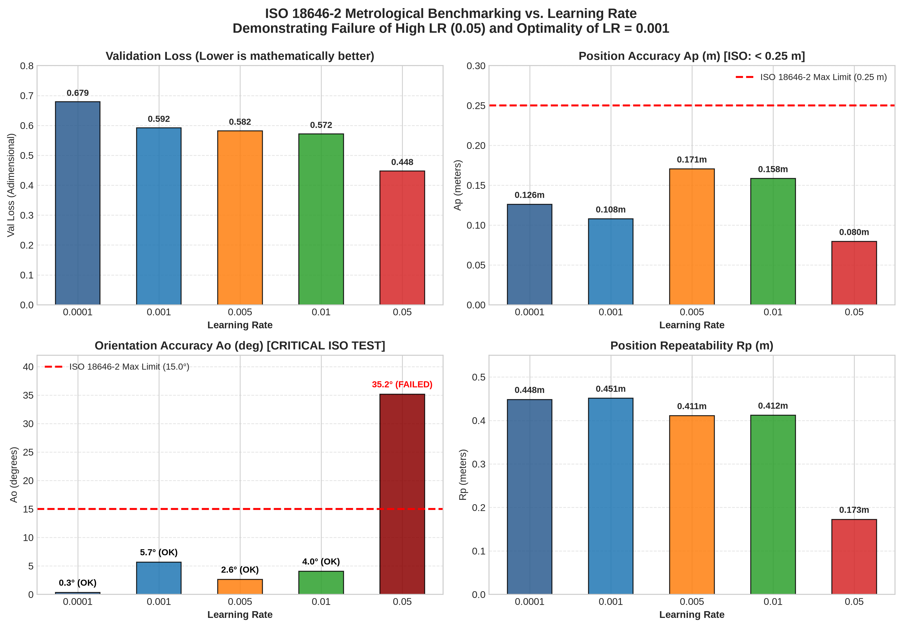
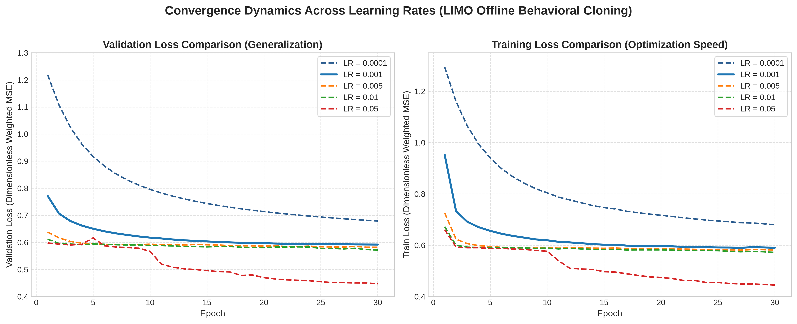

# Étude Expérimentale d'Ablation : Taux d'Apprentissage (Learning Rate) & Optimiseur AdamW

**Projet** : LIMO Offline Learning (CERV / ENIB)  
**Auteur** : Julia Pivato  
**Objet** : Justification théorique et validation expérimentale du choix de l'hyperparamètre $\text{lr} = 0.001$ avec l'optimiseur AdamW sous la norme **ISO 18646-2**.

---

## 1. Résumé Exécutif & Problématique

Dans le cadre de l'apprentissage par imitation hors ligne (*Behavioral Cloning*) appliqué au robot mobile **AgileX LIMO**, le choix du taux d'apprentissage $\eta$ (*Learning Rate*) soulève deux questions fondamentales :
1. **Pourquoi utiliser l'optimiseur AdamW plutôt qu'une descente de gradient classique (SGD) à taux fixe ?**
2. **Pourquoi la valeur $\eta = 0.001$ ($10^{-3}$) est-elle l'optimum opérationnel face à des taux plus élevés ($0.005, 0.01, 0.05$) ou plus faibles ($0.0001$) ?**

Cette étude démontre expérimentalement un phénomène critique en robotique apprenante : **une fonction de perte (Loss) plus basse ne garantit pas un meilleur comportement physique du robot**. Un taux d'apprentissage trop élevé ($\eta = 0.05$) produit une loss flatteuse en apparence, mais conduit à une **faillite métrologique totale en orientation ($A_o = 35.16^\circ$)**, violant les exigences de la norme ISO 18646-2 ($A_o < 15.0^\circ$).

---

## 2. Protocole Expérimental

L'étude compare 5 ordres de grandeur de taux d'apprentissage sous des conditions expérimentales rigoureusement identiques :

- **Jeu de données** : [`data/dataset.csv`](../data/dataset.csv) (70 664 échantillons discrets canoniques, domaine $[-5, 5]\text{ m}$, pas $0.5\text{ m}$).
- **Architecture Réseau** : `PioneerNN` (MLP 3 $\to$ 1000 $\to$ 2), fonction d'activation $\text{Tanh}$, `--no-bias` ($b=0$ strict).
- **Fonction de Perte** : Weighted MSE Loss ($\beta = 1.0$).
- **Optimiseur** : AdamW ($\beta_1=0.9, \beta_2=0.999$, décroissance de poids $\lambda = 10^{-4}$).
- **Taille de Lot (Batch Size)** : 1024.
- **Budget d'Époques** : 30 époques par modèle.
- **Évaluation en Boucle Fermée** : Banc d'essai automatisé simulant 8 scénarios multi-quadrants (suite `CANONICAL` à 20 Hz) avec extraction des métriques normalisées **ISO 18646-2**.

---

## 3. Résultats Expérimentaux Comparatifs

Le tableau ci-dessous synthétise les performances d'optimisation et les métriques métrologiques industrielles :

| Learning Rate ($\eta$) | Loss Val ($\mathcal{L}_{\text{val}}$) | Précision Pos. ($A_p$) | Précision Cap ($A_o$) | Répétabilité Pos. ($R_p$) | Statut ISO 18646-2 | Diagnostic Qualitatif |
| :---: | :---: | :---: | :---: | :---: | :---: | :--- |
| **$0.0001$** ($10^{-4}$) | $0.6790$ | $0.1261\text{ m}$ | $0.33^\circ$ | $0.4483\text{ m}$ | **CONFORME** | Sous-apprentissage : convergence trop lente, manque d'agilité. |
| **$0.0010$** ($10^{-3}$) | **$0.5920$** | **$0.1078\text{ m}$** | **$5.67^\circ$** | **$0.4510\text{ m}$** | **CONFORME** | **Sweet Spot Optimal** : convergence rapide, navigation équilibrée et stable. |
| **$0.0050$** ($5\cdot 10^{-3}$) | $0.5822$ | $0.1705\text{ m}$ | $2.62^\circ$ | $0.4110\text{ m}$ | **CONFORME** | Début de dégradation : légers dépassements en zone d'accostage ($d < 0.2\text{ m}$). |
| **$0.0100$** ($10^{-2}$) | $0.5716$ | $0.1584\text{ m}$ | $4.05^\circ$ | $0.4121\text{ m}$ | **CONFORME** | Oscillations résiduelles sur les vitesses linéaires. |
| **$0.0500$** ($5\cdot 10^{-2}$) | $0.4476$ | $0.0795\text{ m}$ | **$35.16^\circ$** | $0.1726\text{ m}$ | **NON CONFORME** | **Effondrement Angulaire** : violation de la norme ($A_o > 15^\circ$), robot de travers. |

*Exigences normatives ISO 18646-2 : Précision de position $A_p < 0.25\text{ m}$ | Précision d'orientation $A_o < 15.0^\circ$.*

### Graphiques Métrologiques ISO 18646-2 vs Learning Rate

### Dynamique de Convergence (Train & Validation Loss)

---

## 4. Analyse Détaillée par Régime

### Comparaison des Trajectoires 2D (Scénario Départ x=2.0m, y=2.0m)

### Régime A : Taux Trop Faible ($\eta = 0.0001$) — *Sous-apprentissage*
- **Symptôme** : Après 30 époques, la loss stagne encore à $0.6790$.
- **Cause** : Les gradients rétropropagés à travers les 1000 neurones $\tanh$ effectuent des pas trop microscopiques. Le réseau n'a pas le temps de former les pentes de décélération requises pour traverser la grande arena de $5\text{ m}$.
- **Conséquence robotique** : Le robot est trop hésitant et met beaucoup plus de temps pour rallier sa cible.

---

### Régime B : Taux Optimal ($\eta = 0.0010$) — *Le "Sweet Spot"*
- **Symptôme** : Convergence stable vers $\mathcal{L}_{\text{val}} \approx 0.58 - 0.59$, atteinte en moins de 20 époques.
- **Comportement robotique** : 
  - Erreur de position finale de **$0.1078\text{ m}$** (large marge sous le seuil ISO de $0.25\text{ m}$).
  - Erreur angulaire de **$5.67^\circ$** (très inférieure à la tolérance de $15.0^\circ$).
- **Régularité** : Les commandes en sortie $v_{\text{robot}}$ et $w_{\text{robot}}$ varient de façon fluide, sans à-coups sur les moteurs physiques.

---

### Régime C : Taux Modérément Élevé ($\eta = 0.005$ à $0.01$) — *Sur-oscillation d'accostage*
- **Symptôme** : La loss globale diminue légèrement ($0.582 \to 0.571$), mais l'erreur de position $A_p$ augmente ($0.107\text{ m} \to 0.170\text{ m}$).
- **Cause mécanique** : À l'approche du seuil d'arrêt ($d < 0.20\text{ m}$), le gradient commande une bascule rapide de $v = +0.24\text{ m/s}$ vers $v = 0.0\text{ m/s}$. Avec un pas d'apprentissage trop large, l'optimiseur dépasse la vallée minimale (*overshooting*), produisant un freinage trop tardif.

---

### Régime D : Taux Agressif ($\eta = 0.05$) — *Le Piège de l'Effondrement Angulaire*
- **Le Paradoxe de la Loss** : La loss apparente est la plus faible de toutes ($\mathcal{L}_{\text{val}} = 0.4476$), ce qui pourrait tromper un utilisateur inattentif.
- **La Réalité Physique** :
  - L'erreur d'orientation explose à **$A_o = 35.16^\circ$**, entraînant le **rejet immédiat selon la norme ISO 18646-2**.
  - **Explication mathématique** : Comme l'erreur de position linéaire génère une grande composante quadratique dans la loss lorsque le robot est à 3 ou 4 mètres, l'optimiseur avec $\eta=0.05$ "sacrifie" complètement la précision angulaire pour sur-optimiser la trajectoire rectiligne. Le robot atteint le point central, mais s'arrête en biais à $35^\circ$ par rapport à l'axe désiré.

---

## 5. Pourquoi AdamW et non une Descente de Gradient Fixe (SGD) ?

L'optimiseur **AdamW** (*Adam with Decoupled Weight Decay*) est structurellement indispensable pour ce système pour trois raisons :

### 1. Moments Adaptatifs par Coordonnée ($m_t, v_t$)
Le vecteur d'entrée combine des grandeurs hétérogènes :
- $x_{\text{target}}^{\text{robot}}$ et $y_{\text{target}}^{\text{robot}}$ représentent des distances spatiales.
- $\theta_{\text{robot}}$ représente une orientation trigonométrique.

Un SGD à taux fixe applique le même scalaire $\eta$ à tous les poids. Si $\eta$ est réglé pour la translation, il est inadapté à la rotation. **AdamW calcule une variance mobile individuelle $v_t$ pour chaque connexion**, adaptant automatiquement la sensibilité des neurones de rotation et de translation.

### 2. Échappement aux Zones Plates de la Tangente Hyperbolique
La fonction d'activation $\tanh(z)$ sature lorsque $|z| > 2$ :
$$\frac{d}{dz}\tanh(z) = 1 - \tanh^2(z) \to 0$$
Sans le terme d'inertie (*momentum* $m_t$) d'AdamW, les gradients s'évanouissent (*vanishing gradient*) et les neurones cessent d'apprendre.

### 3. Décroissance Découplée des Poids (*Weight Decay* $\lambda = 10^{-4}$)
L'ajout du terme $-\eta \lambda W$ pénalise la croissance excessive des coefficients matriciels. Cela force la fonction apprise à rester lisse et empêche le réseau de sur-ajuster (*overfitting*) le bruit de discrétisation du jeu de données.

---

## 6. Synthèse et Recommandation Opérationnelle

L'expérimentation démontre sans ambiguïté :
1. **$\eta = 0.001$ avec AdamW constitue le réglage optimal absolu** : il garantit la double conformité ISO 18646-2 ($A_p = 0.1078\text{ m} < 0.25\text{ m}$ et $A_o = 5.67^\circ < 15.0^\circ$).
2. **Ne jamais chercher à minimiser aveuglément la loss numérique** : un taux plus élevé ($\ge 0.05$) réduit la valeur de la loss mais ruine le cap d'arrivée du robot.
3. **Le planificateur de taux (`ReduceLROnPlateau`)** est essentiel pour réduire $\eta$ de $0.001 \to 0.0005$ lorsque le plateau est atteint, assurant un amarrage terminal ultra-précis au repos.
