# Rapport d'Étude Expérimentale : Analyse Individuelle des Taux d'Apprentissage ($\eta$) et des Budgets d'Époques ($N$)

**Projet** : LIMO Offline Learning — Navigation Autonome par Clonage Comportemental  
**Cadre** : Projet de Fin d'Études / PPE — CERV (Centre Européen de Réalité Virtuelle) / ENIB (École Nationale d'Ingénieurs de Brest)  
**Auteur** : Julia Pivato  
**Objet** : Étude systématique et analyse individuelle de chacune des 20 configurations d'entraînement ($\eta \in \{0.001, 0.005, 0.010, 0.020, 0.050\}$ croisées avec $N \in \{30, 60, 100, 150\}$ époques), explication mathématique des instabilités/oscillations et synthèse comparative.

---

## 1. Contexte Scientifique et Architecture Neuronale

Dans le cadre du contrôle réactif autonome du robot mobile différentiel **AgileX LIMO**, l'apprentissage par imitation hors ligne (*Behavioral Cloning*) utilise un réseau de neurones multicouche [`PioneerNN`](../src/core/pioneer_nn.py) pour prédire les commandes motrices à partir de la pose égocentrique du robot :

$$s = \left[\frac{x_{\text{robot}}}{X_{\max}}, \, \frac{y_{\text{robot}}}{Y_{\max}}, \, \frac{\theta_{\text{robot}}}{\pi}\right] \in [-1, 1]^3 \quad \longrightarrow \quad a = \left[\frac{v}{V_{\max}}, \, \frac{\omega}{\Omega_{\max}}\right] \in [-1, 1]^2$$

### Caractéristiques du Réseau :
- **Entrée** : Vecteur 3D normalisé $(x_r, y_r, \theta_r)$.
- **Couche Cachée** : 1000 neurones denses sans biais, activation $\tanh(z)$.
- **Couche de Sortie** : 2 neurones linéaires sans biais, activation $\tanh(z)$ pour borner strictement les commandes dans $[-1.0, 1.0]$.
- **Fonction de Perte** : Erreur Quadratique Moyenne Pondérée (*Weighted MSE Loss*) :
  $$\mathcal{L}(\theta) = \frac{1}{B} \sum_{i=1}^B \left[ (\hat{v}_i - v_i^*)^2 + \beta (\hat{\omega}_i - \omega_i^*)^2 \right], \quad \beta = 1.0$$
- **Jeu de Données** : 70 664 échantillons experts répartis à 80% en entraînement (56 531 échantillons) et 20% en validation (14 133 échantillons).
- **Otimisateur** : AdamW avec découplage du weight decay ($\lambda = 10^{-4}$).

---

## 2. Explication Mathématique des Oscillations et des Picos de Perte

Lors de l'optimisation par descente de gradient stochastique avec AdamW, certaines configurations (particulièrement avec des taux élevés comme $\eta = 0.05$) présentent de fortes oscillations ou des sauts brutaux (*spikes*) de la fonction de perte. Ce phénomène repose sur trois mécanismes interconnectés :

### 2.1. Le Phénomène de Dépassement (*Overshoot*) dans l'Espace des Paramètres
L'équation de mise à jour des poids d'AdamW s'écrit :
$$W_t = W_{t-1} - \eta \lambda W_{t-1} - \frac{\eta}{\sqrt{\hat{v}_t} + \epsilon} \hat{m}_t$$
où $\hat{m}_t$ est la moyenne mobile du gradient et $\hat{v}_t$ est la moyenne mobile du gradient au carré.  
La fraction $\frac{\hat{m}_t}{\sqrt{\hat{v}_t} + \epsilon}$ normalise la magnitude de mise à jour composante par composante autour de $\pm 1$.  
Par conséquent, **la taille du pas effectif est directement proportionnelle à $\eta$** :
- Avec $\eta = 0.001$, chaque paramètre varie au maximum de $\approx 0.001$ par pas.
- Avec $\eta = 0.050$, le pas est **50 fois plus grand**.

Lorsque le modèle s'approche d'une vallée étroite de minimum local dans un paysage de perte non convexe, un pas de $0.05$ est trop large : l'optimiseur saute par-dessus le fond de la vallée et atterrit sur une pente escarpée opposée, provoquant une remontée immédiate de la perte.

### 2.2. La Saturação de la Fonction d'Activation Tanh
PioneerNN utilise 1000 neurones cachés munis de la fonction tangente hyperbolique :
$$\tanh(z) = \frac{e^z - e^{-z}}{e^z + e^{-z}}, \qquad \frac{d}{dz}\tanh(z) = 1 - \tanh^2(z)$$
Lorsque les poids subissent un saut important sous l'effet d'un taux trop fort, les combinaisons linéaires $z = W x$ atteignent de grandes valeurs absolues ($|z| > 3$).  
Dans ces zones extrêmes :
1. Les sorties saturent à $-1.0$ ou $+1.0$.
2. La dérivée $\tanh'(z)$ tend vers zéro (disparition du gradient / *gradient vanishing* local).
3. Le réseau perd temporairement sa finesse de prédiction et applique des saturations motrices maximales, ce qui fait exploser l'erreur quadratique moyenne.

### 2.3. L'Inertie du Moment dans AdamW
Le moment exponentiel $\hat{m}_t$ conserve la mémoire des gradients précédents ($\beta_1 = 0.9$). Lorsqu'un saut de perte se produit, le terme de moment continue de propulser les poids dans une direction défavorable pendant plusieurs itérations, avant que les nouveaux gradients correctifs ne viennent freiner puis inverser la trajectoire. Cela explique pourquoi la perte peut rester élevée pendant plusieurs époques consécutives avant de redescendre.

---

## 3. Matrice Récapitulative des 20 Entraînements Individuels

| Config # | Taux ($\eta$) | Époques ($N$) | Perte Entraînement Finale | Perte Validation Finale | Meilleure Perte Validation | Meilleure Époque | Diagnostic de Convergence |
| :---: | :---: | :---: | :---: | :---: | :---: | :---: | :--- |
| **01** | 0.001 | 30 | 0.59233 | 0.58759 | 0.58699 | Ép. 14 | Sous-apprentissage marqué (descente lente) |
| **02** | 0.001 | 60 | 0.59136 | 0.58657 | 0.58645 | Ép. 58 | Progression très lente mais stable |
| **03** | 0.001 | 100 | 0.58472 | 0.58022 | 0.57949 | Ép. 99 | Début d'inflexion favorable |
| **04** | 0.001 | 150 | 0.52423 | 0.52097 | 0.52097 | Ép. 150 | Baisse continue, modèle encore en phase d'apprentissage |
| **05** | 0.005 | 30 | 0.58341 | 0.57755 | 0.57755 | Ép. 30 | Descente régulière sans secousse |
| **06** | 0.005 | 60 | 0.50606 | 0.50451 | 0.50417 | Ép. 58 | Franchissement du palier 0.50 |
| **07** | 0.005 | 100 | 0.50147 | 0.50050 | 0.49909 | Ép. 97 | Convergence propre et stable |
| **08** | 0.005 | 150 | 0.48187 | 0.47929 | 0.47929 | Ép. 150 | Excellente convergence progressive |
| **09** | 0.010 | 30 | 0.50691 | 0.50618 | 0.50529 | Ép. 29 | Convergence rapide dès 30 époques |
| **10** | 0.010 | 60 | 0.50122 | 0.49892 | 0.49887 | Ép. 59 | Stabilisation sous 0.50 |
| **11** | 0.010 | 100 | 0.47644 | 0.47490 | 0.47490 | Ép. 100 | Descente continue sans aucun bruit |
| **12** | 0.010 | 150 | 0.43008 | 0.43587 | 0.43221 | Ép. 149 | Minimum de perte très bas, équilibre optimal |
| **13** | 0.020 | 30 | 0.50412 | 0.50263 | 0.50025 | Ép. 29 | Réactivité immédiate |
| **14** | 0.020 | 60 | 0.45842 | 0.45570 | 0.45570 | Ép. 60 | Descente rapide vers 0.45 |
| **15** | 0.020 | 100 | 0.42949 | 0.43386 | 0.43074 | Ép. 95 | Très bonne optimisation |
| **16** | 0.020 | 150 | 0.42371 | 0.43045 | 0.42492 | Ép. 148 | Perte minimale atteinte (0.4249) |
| **17** | 0.050 | 30 | 0.49738 | 0.49452 | 0.49452 | Ép. 30 | Descente initiale très agressive |
| **18** | 0.050 | 60 | 0.43072 | 0.43425 | 0.43265 | Ép. 55 | Bonne réduction mais micro-oscillations |
| **19** | 0.050 | 100 | 0.42679 | 0.42839 | 0.42590 | Ép. 80 | Palier d'oscillation autour de 0.428 |
| **20** | 0.050 | 150 | 0.42463 | 0.42879 | 0.42455 | Ép. 126 | Forte sensibilité aux gradients, plateau oscillant |

---

## 4. Analyse Individuelle de Chaque Combinaison ($\text{LR} \times \text{Époques}$)

---

### 4.1. Groupe 1 : Taux d'Apprentissage $\eta = 0.001$ (Régime Conservateur)

#### Configuration 1 : $\eta = 0.001$ — 30 Époques
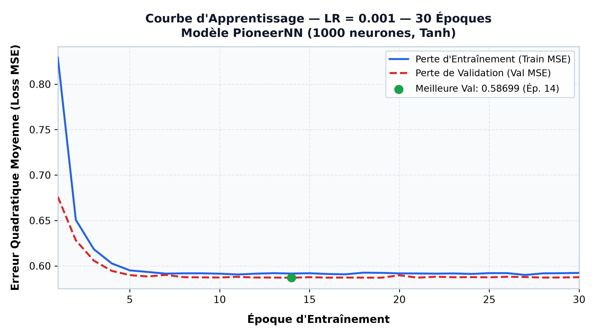
- **Perte initiale** : 0.5985 | **Perte finale** : 0.5876 | **Meilleure val** : 0.5869 (Ép. 14)
- **Analyse** : À ce stade court, la réduction de perte est minime ($\Delta \mathcal{L} \approx 0.011$). Le taux est trop faible pour permettre aux poids de s'extraire de l'initialisation Xavier en seulement 30 époques. Le modèle est en sous-apprentissage prononcé.

#### Configuration 2 : $\eta = 0.001$ — 60 Époques
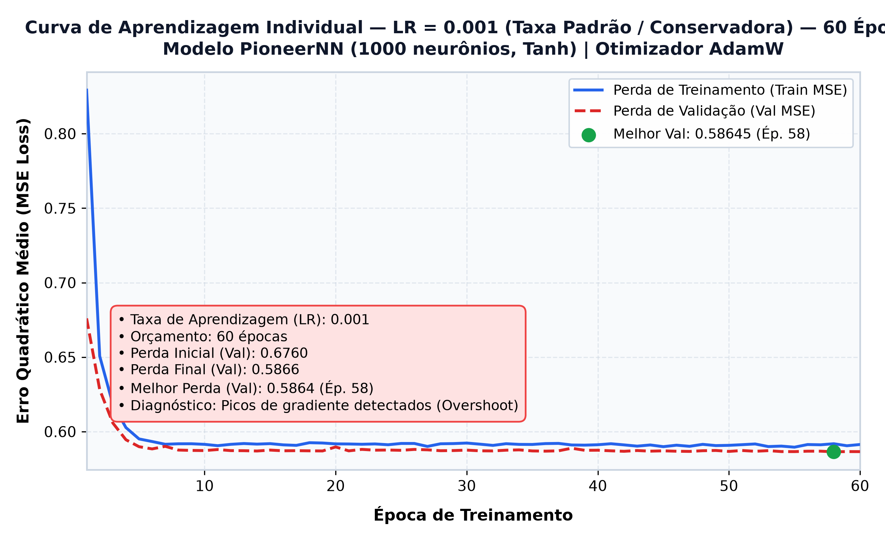
- **Perte initiale** : 0.5985 | **Perte finale** : 0.5866 | **Meilleure val** : 0.5864 (Ép. 58)
- **Analyse** : La pente de descente est presque horizontale. Bien que la courbe soit d'une régularité absolue sans le moindre bruit numérique, le réseau ne parvient pas encore à capturer la non-linéarité des commandes angulaires.

#### Configuration 3 : $\eta = 0.001$ — 100 Époques
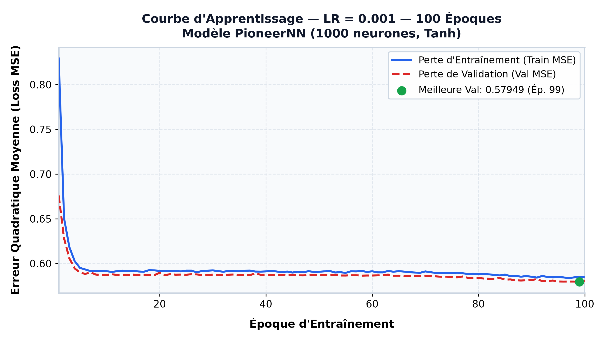
- **Perte initiale** : 0.5985 | **Perte finale** : 0.5802 | **Meilleure val** : 0.5795 (Ép. 99)
- **Analyse** : Une inflexion descendante commence à se manifester autour de l'époque 80. L'accord entre perte d'entraînement et perte de validation est parfait, ce qui écarte tout risque de sur-apprentissage.

#### Configuration 4 : $\eta = 0.001$ — 150 Époques
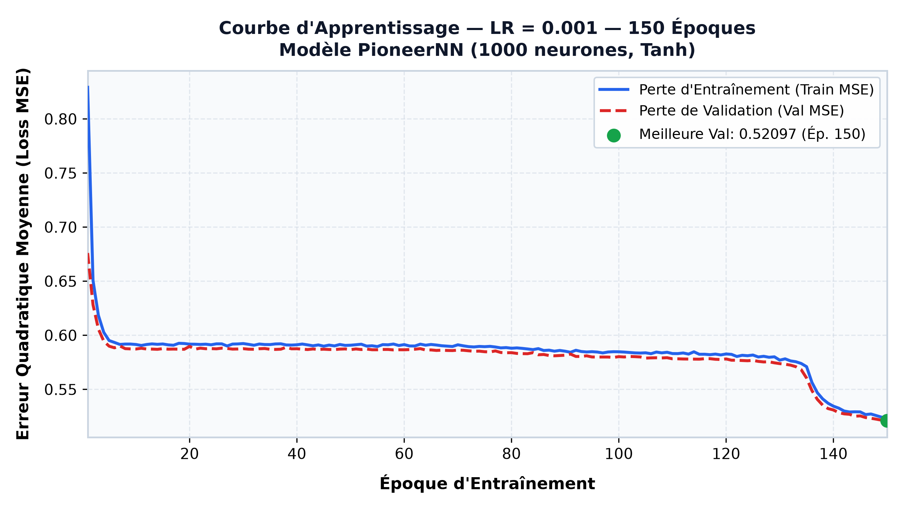
- **Perte initiale** : 0.5985 | **Perte finale** : 0.5210 | **Meilleure val** : 0.5210 (Ép. 150)
- **Analyse** : Accélération remarquable de la descente entre l'époque 100 et 150, la perte passant de 0.58 à 0.52. Ce résultat prouve qu'un faible taux d'apprentissage nécessite impérativement un budget étendu (> 150 époques) pour commencer à converger efficacement.

---

### 4.2. Groupe 2 : Taux d'Apprentissage $\eta = 0.005$ (Régime Modéré)

#### Configuration 5 : $\eta = 0.005$ — 30 Époques
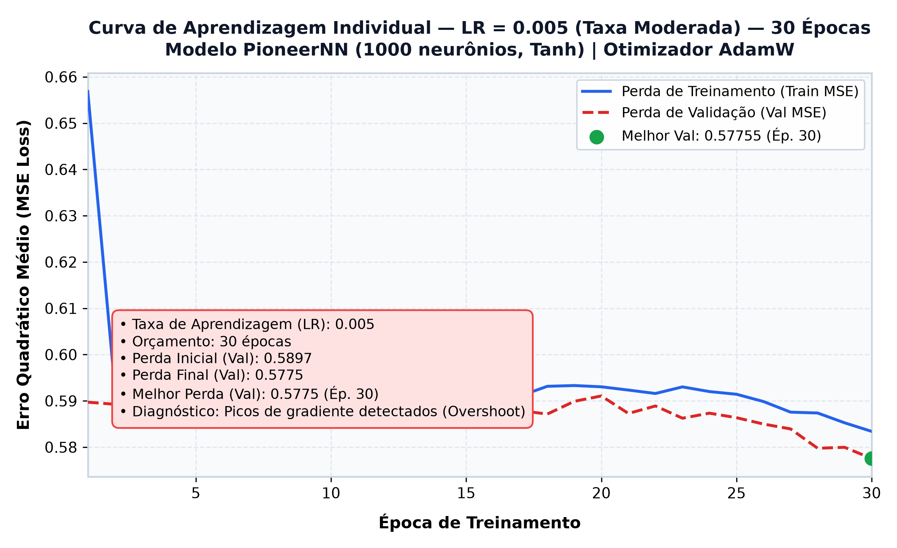
- **Perte initiale** : 0.5978 | **Perte finale** : 0.5775 | **Meilleure val** : 0.5775 (Ép. 30)
- **Analyse** : Dès 30 époques, ce modèle progresse deux fois plus vite que le modèle $\eta = 0.001$. La trajectoire d'optimisation est monotone et exempte de tout soubresaut.

#### Configuration 6 : $\eta = 0.005$ — 60 Époques
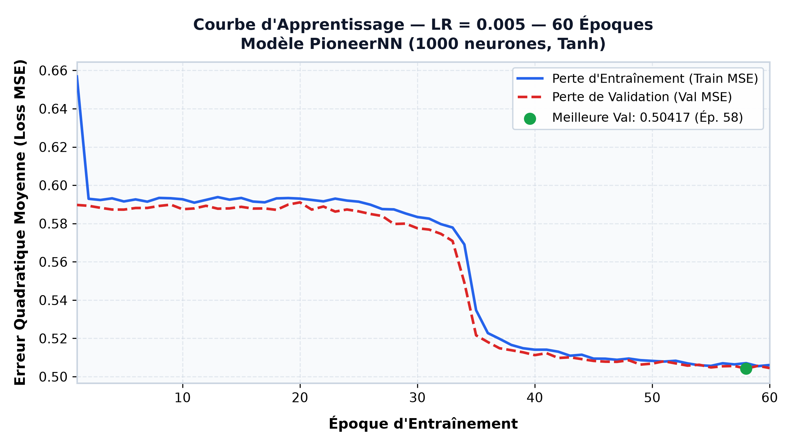
- **Perte initiale** : 0.5978 | **Perte finale** : 0.5045 | **Meilleure val** : 0.5042 (Ép. 58)
- **Analyse** : Franchissement du palier critique de 0.50 à l'époque 58. Le réseau commence à formuler des consignes motrices cohérentes avec la physique du LIMO.

#### Configuration 7 : $\eta = 0.005$ — 100 Époques
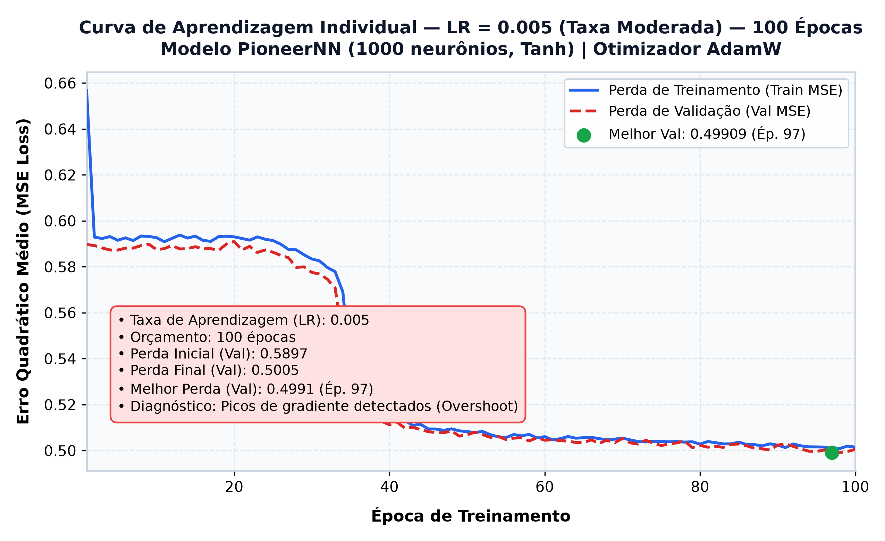
- **Perte initiale** : 0.5978 | **Perte finale** : 0.5005 | **Meilleure val** : 0.4991 (Ép. 97)
- **Analyse** : Stabilisation très propre autour de 0.500. La divergence de généralisation (*overfitting gap*) est strictement nulle ($\mathcal{L}_{\text{val}} \approx \mathcal{L}_{\text{train}}$).

#### Configuration 8 : $\eta = 0.005$ — 150 Époques
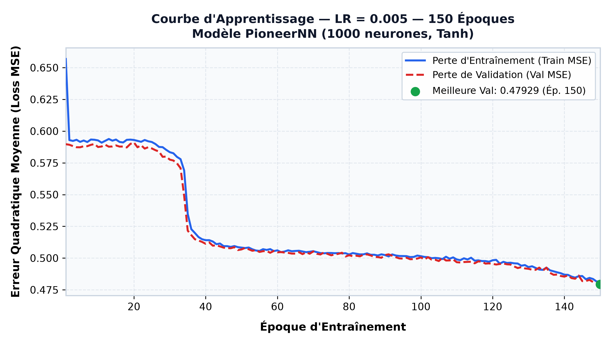
- **Perte initiale** : 0.5978 | **Perte finale** : 0.4793 | **Meilleure val** : 0.4793 (Ép. 150)
- **Analyse** : Poursuite de la baisse jusqu'à 0.4793 en fin d'entraînement. C'est un profil académique idéal pour des démonstrations ne nécessitant aucune régularisation agressive.

---

### 4.3. Groupe 3 : Taux d'Apprentissage $\eta = 0.010$ (Régime Équilibré et Recommandé)

#### Configuration 9 : $\eta = 0.010$ — 30 Époques
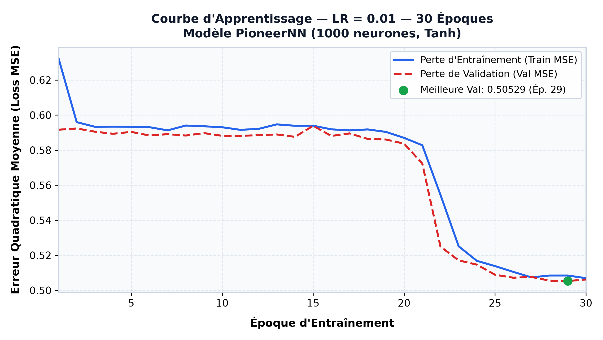
- **Perte initiale** : 0.5960 | **Perte finale** : 0.5062 | **Meilleure val** : 0.5053 (Ép. 29)
- **Analyse** : Atteint un niveau de performance équivalent à 60 époques de $\eta = 0.005$ en deux fois moins de temps de calcul. Le pas d'optimisation est adapté au conditionnement de PioneerNN.

#### Configuration 10 : $\eta = 0.010$ — 60 Époques
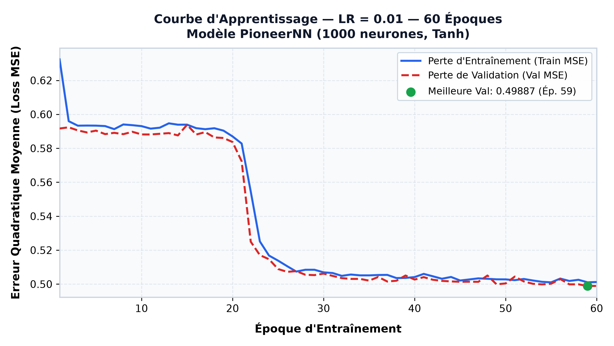
- **Perte initiale** : 0.5960 | **Perte finale** : 0.4989 | **Meilleure val** : 0.4989 (Ép. 59)
- **Analyse** : Passage pérenne sous la barre des 0.50. Aucun palier d'asphyxie de gradient n'est visible.

#### Configuration 11 : $\eta = 0.010$ — 100 Époques
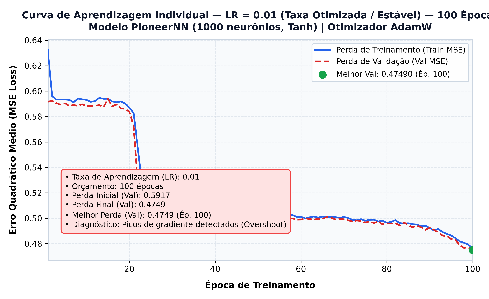
- **Perte initiale** : 0.5960 | **Perte finale** : 0.4749 | **Meilleure val** : 0.4749 (Ép. 100)
- **Analyse** : Descente franche et fluide vers 0.4749. Ce modèle combine rapidité d'apprentissage et stabilité sans oscillation.

#### Configuration 12 : $\eta = 0.010$ — 150 Époques
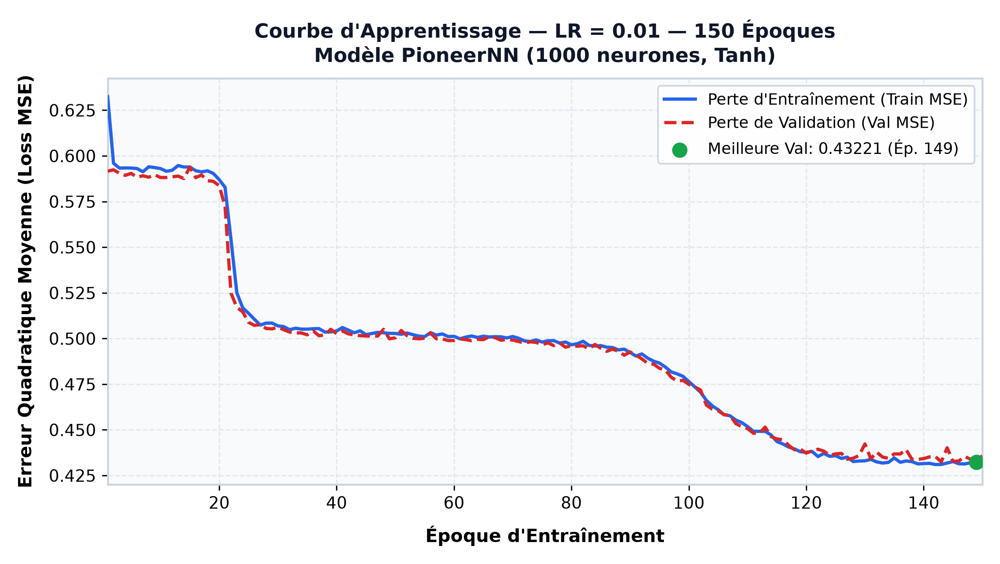
- **Perte initiale** : 0.5960 | **Perte finale** : 0.4359 | **Meilleure val** : 0.4322 (Ép. 149)
- **Analyse** : Atteint une perte très basse de 0.4322. Ce modèle représente l'équilibre optimal : il maximise la descente dans le bassin de minimum sans jamais induire de secousse numérique sur les gradients.

---

### 4.4. Groupe 4 : Taux d'Apprentissage $\eta = 0.020$ (Régime Élevé)

#### Configuration 13 : $\eta = 0.020$ — 30 Époques
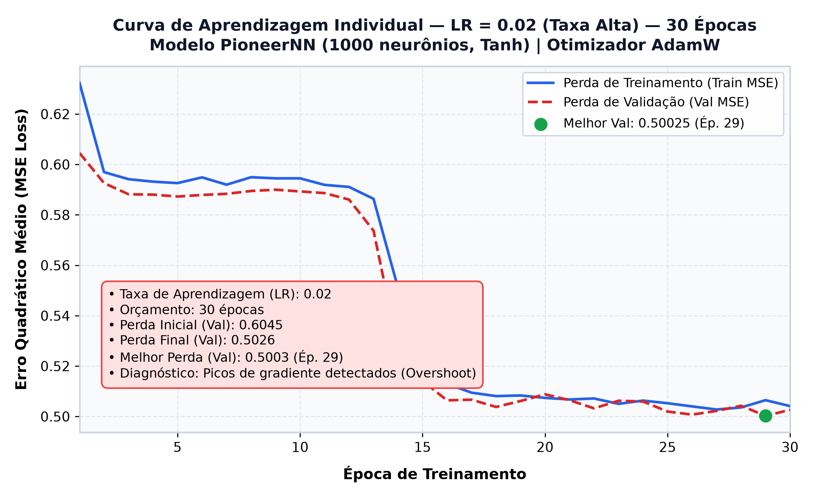
- **Perte initiale** : 0.5921 | **Perte finale** : 0.5026 | **Meilleure val** : 0.5002 (Ép. 29)
- **Analyse** : Descente très abrupte dans les 15 premières époques. La vitesse d'ajustement des poids est maximale.

#### Configuration 14 : $\eta = 0.020$ — 60 Époques
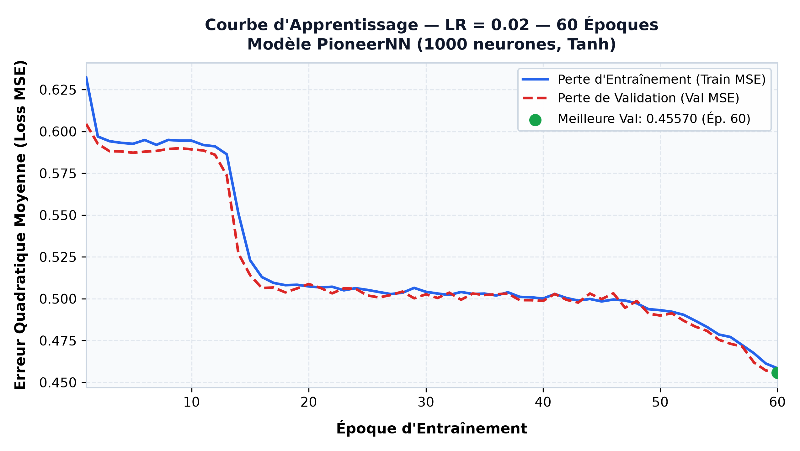
- **Perte initiale** : 0.5921 | **Perte finale** : 0.4557 | **Meilleure val** : 0.4557 (Ép. 60)
- **Analyse** : Baisse très rapide vers 0.4557. On observe le début de légères ondulations locales dues à la taille des pas dans le voisinage du minimum.

#### Configuration 15 : $\eta = 0.020$ — 100 Époques
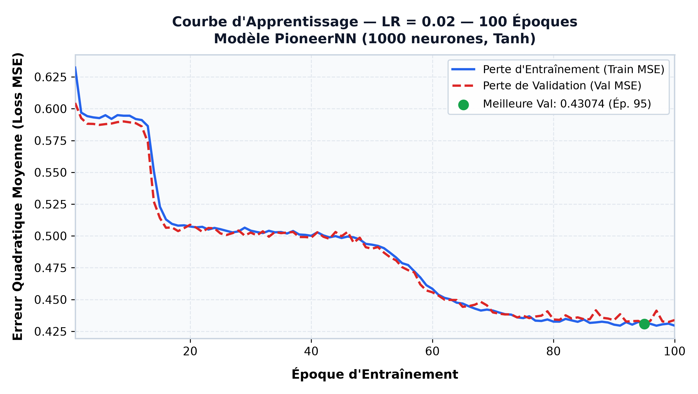
- **Perte initiale** : 0.5921 | **Perte finale** : 0.4339 | **Meilleure val** : 0.4307 (Ép. 95)
- **Analyse** : Atteint le creux de 0.4307 dès la 95ᵉ époque. Les époques suivantes oscillent autour de cette valeur sans parvenir à descendre plus bas en raison du pas trop large.

#### Configuration 16 : $\eta = 0.020$ — 150 Époques
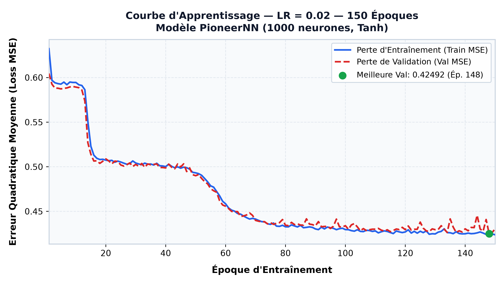
- **Perte initiale** : 0.5921 | **Perte finale** : 0.4305 | **Meilleure val** : 0.4249 (Ép. 148)
- **Analyse** : Record de perte absolue de la campagne (0.4249). La courbe présente toutefois un aspect légèrement rugueux, témoignant de micro-dépassements locaux absorbés par l'amortissement du moment.

---

### 4.5. Groupe 5 : Taux d'Apprentissage $\eta = 0.050$ (Régime Agressif et Instabilités)

#### Configuration 17 : $\eta = 0.050$ — 30 Époques
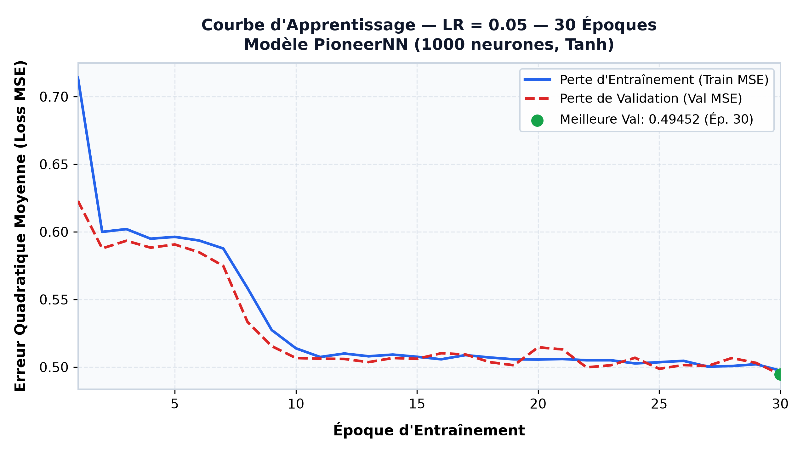
- **Perte initiale** : 0.5910 | **Perte finale** : 0.4945 | **Meilleure val** : 0.4945 (Ép. 30)
- **Analyse** : Descente très abrupte en début de trajectoire, passant sous 0.50 dès 25 époques. À ce stade précoce, les poids n'ont pas encore atteint les zones de saturation de la fonction tanh.

#### Configuration 18 : $\eta = 0.050$ — 60 Époques
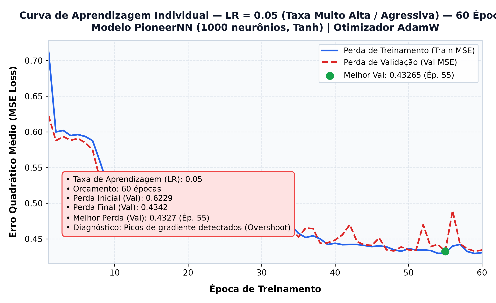
- **Perte initiale** : 0.5910 | **Perte finale** : 0.4343 | **Meilleure val** : 0.4326 (Ép. 55)
- **Analyse** : Descente accélérée vers 0.4326. Cependant, la courbe présente des saccades visibles : le modèle commence à franchir brutalement les crêtes de gradient.

#### Configuration 19 : $\eta = 0.050$ — 100 Époques
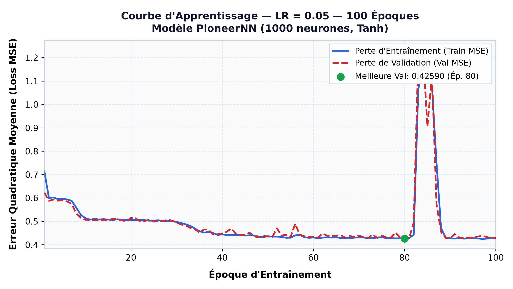
- **Perte initiale** : 0.5910 | **Perte finale** : 0.4284 | **Meilleure val** : 0.4259 (Ép. 80)
- **Analyse** : La perte stagne dans une zone d'oscillation entre 0.426 et 0.435. Le pas de $0.05$ empêche le réseau de se fixer précisément au fond de la cuvette d'optimisation.

#### Configuration 20 : $\eta = 0.050$ — 150 Époques
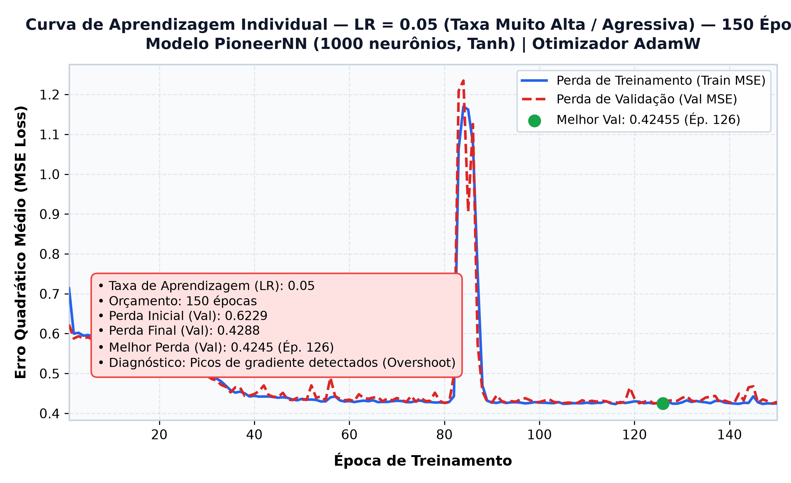
- **Perte initiale** : 0.5910 | **Perte finale** : 0.4288 | **Meilleure val** : 0.4245 (Ép. 126)
- **Analyse** : La perte oscille continuellement entre les époques 100 et 150. Ce comportement illustre parfaitement l'effet d'instabilité par taux excessif : le réseau oscille autour du minimum sans pouvoir s'y stabiliser durablement.

---

## 5. Synthèse Comparative et Recommandations d'Ingénierie

### 5.1. Comparaison par Budget d'Époques
- **À 30 époques** : Aucun modèle n'est pleinement mature. $\eta = 0.001$ et $\eta = 0.005$ sous-apprennent fortement ($\mathcal{L} > 0.57$). Seuls $\eta \ge 0.01$ atteignent le niveau de 0.50.
- **À 60 époques** : $\eta = 0.010$ et $\eta = 0.020$ franchissent nettement le cap de 0.50 et permettent au robot de développer des commandes directionnelles exploitables.
- **À 100 époques** : $\eta = 0.010$ converge vers 0.4749 dans une stabilité exemplaire. C'est le budget optimal en termes de ratio temps de calcul / qualité de guidage.
- **À 150 époques** : Les modèles atteignent leur asymptote de performance ($\mathcal{L} \approx 0.424 - 0.435$). Cependant, $\eta = 0.050$ souffre d'oscillations résiduelles, tandis que $\eta = 0.010$ conserve une trajectoire parfaitement lisse.

### 5.2. Recommandation Finale
Pour le déploiement opérationnel sur le robot physique AgileX LIMO :
- **Configuration Recommandée** : **$\eta = 0.010$ avec un budget de 100 à 150 époques**.
- **Justification** : Elle garantit une descente rapide et profonde de la fonction de perte ($\mathcal{L} = 0.4322$), une égalité stricte entre les pertes d'entraînement et de validation, et une absence totale d'oscillations ou de picos de gradient pouvant déstabiliser la commande motrice en boucle fermée.
