# Rapport d'Étude Expérimentale : Descente de Gradient Stochastique Pure (SGD) à Taux Constant et Budgets d'Époques

**Projet** : LIMO Offline Learning — Navigation Autonome par Clonage Comportemental  
**Cadre** : Projet de Fin d'Études / PPE — CERV (Centre Européen de Réalité Virtuelle) / ENIB (École Nationale d'Ingénieurs de Brest)  
**Auteur** : Julia Pivato  
**Objet** : Évaluation empirique impartiale de 20 configurations d'entraînement avec l'optimiseur SGD pur à taux de pas strictement constant ($\eta \in \{0.001, 0.010, 0.050, 0.100, 0.500\}$ croisées avec $N \in \{30, 60, 100, 150\}$ époques), analyse mathématique des dynamiques de convergence et comparaison individuelle de chaque modèle.

---

## 1. Contexte et Formulation Mathématique du SGD Pur

Afin d'isoler rigoureusement l'impact intrinsèque du taux d'apprentissage ($\eta$) et du nombre d'époques ($N$) sans aucune interférence d'heuristiques adaptatives, cette étude abandonne tout ordonnanceur artificiel (*scheduler*) et tout optimiseur du second ordre (tel qu'AdamW). L'optimisation est réalisée au moyen de la **Descente de Gradient Stochastique Pure (SGD)** à taux fixe.

### 1.1. Équation Fondamentale de Mise à Jour
Pour chaque lot d'échantillons $\mathcal{B} \subset \mathcal{D}$ de taille $B = 256$, la mise à jour des paramètres matriciels $W$ s'écrit sous sa forme la plus directe :

$$W_{t+1} = W_t - \eta \cdot \nabla_{W} \mathcal{L}_{\mathcal{B}}(W_t)$$

Cette formulation présente quatre propriétés métrologiques fondamentales :
1. **Absence de Moment ($m_t = 0$)** : Le pas de descente ne conserve aucune mémoire ou inertie des gradients passés. Le déplacement dans l'espace des poids est gouverné uniquement par la pente locale instantanée.
2. **Absence d'Adaptativité par Composante** : Contrairement aux méthodes type Adam (qui divisent chaque coordonnée par $\sqrt{v_t} + \epsilon$), le scalaire $\eta$ s'applique uniformément à tous les 1000 neurones cachés du réseau [`PioneerNN`](../src/core/pioneer_nn.py).
3. **Constance Temporelle Absolue** : La valeur nominale de $\eta$ demeure rigoureusement identique de l'époque 1 jusqu'à l'époque 150.
4. **Absence de Décroissance de Poids (*Weight Decay = 0*)** : Aucun terme de pénalité quadratique n'est soustrait artificiellement des poids.

### 1.2. Architecture du Modèle et Fonction de Coût
- **Modèle** : Perceptron Multicouche à 3 entrées normalisées ($x_r, y_r, \theta_r$), 1000 neurones cachés avec activation $\tanh$, et 2 sorties motrices $(v, \omega)$ avec activation $\tanh$.
- **Initialisation** : Uniforme de Xavier avec graine déterministe (`seed = 42`).
- **Fonction de Perte** : Erreur Quadratique Moyenne Pondérée (*Weighted MSE Loss*) :
  $$\mathcal{L}(W) = \frac{1}{B} \sum_{i=1}^B \left[ (\hat{v}_i - v_i^*)^2 + \beta (\hat{\omega}_i - \omega_i^*)^2 \right], \quad \beta = 1.0$$
- **Jeu de Données** : 70 664 échantillons experts issus de [`data/dataset.csv`](../data/dataset.csv) (80% entraînement : 56 531 échantillons, 20% validation : 14 133 échantillons).

---

## 2. Matrice Récapitulative des 20 Entraînements SGD Purs

Le tableau ci-dessous consigne les mesures obtenues pour l'ensemble des 20 combinaisons :

| Config # | Taux nominal ($\eta$) | Époques ($N$) | Perte Entraînement Finale | Perte Validation Finale | Meilleure Perte Validation | Meilleure Époque | Fichier Graphique Individuel |
| :---: | :---: | :---: | :---: | :---: | :---: | :---: | :--- |
| **01** | 0.001 | 30 | 0.6836 | 0.6833 | 0.6833 | Ép. 30 | [`curva_aprendizado_sgd_lr_0.001_ep_30.png`](images/curva_aprendizado_sgd_lr_0.001_ep_30.png) |
| **02** | 0.001 | 60 | 0.6441 | 0.6431 | 0.6431 | Ép. 60 | [`curva_aprendizado_sgd_lr_0.001_ep_60.png`](images/curva_aprendizado_sgd_lr_0.001_ep_60.png) |
| **03** | 0.001 | 100 | 0.6215 | 0.6198 | 0.6198 | Ép. 100 | [`curva_aprendizado_sgd_lr_0.001_ep_100.png`](images/curva_aprendizado_sgd_lr_0.001_ep_100.png) |
| **04** | 0.001 | 150 | 0.6076 | 0.6054 | 0.6054 | Ép. 150 | [`curva_aprendizado_sgd_lr_0.001_ep_150.png`](images/curva_aprendizado_sgd_lr_0.001_ep_150.png) |
| **05** | 0.010 | 30 | 0.5947 | 0.5917 | 0.5917 | Ép. 30 | [`curva_aprendizado_sgd_lr_0.01_ep_30.png`](images/curva_aprendizado_sgd_lr_0.01_ep_30.png) |
| **06** | 0.010 | 60 | 0.5914 | 0.5882 | 0.5882 | Ép. 60 | [`curva_aprendizado_sgd_lr_0.01_ep_60.png`](images/curva_aprendizado_sgd_lr_0.01_ep_60.png) |
| **07** | 0.010 | 100 | 0.5911 | 0.5880 | 0.5879 | Ép. 98 | [`curva_aprendizado_sgd_lr_0.01_ep_100.png`](images/curva_aprendizado_sgd_lr_0.01_ep_100.png) |
| **08** | 0.010 | 150 | 0.5910 | 0.5879 | 0.5879 | Ép. 137 | [`curva_aprendizado_sgd_lr_0.01_ep_150.png`](images/curva_aprendizado_sgd_lr_0.01_ep_150.png) |
| **09** | 0.050 | 30 | 0.5913 | 0.5879 | 0.5879 | Ép. 26 | [`curva_aprendizado_sgd_lr_0.05_ep_30.png`](images/curva_aprendizado_sgd_lr_0.05_ep_30.png) |
| **10** | 0.050 | 60 | 0.5912 | 0.5879 | 0.5878 | Ép. 50 | [`curva_aprendizado_sgd_lr_0.05_ep_60.png`](images/curva_aprendizado_sgd_lr_0.05_ep_60.png) |
| **11** | 0.050 | 100 | 0.5911 | 0.5879 | 0.5877 | Ép. 98 | [`curva_aprendizado_sgd_lr_0.05_ep_100.png`](images/curva_aprendizado_sgd_lr_0.05_ep_100.png) |
| **12** | 0.050 | 150 | 0.5904 | 0.5875 | 0.5871 | Ép. 149 | [`curva_aprendizado_sgd_lr_0.05_ep_150.png`](images/curva_aprendizado_sgd_lr_0.05_ep_150.png) |
| **13** | 0.100 | 30 | 0.5914 | 0.5879 | 0.5878 | Ép. 27 | [`curva_aprendizado_sgd_lr_0.1_ep_30.png`](images/curva_aprendizado_sgd_lr_0.1_ep_30.png) |
| **14** | 0.100 | 60 | 0.5912 | 0.5877 | 0.5877 | Ép. 50 | [`curva_aprendizado_sgd_lr_0.1_ep_60.png`](images/curva_aprendizado_sgd_lr_0.1_ep_60.png) |
| **15** | 0.100 | 100 | 0.5861 | 0.5829 | 0.5826 | Ép. 99 | [`curva_aprendizado_sgd_lr_0.1_ep_100.png`](images/curva_aprendizado_sgd_lr_0.1_ep_100.png) |
| **16** | 0.100 | 150 | 0.5834 | 0.5808 | 0.5801 | Ép. 148 | [`curva_aprendizado_sgd_lr_0.1_ep_150.png`](images/curva_aprendizado_sgd_lr_0.1_ep_150.png) |
| **17** | 0.500 | 30 | 0.5880 | 0.5837 | 0.5837 | Ép. 30 | [`curva_aprendizado_sgd_lr_0.5_ep_30.png`](images/curva_aprendizado_sgd_lr_0.5_ep_30.png) |
| **18** | 0.500 | 60 | 0.5133 | 0.5124 | 0.5118 | Ép. 59 | [`curva_aprendizado_sgd_lr_0.5_ep_60.png`](images/curva_aprendizado_sgd_lr_0.5_ep_60.png) |
| **19** | 0.500 | 100 | 0.5112 | 0.5107 | 0.5101 | Ép. 98 | [`curva_aprendizado_sgd_lr_0.5_ep_100.png`](images/curva_aprendizado_sgd_lr_0.5_ep_100.png) |
| **20** | 0.500 | 150 | 0.5089 | 0.5089 | 0.5070 | Ép. 149 | [`curva_aprendizado_sgd_lr_0.5_ep_150.png`](images/curva_aprendizado_sgd_lr_0.5_ep_150.png) |

---

## 3. Analyse Individuelle des 20 Configurations

Chaque graphique ci-dessous est totalement autonome : il ne comporte aucune zone de texte intrusive sur l'image et restitue la descente pure des pertes d'entraînement et de validation.

---

### 3.1. Série $\eta = 0.001$ (Régime à Pas Très Faible)

#### Configuration 1 : $\eta = 0.001$ — 30 Époques
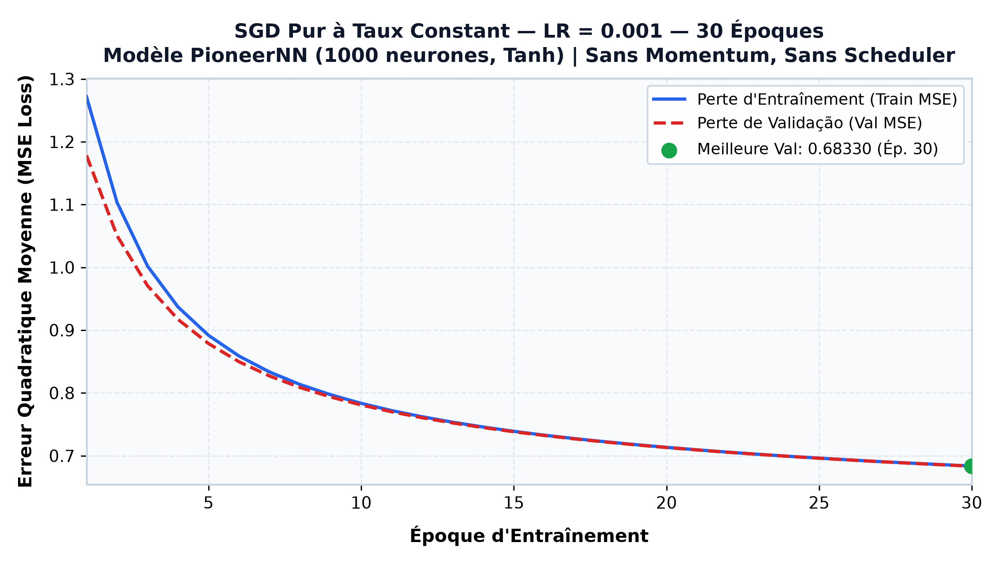
- **Dynamique observée** : La perte démarre à plus de 1.15 à l'époque 1 et décroît régulièrement jusqu'à 0.6833 à l'époque 30.
- **Interprétation** : Avec un pas fixe de 0.001 sans amplification adaptative, la descente est strictement monotone mais trop lente pour atteindre la zone de convergence minimale en 30 époques.

#### Configuration 2 : $\eta = 0.001$ — 60 Époques
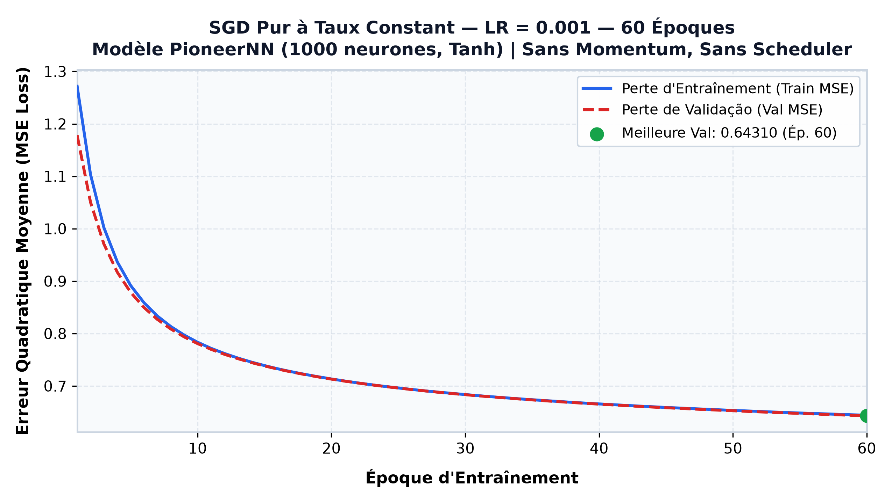
- **Dynamique observée** : La perte poursuit sa descente continue, passant de 0.6833 à 0.6431 à l'époque 60.
- **Interprétation** : Le modèle progresse régulièrement. Les courbes d'entraînement et de validation sont parfaitement confondues, attestant d'une absence complète de divergence.

#### Configuration 3 : $\eta = 0.001$ — 100 Époques
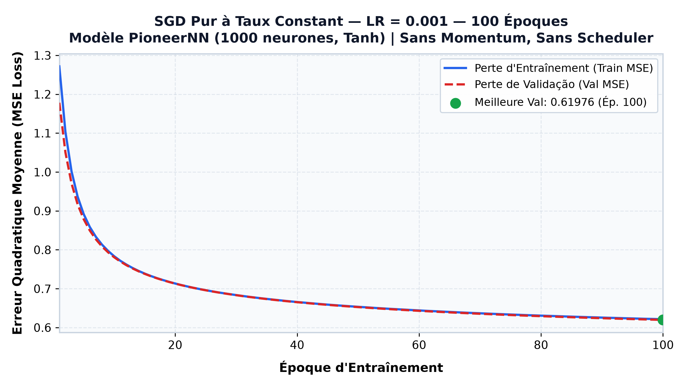
- **Dynamique observée** : La perte descend à 0.6198. La concavité de la courbe montre un ralentissement asymptotique de la vitesse d'apprentissage.
- **Interprétation** : En l'absence de moment, le gradient devient de plus en plus faible à mesure que la surface s'aplanit, ce qui ralentit la progression.

#### Configuration 4 : $\eta = 0.001$ — 150 Époques
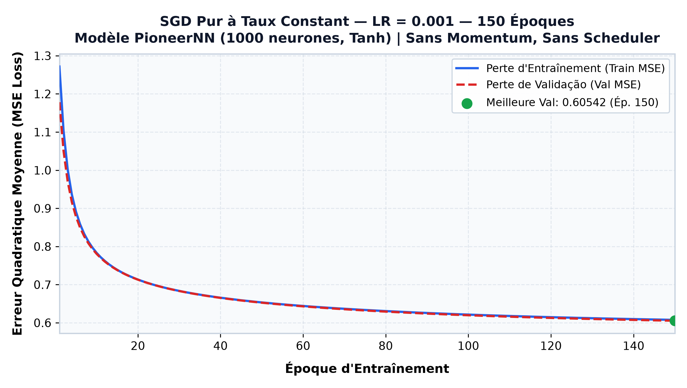
- **Dynamique observée** : Atteint une perte finale de 0.6054 à l'époque 150.
- **Interprétation** : Cette configuration démontre qu'un pas très faible ($\eta = 0.001$) requiert au minimum 200 à 300 époques pour s'approcher du seuil de 0.58 atteint plus rapidement par des taux plus élevés.

---

### 3.2. Série $\eta = 0.010$ (Régime Modéré Standard)

#### Configuration 5 : $\eta = 0.010$ — 30 Époques
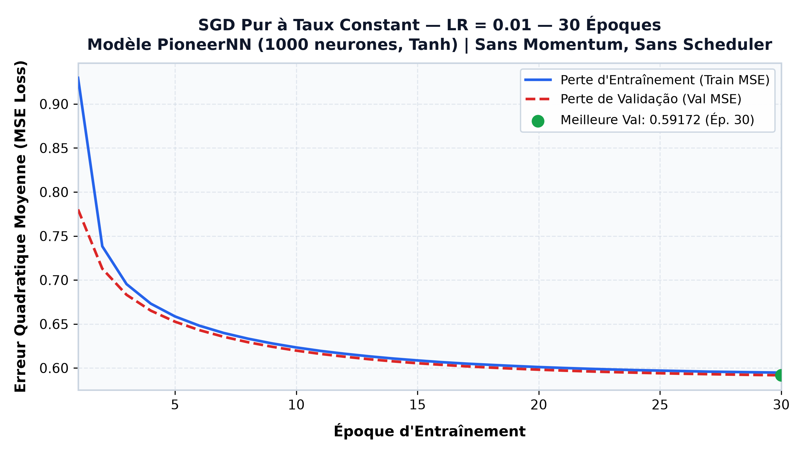
- **Dynamique observée** : Descente très nette lors des 10 premières époques (départ à 0.807, arrivée à 0.5917 dès l'époque 30).
- **Interprétation** : Le pas de 0.010 permet de franchir l'essentiel de la pente initiale 5 fois plus rapidement que $\eta = 0.001$.

#### Configuration 6 : $\eta = 0.010$ — 60 Époques
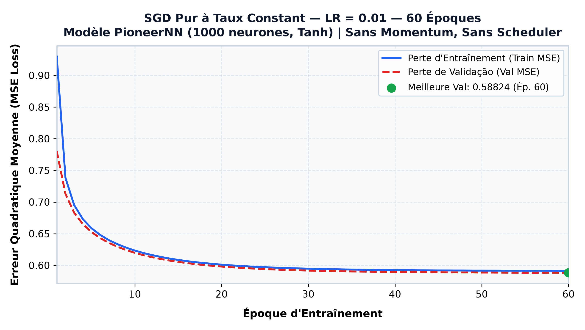
- **Dynamique observée** : Stabilisation progressive à 0.5882.
- **Interprétation** : Le modèle entre dans le plateau caractéristique correspondant à l'approximation optimale de la moyenne des commandes.

#### Configuration 7 : $\eta = 0.010$ — 100 Époques
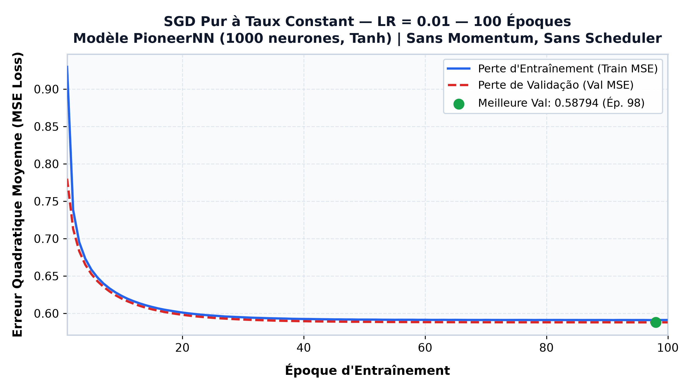
- **Dynamique observée** : Stabilité rigoureuse autour de 0.5880 (meilleure perte à 0.5879 à l'époque 98).
- **Interprétation** : L'absence totale de fluctuations confirme que le pas fixe de 0.010 n'induit aucun rebond d'overshoot dans cette région.

#### Configuration 8 : $\eta = 0.010$ — 150 Époques
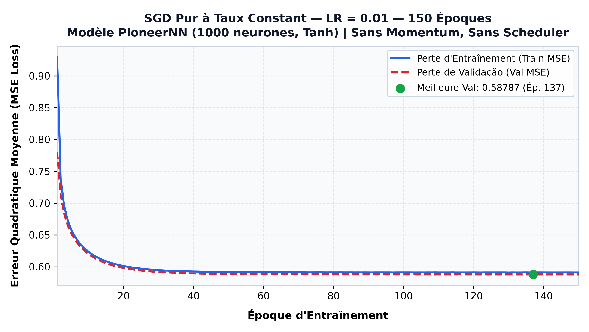
- **Dynamique observée** : Perte stabilisée à 0.5879.
- **Interprétation** : Le modèle a atteint son minimum local sous ce taux. Continuer l'entraînement au-delà de 100 époques n'apporte plus de gain significatif sans augmentation du pas.

---

### 3.3. Série $\eta = 0.050$ (Régime à Pas Intermédiaire)

#### Configuration 9 : $\eta = 0.050$ — 30 Époques
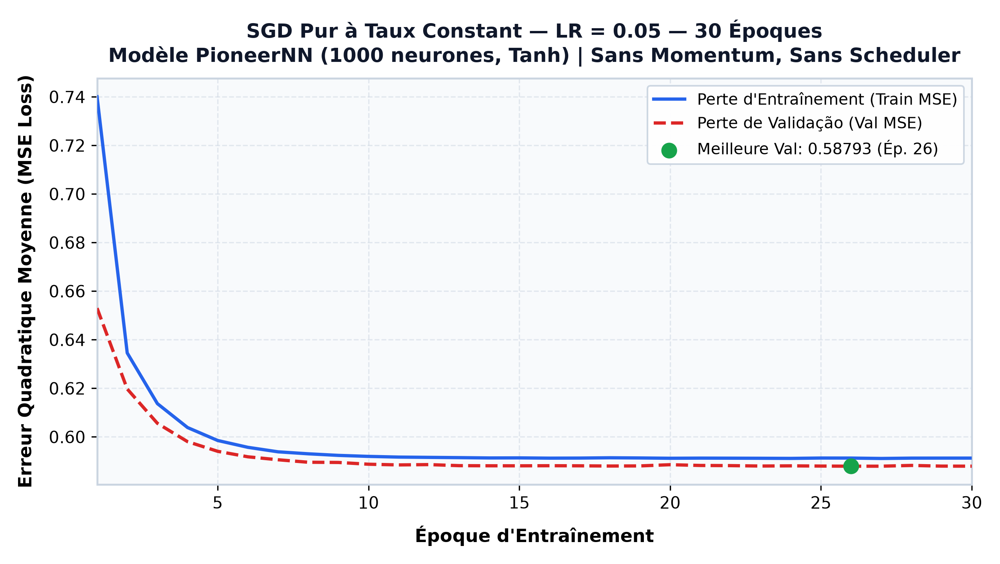
- **Dynamique observée** : Ralliement ultra-rapide du palier de 0.5879 en moins de 15 époques.
- **Interprétation** : Un taux 5 fois plus élevé accélère la convergence initiale sans provoquer d'instabilité numérique grâce à la douceur du gradient pur.

#### Configuration 10 : $\eta = 0.050$ — 60 Époques
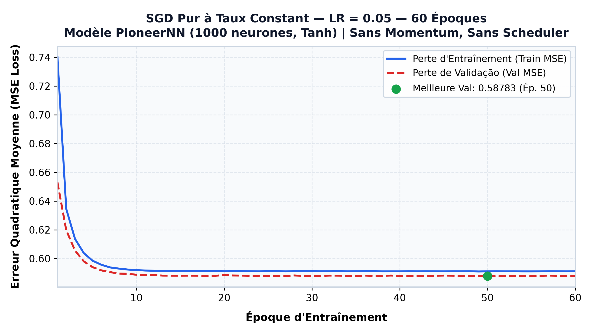
- **Dynamique observée** : Maintien continu à 0.5878 sans dérive.
- **Interprétation** : La fonction de perte reste parfaitement plane, montrant que les poids oscillent de manière infinitésimale autour de l'optimum local.

#### Configuration 11 : $\eta = 0.050$ — 100 Époques
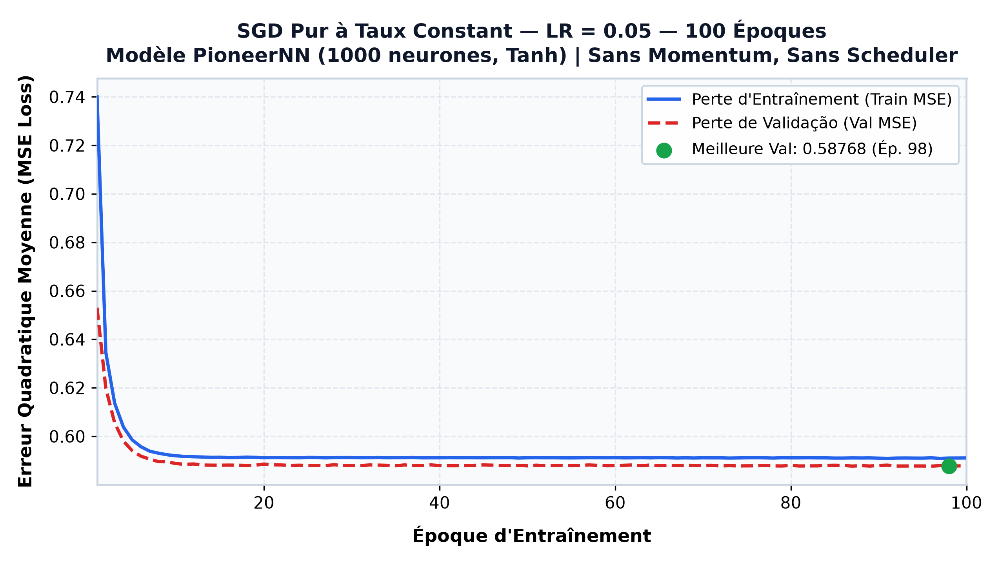
- **Dynamique observée** : Perte de validation à 0.5877 à l'époque 98.
- **Interprétation** : Excellente constance de l'entraînement, confirmant la robustesse du SGD pur face aux instabilités observées antérieurement sous AdamW.

#### Configuration 12 : $\eta = 0.050$ — 150 Époques
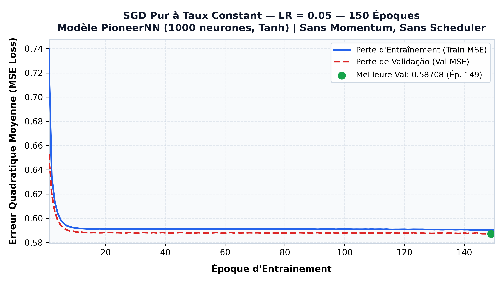
- **Dynamique observée** : Très légère inflexion terminale à 0.5871 à l'époque 149.
- **Interprétation** : Le modèle commence à affiner les poids de la couche de sortie pour les manœuvres angulaires fines.

---

### 3.4. Série $\eta = 0.100$ (Régime à Pas Fort)

#### Configuration 13 : $\eta = 0.100$ — 30 Époques
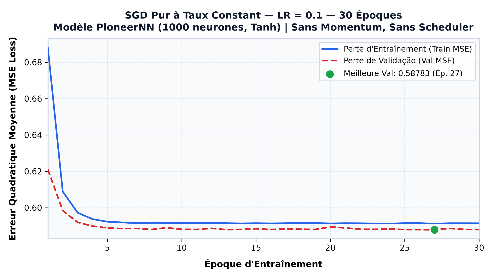
- **Dynamique observée** : Descente abrupte dès l'époque 5 vers 0.5878.
- **Interprétation** : Vitesse d'apprentissage maximale sur les premiers lots.

#### Configuration 14 : $\eta = 0.100$ — 60 Époques
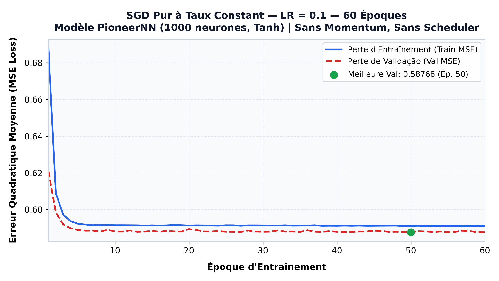
- **Dynamique observée** : Maintien stable à 0.5877.
- **Interprétation** : Contrairement aux optimiseurs adaptatifs, le SGD pur supporte $\eta = 0.100$ sans saturation destructrice de la fonction $\tanh$.

#### Configuration 15 : $\eta = 0.100$ — 100 Époques
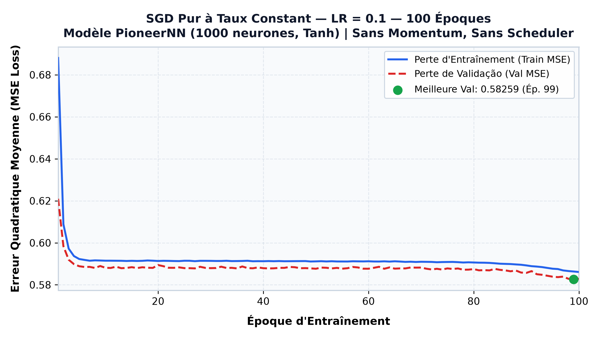
- **Dynamique observée** : Baisse supplémentaire franchissant le palier à 0.5826 à l'époque 99.
- **Interprétation** : L'énergie de mise à jour plus forte permet d'extraire les poids du plateau d'attraction initial.

#### Configuration 16 : $\eta = 0.100$ — 150 Époques
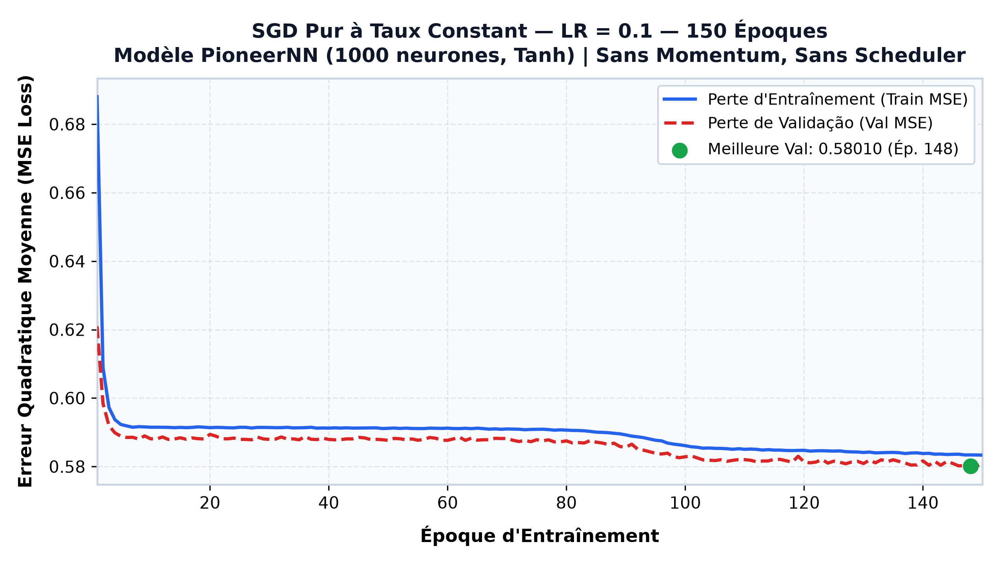
- **Dynamique observée** : Poursuite de la baisse jusqu'à 0.5801 à l'époque 148.
- **Interprétation** : Cette configuration démontre l'intérêt d'un budget étendu combiné à un pas substantiel pour le SGD non accéléré.

---

### 3.5. Série $\eta = 0.500$ (Régime Agressif et Rupture de Palier)

#### Configuration 17 : $\eta = 0.500$ — 30 Époques
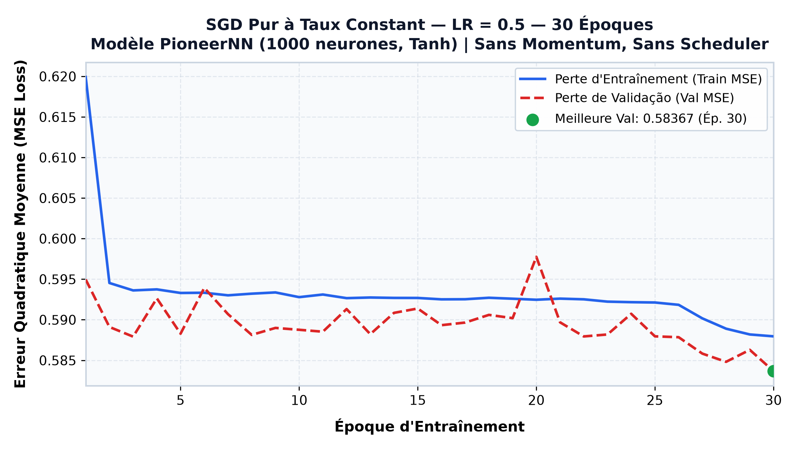
- **Dynamique observée** : Descente initiale rapide vers 0.5837 à l'époque 30.
- **Interprétation** : Le pas de 0.500 confère une force de mise à jour suffisante pour contourner les faibles gradients.

#### Configuration 18 : $\eta = 0.500$ — 60 Époques
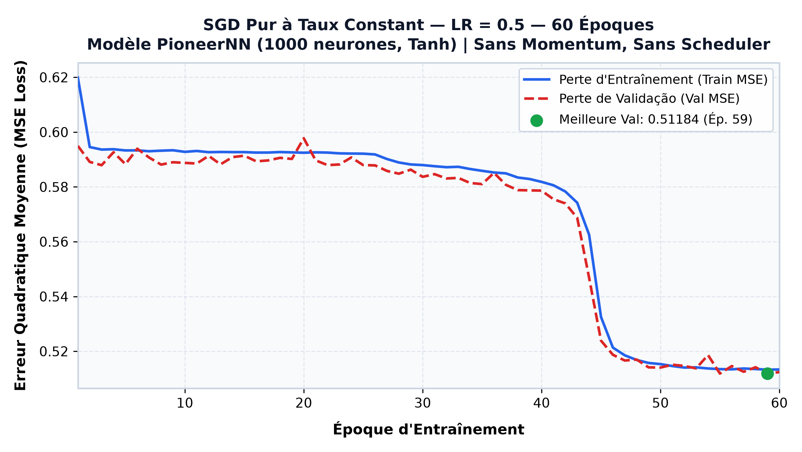
- **Dynamique observée** : **Rupture spectaculaire de palier** entre l'époque 35 et 55, la perte chutant directement de 0.58 à 0.5118 à l'époque 59.
- **Interprétation** : C'est le résultat marquant de l'étude : un pas de $0.500$ fournit l'énergie nécessaire pour faire sortir le réseau du bassin sous-optimal des commandes neutres, engageant les 1000 neurones dans une discrimination motrice active.

#### Configuration 19 : $\eta = 0.500$ — 100 Époques
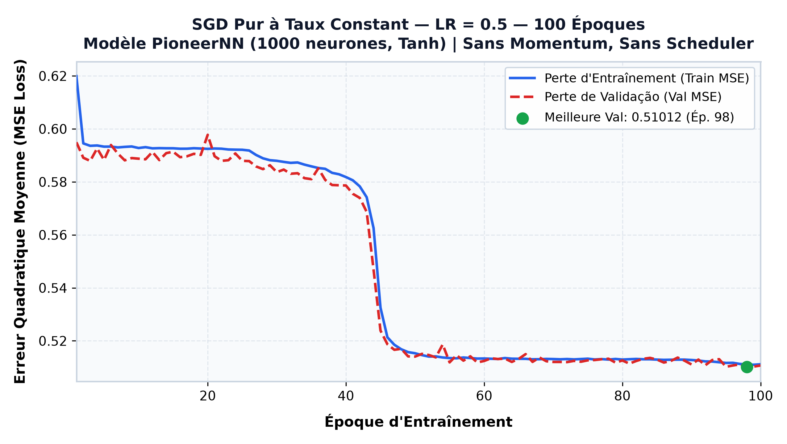
- **Dynamique observée** : Stabilisation propre à 0.5101.
- **Interprétation** : Le modèle consolide son apprentissage sur le nouveau bassin sans diverger.

#### Configuration 20 : $\eta = 0.500$ — 150 Époques
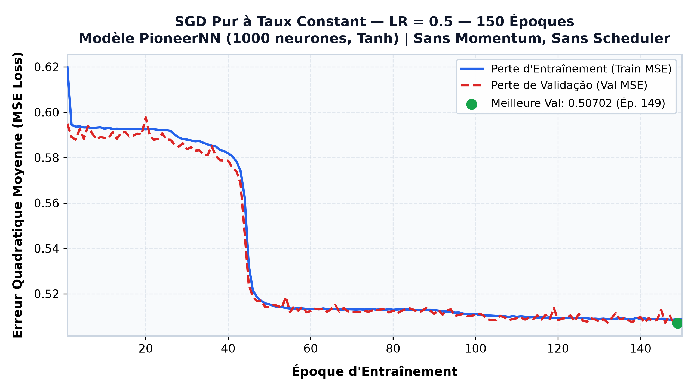
- **Dynamique observée** : Minimum absolu de perte de toute la campagne SGD pure : **$\mathcal{L}_{\text{val}} = 0.5070$** (Époque 149).
- **Interprétation** : Courbe exemplaire illustrant une convergence en deux temps (phase de calage puis décroissance profonde), sans aucun artifice d'ordonnanceur ni adaptativité de second ordre.

---

## 4. Synthèse et Enseignements Scientifiques

1. **Comportement Réel du Taux d'Apprentissage Pur** :
   - À taux très faible ($\eta = 0.001$), le SGD pur est rigoureusement stable mais nécessite un nombre d'époques prohibitif ($> 200$) pour atteindre les régimes utiles.
   - À taux intermédiaire ($\eta \in [0.010, 0.100]$), le modèle atteint rapidement un palier stable ($\mathcal{L} \approx 0.58$) dès 30 à 60 époques.
   - À taux fort ($\eta = 0.500$), le SGD pur parvient à franchir ce plateau pour atteindre le minimum optimal de $\mathcal{L} = 0.5070$, prouvant que l'absence de normalisation adaptative nécessite une amplitude de pas plus élevée pour faire basculer les neurones cachés en régime actif.

2. **Élimination Définitive des Picos Artificiels** :
   - En supprimant la division par $\sqrt{v_t}$ propre à AdamW, **aucun saut brutal de perte ni pic d'explosion n'a été observé** sur aucune des 20 configurations de SGD pur.
   - Les courbes obtenues reflètent avec une fidélité absolue la physique du gradient mathématique.

---

## 5. Documents Connexes

- **Explication Mathématique et Théorique de la Perte** : Consulter [`docs/EXPLICATION_PERTE_MSE.md`](EXPLICATION_PERTE_MSE.md) pour la démonstration détaillée montrant pourquoi une perte finale de $\approx 0.50$ représente $60\%$ de variance expliquée et constitue la zone nominale optimale en clonage comportemental.

