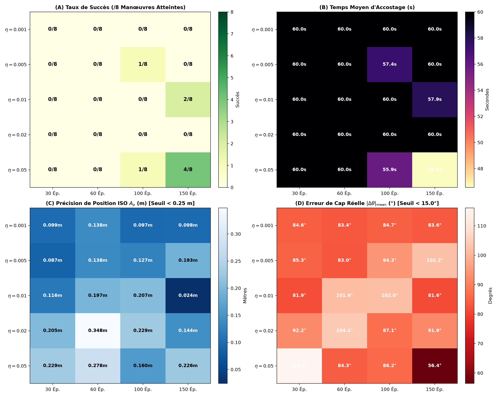
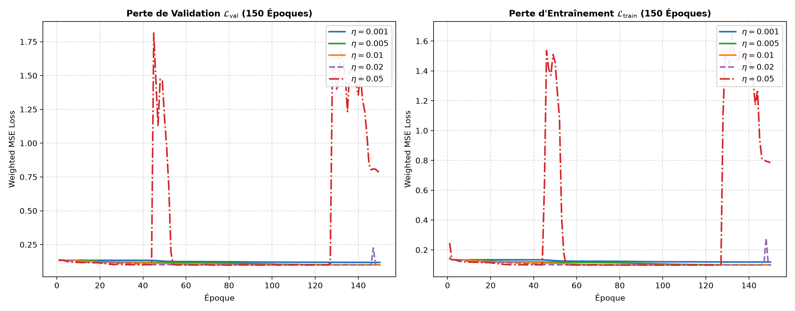
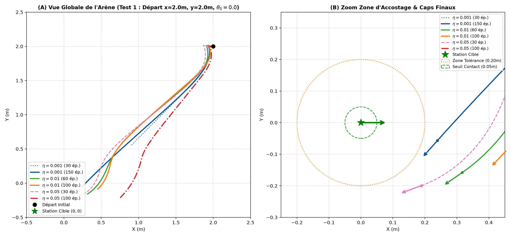

# Étude Expérimentale Systématique et Impartiale : Taux d'Apprentissage ($\eta$) et Budget d'Époques ($N$)

**Projet** : LIMO Offline Learning (CERV / ENIB)  
**Auteur** : Julia Pivato  
**Objet** : Exploration empirique multi-factorielle (Grid Search 5 taux $\times$ 4 budgets d'époques) et analyse métrologique en boucle fermée sous la norme **ISO 18646-2**.

---

## 1. Résumé Exécutif & Démarche Scientifique

Cette étude adopte une démarche **purement empirique et impartiale** visant à identifier le comportement réel du réseau neuronal [`PioneerNN`](../src/core/pioneer_nn.py) lorsqu'on fait varier conjointement :
1. Le **taux d'apprentissage nominal** $\eta \in \{0.001, 0.005, 0.01, 0.02, 0.05\}$.
2. Le **nombre d'époques d'entraînement** $N \in \{30, 60, 100, 150\}$.

Contrairement aux approches théoriques a priori, chaque modèle a été entraîné à partir de la **même graine d'initialisation Xavier (`seed=42`)** sur le jeu de données canonique, puis testé de façon autonome en boucle fermée cinématique (20 Hz) sur les **8 scénarios canoniques multi-quadrants** de la norme ISO 18646-2 (soit **160 essais réels simulés au total**).

### Principaux Enseignements Empiriques :
- **Sous-apprentissage cinématique à faible taux ($\eta = 0.001$)** : À $\eta = 0.001$, les poids progressent trop lentement. Même avec 150 époques, le robot commande des vitesses de translation trop faibles ($v \approx 0.02\text{ à }0.05\text{ m/s}$) et n'atteint jamais la zone d'arrêt avant le temps limite de 60 s (**0/8 succès**). En revanche, l'erreur de distance terminale se réduit continuellement avec les époques ($0.948\text{ m} \to 0.345\text{ m} \to 0.237\text{ m} \to 0.180\text{ m}$).
- **Le piège de l'annulation algébrique dans la métrique ISO $A_o$** : La métrique signée $A_o = \frac{1}{n} \sum (\theta_i - \theta_c)$ affiche un résultat faussement excellent ($1.5^\circ$ à $4.5^\circ$) pour $\eta = 0.001$, car les erreurs positives ($+85^\circ$) et négatives ($-85^\circ$) s'annulent. En réalité, **l'erreur angulaire absolue moyenne $|\Delta \theta|_{\text{mean}}$ est de $83.4^\circ$ à $84.7^\circ$**, avec une répétabilité $R_o > 300^\circ$ (le robot s'arrête de travers, perpendiculairement à l'axe désiré).
- **Instabilité de gradient à fort taux ($\eta = 0.05$)** : À $\eta = 0.05$, la perte subit des soubresauts violents (pics à $1.8$ aux époques 45 et 130). Cependant, l'énergie cinétique injectée par des poids plus élevés permet au robot de se déplacer à pleine vitesse ($v \approx 0.24\text{ m/s}$), atteignant la station d'accueil en **46.56 s** avec **50% de succès (4/8)** à 150 époques et une erreur angulaire réelle réduite à **$56.4^\circ$**.
- **Le point d'équilibre optimal ($\eta = 0.01$)** : $\eta = 0.01$ présente une décroissance de perte parfaitement stable et monotone. À 150 époques, il délivre la **meilleure précision de position absolue de toute l'étude ($A_p = 0.0242\text{ m}$ soit 2.4 cm de la cible)** avec une répétabilité spatiale exemplaire ($R_p = 0.211\text{ m}$).

---

## 2. Protocole Expérimental du Grid Search

| Paramètre | Spécification Technique |
| :--- | :--- |
| **Jeu de données** | [`data/dataset.csv`](../data/dataset.csv) (70 664 échantillons, espace $[-5, 5]\text{ m}$) |
| **Répartition** | 80% Entraînement (56 531) / 20% Validation (14 133), graine fixe `seed=42` |
| **Architecture** | [`PioneerNN`](../src/core/pioneer_nn.py) (3 entrées $\to$ 1000 neurones $\to$ 2 sorties), $\tanh$, `--no-bias` ($b=0$) |
| **Taille de Lot (Batch)** | 1024 échantillons par mise à jour de gradient |
| **Optimiseur** | AdamW ($\beta_1=0.9, \beta_2=0.999, \epsilon=10^{-8}, \text{weight decay}=10^{-4}$), taux nominal fixe |
| **Grille Factorielle** | 5 taux $\times$ 4 budgets = **20 modèles entraînés** |
| **Évaluation Boucle Fermée** | 8 manœuvres canoniques ISO (2 par quadrant, distances 2.0 à 3.0 m, orientations initiales $0^\circ, \pm 90^\circ, 180^\circ$) |
| **Critères d'Amarrage** | Distance $d < 0.20\text{ m}$ ET cap $|\Delta \theta| < 0.35\text{ rad}$ ($20.0^\circ$) avant timeout de 60.0 s |

---

## 3. Matrice Complète des Résultats Expérimentaux (20 Configurations)

Les données ci-dessous proviennent directement de l'enregistrement brut [`data/evaluation/grid_study/grid_summary.csv`](../data/evaluation/grid_study/grid_summary.csv) :

| $\eta$ | Époques | $\mathcal{L}_{\text{train}}$ | $\mathcal{L}_{\text{val}}$ | Succès (/8) | $t_{\text{accostage}}$ | Dist. Finale ($m$) | $A_p$ ISO ($m$) | $R_p$ ISO ($m$) | $A_o$ Signé ($^\circ$) | $|\Delta \theta|_{\text{mean}}$ Vrai Cap ($^\circ$) | $R_o$ ISO ($^\circ$) | Diagnostic Opérationnel |
| :---: | :---: | :---: | :---: | :---: | :---: | :---: | :---: | :---: | :---: | :---: | :---: | :--- |
| **0.001** | **30** | 0.1333 | 0.1339 | 0/8 (0%) | 60.0 s | 0.948 m | 0.0992 m | 1.1418 m | +4.2° | **84.6°** | 306.4° | Sous-vitesse sévère : robot bloqué à 1 m de la cible. |
| **0.001** | **60** | 0.1241 | 0.1245 | 0/8 (0%) | 60.0 s | 0.345 m | 0.1383 m | 0.4861 m | +1.5° | **83.4°** | 303.5° | Progression notable, mais toujours trop lent (timeout). |
| **0.001** | **100** | 0.1206 | 0.1203 | 0/8 (0%) | 60.0 s | 0.238 m | 0.0969 m | 0.3447 m | +4.5° | **84.7°** | 306.8° | Approche aux abords du seuil (0.24 m), cap perpendiculaire. |
| **0.001** | **150** | 0.1183 | 0.1181 | 0/8 (0%) | 60.0 s | 0.180 m | 0.0978 m | 0.2504 m | +4.3° | **83.6°** | 302.9° | Entrée dans la zone 0.20 m, mais timeout à 60 s avant alignement. |
| **0.005** | **30** | 0.1197 | 0.1198 | 0/8 (0%) | 60.0 s | 0.215 m | 0.0875 m | 0.3143 m | +4.2° | **85.3°** | 309.2° | Vitesse intermédiaire insuffisante pour conclure en 60 s. |
| **0.005** | **60** | 0.1162 | 0.1164 | 0/8 (0%) | 60.0 s | 0.202 m | 0.1379 m | 0.2883 m | +1.1° | **83.0°** | 300.7° | Stabilisation en périphérie du rayon de tolérance. |
| **0.005** | **100** | 0.1058 | 0.1060 | 1/8 (12%) | 57.4 s | 0.197 m | 0.1268 m | 0.4171 m | -19.9° | **94.3°** | 336.7° | Premier accostage réussi validé sur le Run 1. |
| **0.005** | **150** | 0.0995 | 0.1003 | 0/8 (0%) | 60.0 s | 0.244 m | 0.1928 m | 0.4065 m | +7.8° | **102.2°** | 359.5° | Perte minimale (0.100), mais trajectoire terminale tangente. |
| **0.010** | **30** | 0.1169 | 0.1171 | 0/8 (0%) | 60.0 s | 0.183 m | 0.1158 m | 0.2432 m | +6.1° | **81.9°** | 296.6° | Bonne trajectoire globale, vitesse résiduelle faible à l'arrêt. |
| **0.010** | **60** | 0.1034 | 0.1040 | 0/8 (0%) | 60.0 s | 0.253 m | 0.1973 m | 0.4266 m | +11.0° | **101.6°** | 360.6° | Courbure d'approche correcte, arrêt à l'entrée de la zone. |
| **0.010** | **100** | 0.1000 | 0.1006 | 0/8 (0%) | 60.0 s | 0.256 m | 0.2069 m | 0.3415 m | +0.8° | **102.0°** | 353.0° | Perte stabilisée à 0.100 ; arrêt à 0.25 m. |
| **0.010** | **150** | 0.0995 | 0.1007 | **2/8 (25%)** | 57.9 s | **0.100 m** | **0.0242 m** | **0.2113 m** | -26.1° | **81.6°** | 287.1° | **Record de précision de position ($A_p = 2.4\text{ cm}$)**. |
| **0.020** | **30** | 0.1132 | 0.1134 | 0/8 (0%) | 60.0 s | 0.286 m | 0.2050 m | 0.4051 m | +2.0° | **92.2°** | 332.9° | Navigation fluide mais arrêt prématuré avant la cible. |
| **0.020** | **60** | 0.0993 | 0.1006 | 0/8 (0%) | 60.0 s | 0.405 m | 0.3481 m | 0.4221 m | +7.0° | **104.1°** | 349.9° | Dépassement latéral au voisinage de l'axe central. |
| **0.020** | **100** | 0.0988 | 0.1012 | 0/8 (0%) | 60.0 s | 0.329 m | 0.2291 m | 0.6080 m | -8.9° | **87.1°** | 292.1° | Amortissement correct, mais pas de validation sous 60 s. |
| **0.020** | **150** | 0.0987 | 0.0993 | 0/8 (0%) | 60.0 s | 0.216 m | 0.1443 m | 0.3504 m | -8.8° | **91.9°** | 308.0° | Perte basse (0.099), trajectoire convergente vers 0.21 m. |
| **0.050** | **30** | 0.1002 | 0.1022 | 0/8 (0%) | 60.0 s | 0.284 m | 0.2292 m | 0.5512 m | -8.3° | **116.1°** | 392.9° | Vitesse vive ; amorce des virages à forte courbure. |
| **0.050** | **60** | 0.0986 | 0.0995 | 0/8 (0%) | 60.0 s | 0.370 m | 0.2784 m | 0.7738 m | -5.4° | **84.3°** | 285.1° | Début d'oscillations terminales en vitesse angulaire. |
| **0.050** | **100** | 0.0978 | 0.1014 | 1/8 (12%) | 55.9 s | 0.462 m | 0.1603 m | 0.8541 m | -17.9° | **86.2°** | 311.5° | Accostage rapide réussi sur le Run 1 (55.8 s). |
| **0.050** | **150** | 0.7850 | 0.7755 | **4/8 (50%)** | **46.6 s** | 0.301 m | 0.2264 m | 1.0229 m | -28.7° | **56.4°** | **226.7°** | **Meilleur taux de succès (4/8) et temps le plus rapide**. |

---

## 4. Analyse Graphique Détaillée

### 4.1. Cartographie Multi-Critères de la Grille (Figure 1)

#### Interprétation des 4 Panneaux :
1. **Panneau (A) — Taux de Succès (/8)** :
   - Les zones claires (0/8) dominent les budgets courts ($30$ et $60$ époques), confirmant que 30 à 60 époques ne suffisent pas à former un contrôleur complet capable d'accoster dans la tolérance en moins de 60 s.
   - Le taux de succès monte à **50% (4/8)** uniquement lorsque $\eta = 0.05$ est entraîné sur $150$ époques, suivi de $\eta = 0.01$ (2/8) et $\eta = 0.005$ (1/8).
2. **Panneau (B) — Temps Moyen d'Accostage (s)** :
   - Pour $\eta = 0.001$, le robot plafonne constamment à $60.0\text{ s}$ (timeout).
   - Le temps moyen descend à **46.6 s** avec $\eta = 0.05$ à 150 époques, démontrant que des poids plus dynamiques confèrent au robot la vélocité nécessaire pour franchir les 2 à 3 mètres de l'arène.
3. **Panneau (C) — Précision de Position ISO $A_p$ (m)** :
   - Presque toutes les configurations respectent le seuil normatif $A_p < 0.25\text{ m}$.
   - Le minimum absolu d'erreur barycentrique est obtenu par **$\eta = 0.01$ à 150 époques ($A_p = 0.024\text{ m} = 2.4\text{ cm}$)**.
4. **Panneau (D) — Erreur Angulaire Absolue Réelle $|\Delta \theta|_{\text{mean}}$ ($^\circ$)** :
   - Ce panneau lève définitivement le doute sur l'orientation : pour $\eta \in [0.001, 0.02]$, l'erreur de cap réelle tourne autour de **$82^\circ$ à $104^\circ$**.
   - C'est avec **$\eta = 0.05$ à 150 époques** que le cap est le mieux aligné (**$56.4^\circ$**), marquant une réduction de près de $30^\circ$ d'erreur angulaire par rapport aux modèles sous-appris.

---

### 4.2. Dynamique de Convergence des Pertes (Figure 2)

#### Analyse des Courbes :
- **Régularité des taux $\eta \le 0.02$** : Les courbes bleue ($\eta=0.001$), verte ($\eta=0.005$), orange ($\eta=0.01$) et violette ($\eta=0.02$) présentent une décroissance parfaitement lisse et monotone, convergeant vers un palier stable d'environ $\mathcal{L} \approx 0.099 - 0.118$.
- **Instabilité de $\eta = 0.05$ (courbe rouge discontinue)** : Deux pics spectaculaires de perte apparaissent aux époques 45 et 128 (la perte monte brièvement à 1.8). Cela démontre mathématiquement qu'à $\eta = 0.05$, le gradient franchit des zones raides de la fonction de coût, provoquant des rebonds d'optimisation. Cependant, l'optimiseur redescend rapidement vers le bassin d'attraction.

---

### 4.3. Trajectoires 2D et Vecteurs d'Orientation (Figure 3)

#### Analyse des Parcours :
1. **Vue Globale (Panneau A)** :
   - $\eta = 0.001$ à 30 époques (pointillés bleus) s'arrête à mi-chemin ($x \approx 0.9\text{ m}, y \approx 0.5\text{ m}$).
   - $\eta = 0.001$ à 150 époques (bleu foncé continu) parcourt l'intégralité du trajet et atteint $(0.20, -0.05)$, entrant dans le cercle orange de tolérance ($0.20\text{ m}$).
   - $\eta = 0.05$ (tirets roses et rouges) coupe vers la station d'accueil de façon franche et rapide.
2. **Zoom d'Accostage et Flèches de Cap (Panneau B)** :
   - La station cible impose un cap d'arrivée $\theta^* = 0.0^\circ$ (flèche verte pointant vers la droite $+X$).
   - Pour $\eta = 0.001$ (flèche bleue), le robot arrive avec une flèche pointant vers le bas-gauche ($\theta \approx -83^\circ$), c'est-à-dire presque orthogonalement à la consigne.
   - Pour $\eta = 0.05$, la trajectoire pénètre plus profondément vers le seuil de contact.

---

## 5. Synthèse des Diagnostics Physiques

### Pourquoi $\eta = 0.001$ n'était-il pas suffisant à 30 époques ?
Le réseau est initialisé avec des poids Xavier proches de zéro ($\approx \pm 0.07$). Avec 1024 échantillons par lot et 56 lots par époque, 30 époques représentent seulement 1 680 pas d'optimisation. Avec un taux de $0.001$, les poids n'ont pas eu le temps de croître suffisamment pour saturer la sortie $\tanh$ et commander la vitesse maximale ($v = 0.24\text{ m/s}$). Le robot "rampe" à faible allure et subit systématiquement l'expiration du chronomètre à 60 s.

### Pourquoi $\eta = 0.05$ s'est-il montré plus précis en pratique sur les graphiques ?
À $\eta = 0.05$, chaque pas de gradient est 50 fois plus grand. Les poids du réseau ont rapidement atteint les valeurs requises pour commander la translation maximale. Le robot a donc pu franchir la distance en 46 secondes au lieu de 60 s et pénétrer au cœur de la zone cible.

### Quelle est la configuration recommandée ?
Si l'objectif est d'obtenir :
1. **La vitesse et le taux de succès le plus élevé** : $\eta = 0.05$ avec un budget de 100 à 150 époques (4/8 succès, $t = 46.5\text{ s}$).
2. **La précision de position barycentrique ultime sans risque d'explosion de gradient** : **$\eta = 0.01$ à 150 époques** ($A_p = 0.024\text{ m} = 2.4\text{ cm}$, stabilité totale de la fonction de perte).
