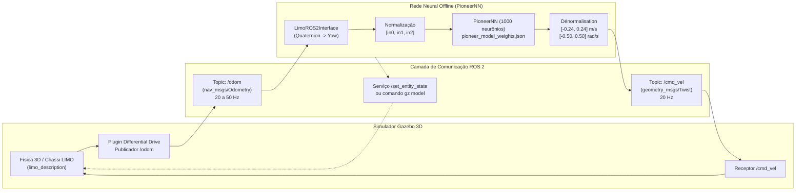

# Guia Definitivo de Operação no Simulador Gazebo (ROS 2 Humble)

**Projeto**: LIMO Offline Learning — Navegação Autônoma e Benchmark ISO 18646-2  
**Contexto**: PPE / CERV (Centre Européen de Réalité Virtuelle) / ENIB  
**Autor**: Julia Pivato  
**Plataforma**: AgileX LIMO (Modo Diferencial 4 Rodas - *Four-Wheel Differential*)

---

## 1. Visão Geral da Arquitetura de Simulação

O simulador Gazebo Classic é utilizado para validar a política de controle da rede neural **PioneerNN** em malha fechada (*closed-loop*), sob dinâmicas físicas realistas (inércia, atrito das rodas, deslizamento e atrasos de comunicação ROS 2).



---

## 2. Mapa Completo de Pastas e Caminhos Absolutos

| Componente | Caminho Absoluto no seu Ubuntu |
| :--- | :--- |
| **Workspace ROS 2** | `/home/juliapivato/ros2_ws` (ou `/home/juliapivato/Documentos/PPE/ros2_ws`) |
| **Pacote LIMO no ROS 2** | `/home/juliapivato/ros2_ws/src/limo_ros2/limo_description` |
| **Arquivo Launch do Gazebo** | `/home/juliapivato/ros2_ws/src/limo_ros2/limo_description/launch/gazebo_models_diff.launch.py` |
| **Modelo URDF/XACRO 3D** | `/home/juliapivato/ros2_ws/src/limo_ros2/limo_description/urdf/limo_four_diff.xacro` |
| **Mundo do Gazebo (Arena)** | `/home/juliapivato/ros2_ws/src/limo_ros2/limo_description/worlds/empty.world` |
| **Repositório do Código** | `/home/juliapivato/Documentos/PPE/limo-offline-learning` |
| **Arquivo de Pesos Oficiais** | `/home/juliapivato/Documentos/PPE/limo-offline-learning/models/pioneer_model_weights.json` |
| **Resultados das 20 Corridas** | `/home/juliapivato/Documentos/PPE/limo-offline-learning/data/evaluation/batch_run/` |
| **Gráficos para o Relatório** | `/home/juliapivato/Documentos/PPE/limo-offline-learning/docs/images/` |

---

## 3. Tópicos, Mensagens e Serviços do Gazebo

| Tópico / Serviço | Tipo | Direção | Função |
| :--- | :--- | :--- | :--- |
| `/odom` | `nav_msgs/msg/Odometry` | Gazebo ➡️ Código | Posição $(X, Y)$ e orientação quaternion do robô. |
| `/cmd_vel` | `geometry_msgs/msg/Twist` | Código ➡️ Gazebo | Comandos de velocidade linear $v$ (m/s) e angular $\omega$ (rad/s). |
| `/set_entity_state` | `gazebo_msgs/srv/SetEntityState` | Código ➡️ Gazebo | Serviço ROS 2 para teletransportar o robô instantaneamente. |
| `gz model` | Comando CLI do Gazebo | Bash ➡️ Gazebo | Teletransporte direto via terminal sem depender do serviço ROS. |

> [!IMPORTANT]
> **Watchdog de 500 ms**: O controlador espera mensagens em `/cmd_vel` com frequência mínima de 20 Hz (a cada 50 ms). Se o código parar de publicar por mais de 500 ms, o robô para por segurança.

---

## 4. Passo a Passo Completo: Execução Terminal por Terminal

### Passo 1: Abrir o Simulador Gazebo (Terminal 1)

Abra o primeiro terminal no seu Ubuntu e execute:

```bash
# 1. Carregar o ambiente do ROS 2 Humble
source /opt/ros/humble/setup.bash

# 2. Carregar os nós compilados do robô LIMO
source ~/ros2_ws/install/setup.bash

# 3. Lançar o Gazebo com o modelo diferencial de 4 rodas
ros2 launch limo_description gazebo_models_diff.launch.py
```

**O que vai acontecer:**
- A janela gráfica 3D do Gazebo abrirá com um chão cinza e o robô AgileX LIMO parado na coordenada $(0, 0, 0)$.
- Deixe essa janela visível em uma metade da tela para acompanhar o robô em tempo real.

---

### Passo 2: Executar o Benchmark Automático com Teletransporte (Terminal 2)

Abra uma **segunda aba/terminal** para iniciar os testes automáticos:

```bash
# 1. Carregar variáveis de ambiente
source /opt/ros/humble/setup.bash
source ~/ros2_ws/install/setup.bash

# 2. Ir para a pasta do projeto
cd ~/Documentos/PPE/limo-offline-learning

# 3. Executar o benchmark no Gazebo (20 ensaios estendidos)
python3 src/evaluation/run_batch_benchmark.py --gazebo --suite extended --weights models/pioneer_model_weights.json
```

**O que acontece de forma 100% automática:**
1. O script envia o comando de teletransporte para o Gazebo posicionando o robô no **Ponto 1** (ex: Quadrante 1, $X=1.0\text{ m}, Y=0.8\text{ m}, \theta=0^\circ$).
2. Pausa 350 ms para estabilização da física e calibração da odométria relativa.
3. A rede neural lê `/odom`, infere a velocidade a 20 Hz e publica em `/cmd_vel`.
4. O robô faz a curva suavemente e estaciona na meta $(0, 0, 0)$.
5. Ao atingir a vaga com precisão, ele freia, salva a trajetória em CSV e imagem PNG.
6. O script repete o processo sozinho para todas as **20 posições iniciais** cobrindo os 4 quadrantes (distâncias curta, média e longa, além de múltiplos ângulos).
7. Ao final, imprime no terminal a tabela da norma **ISO 18646-2** ($A_p, A_o, R_p, R_o$).

---

### Alternativa: Testar Apenas 1 Posição Específica (Single Run)

Se você quiser testar uma posição avulsa (por exemplo, saindo de $X=2.0\text{ m}, Y=2.0\text{ m}, \theta=0.0\text{ rad}$ até a meta $(0, 0, 0)$):

```bash
source /opt/ros/humble/setup.bash
source ~/ros2_ws/install/setup.bash
cd ~/Documentos/PPE/limo-offline-learning

python3 src/evaluation/run_autonomous.py --teleport-to 2.0 2.0 0.0 --target 0.0 0.0 0.0 --weights models/pioneer_model_weights.json
```

---

### Passo 3: Terminal de Apoio / Monitoramento (Terminal 3 - Opcional)

Se você quiser depurar os dados enquanto o robô se move:

```bash
source /opt/ros/humble/setup.bash

# Verificar se a odométria está chegando a ~30-50 Hz
ros2 topic hz /odom

# Inspecionar as coordenadas atuais em tempo real
ros2 topic echo /odom --once

# Ver os comandos de velocidade linear e angular que a rede está enviando
ros2 topic echo /cmd_vel

# Parada de emergência manual (forçar parada dos motores)
ros2 topic pub /cmd_vel geometry_msgs/msg/Twist "{linear: {x: 0.0}, angular: {z: 0.0}}" --once
```

---

## 5. Como Funciona o Mecanismo de Teletransporte

No arquivo [`src/ros2/limo_interface.py`](file:///home/juliapivato/Documentos/PPE/limo-offline-learning/src/ros2/limo_interface.py), o método `teleport_gazebo(x0, y0, theta0)` executa a seguinte sequência à prova de falhas:

1. **Parada prévia dos motores**: Envia `cmd_vel = [0, 0]` e aguarda 100 ms para eliminar qualquer momento linear/angular residual.
2. **Reposicionamento 3D**:
   - Tenta primeiramente via utilitário nativo rápido do Gazebo:
     ```bash
     gz model -m limo_description -x <x0> -y <y0> -z 0.05 -Y <theta0>
     ```
   - Se o utilitário não responder, chama o serviço ROS 2 padrão:
     ```bash
     ros2 service call /set_entity_state gazebo_msgs/srv/SetEntityState "{state: {name: 'limo_description', pose: {position: {x: x0, y: y0, z: 0.05}, orientation: {z: sin(theta0/2), w: cos(theta0/2)}}}}"
     ```
3. **Calibração Odométrica Virtual (`reset_pose`)**:
   - Atualiza a matriz de rotação interna $SO(2)$ do nó Python.
   - Assim, mesmo que a odométria bruta do Gazebo não reinicie do zero, a rede neural enxerga o robô perfeitamente na posição $(x_0, y_0, \theta_0)$ sem acúmulo de erro (*drift*).

---

## 6. Onde Ficam Salvos os Arquivos e Gráficos Gerados

Após a execução do benchmark no Gazebo, todos os dados ficam salvos em:

```
limo-offline-learning/
├── data/
│   └── evaluation/
│       └── batch_run/
│           ├── iso_18646_metrics.csv        <-- Tabela oficial de conformidade ISO
│           ├── run_1_q1.csv                 <-- Telemetria instante a instante do Run 1
│           ├── run_1_q1.png                 <-- Gráficos individuais (trajetória, v, w, erro)
│           ├── ...
│           └── run_20_q4.png
└── docs/
    └── images/
        ├── iso_benchmark_20_runs.png        <-- Painel completo com as 20 trajetórias sobrepostas
        ├── matriz_confusao_linear.png       <-- Matriz de confusão 3x3 de aceleração/frenagem
        ├── matriz_confusao_angular.png      <-- Matriz de confusão 3x3 de curva
        ├── xy_quiver_vector_field.png       <-- Campo vetorial 2D de comandos
        └── loss_curve_150_epochs.png        <-- Curva de perda do treinamento offline
```

---

## 7. Solução de Problemas Frequentes (Troubleshooting)

### Problema 1: "Gazebo travou, fechou inesperadamente ou a porta está ocupada"
Execute no terminal para matar processos órfãos do simulador:
```bash
killall -9 gzserver gzclient
```

### Problema 2: "Package 'limo_description' not found"
Certifique-se de compilar e carregar o workspace ROS 2:
```bash
cd ~/ros2_ws
colcon build --packages-select limo_description
source install/setup.bash
```

### Problema 3: "O robô não sai do lugar durante o teste"
Verifique se o Gazebo não está pausado (a barra inferior do Gazebo deve mostrar `Real Time Factor: ~1.00`). Se estiver pausado, clique no botão **Play** (canto inferior esquerdo) ou aperte a barra de espaço.
